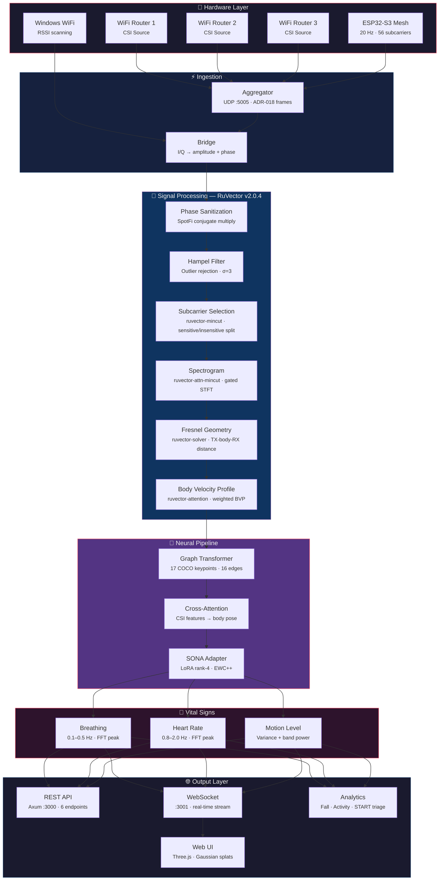
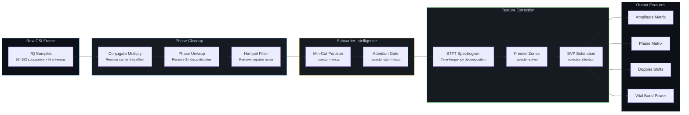
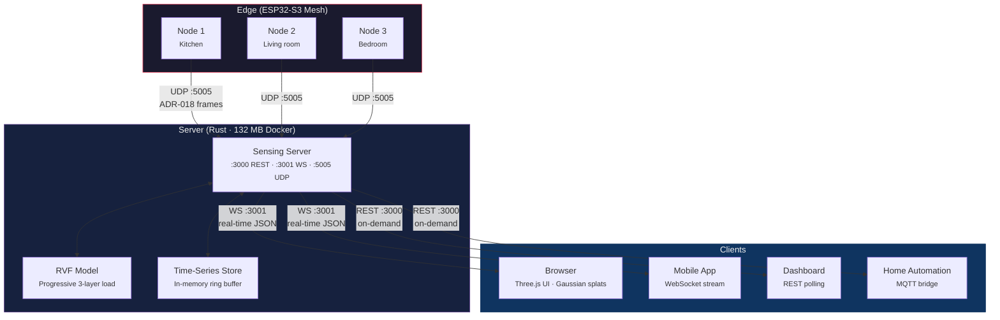

# RuView — 扩展文档

本文档收录从 [README.md](../README.md) 拆出的详细章节，让主 README 聚焦于概览、使用场景与支持信息。

---

## 最新增补

### 实时稠密点云（新增）

RuView 现在可以融合摄像头深度、WiFi CSI 与毫米波雷达，生成**实时三维点云**。所有传感器同时流入一个统一的空间模型。

| 传感器 | 数据 | 集成方式 |
|--------|------|-------------|
| **摄像头** | MiDaS 单目深度（GPU） | 640×480 → 每帧 19,200+ 个深度点 |
| **ESP32 CSI** | ADR-018 二进制帧（UDP） | 射频层析 → 8×8×4 占用网格 |
| **WiFlow 姿态** | 由 CSI 得出的 17 个 COCO 关键点 | 骨架叠加到点云上 |
| **生命体征** | 由 CSI 相位得出的呼吸率 | 每 60 秒写入 ruOS brain |
| **运动** | CSI 幅度方差 | 自适应采集速率（静止时跳过深度采集） |

**快速开始：**
```bash
cd v2
cargo build --release -p wifi-densepose-pointcloud
./target/release/ruview-pointcloud serve --bind 127.0.0.1:9880
# 打开 http://localhost:9880 查看实时三维视图
```

**命令行指令：**
```bash
ruview-pointcloud demo                            # 合成数据演示
ruview-pointcloud serve --bind 127.0.0.1:9880     # live server + Three.js viewer
ruview-pointcloud capture --output room.ply       # 导出为 PLY
ruview-pointcloud train                           # depth calibration + DPO pairs
ruview-pointcloud cameras                         # 列出可用摄像头
ruview-pointcloud csi-test --count 100            # 发送测试 CSI 帧
ruview-pointcloud fingerprint office --seconds 5  # 记录具名的 CSI 房间指纹
```

HTTP/视图服务默认只绑定**回环地址（`127.0.0.1`）** —— 把实时摄像头/CSI/生命体征暴露到 `0.0.0.0` 必须由用户显式开启。Brain 地址默认为 `http://127.0.0.1:9876`，可通过环境变量 `RUVIEW_BRAIN_URL` 或 `serve`/`train` 的 `--brain` 参数覆盖。

姿态叠加目前用的是**幅度能量启发式**（`heuristic_pose_from_amplitude`），而不是训练好的 WiFlow 推理 —— 真正的 ONNX/Candle 推理已列入后续工作。

**性能：** 流水线 22ms、API 905 请求/秒、由 20 帧构建 4 万体素的房间模型。

**Brain 集成：** 空间观测（运动、生命体征、骨架、占用情况）每 60 秒同步到 ruOS brain，供智能体推理使用。

完整细节见 [PR #405](https://github.com/ruvnet/RuView/pull/405)。

### v0.7.0 新增内容

<details>
<summary><strong>摄像头真值训练</strong></summary>

**v0.7.0 加入了摄像头监督的姿态训练**，使用 MediaPipe 配合真实 ESP32 CSI 数据：

| 能力 | 作用 | ADR |
|-----------|-------------|-----|
| **摄像头真值采集** | MediaPipe PoseLandmarker 以 30fps 捕获 17 个 COCO 关键点，与 ESP32 CSI 同步 | [ADR-079](../docs/adr/ADR-079-camera-ground-truth-training.md) |
| **ruvector 子载波筛选** | 基于方差的 top-K 把输入减半（70→35 个子载波） | ADR-079 O6 |
| **Stoer-Wagner 最小割** | 按人分离子载波簇，用于多人训练 | ADR-079 O8 |
| **可扩展 WiFlow 模型** | 4 档预设：lite (189K) → small (474K) → medium (800K) → full (770 万参数) | ADR-079 |

```bash
# 采集真值（摄像头与 ESP32 同步）
python scripts/collect-ground-truth.py --duration 300 --preview
python scripts/record-csi-udp.py --duration 300

# 把 CSI 窗口与摄像头关键点对齐
node scripts/align-ground-truth.js --gt data/ground-truth/*.jsonl --csi data/recordings/*.csi.jsonl

# 训练 WiFlow 模型（先用 lite，数据变多再放大）
node scripts/train-wiflow-supervised.js --data data/paired/*.jsonl --scale lite

# 评估
node scripts/eval-wiflow.js --model models/wiflow-real/wiflow-v1.json --data data/paired/*.jsonl
```

> **精度撤回声明（2026-06-10）：** 此前此处展示的
> 「92.9% PCK@20」数值已撤回。对留存评估集（69 个样本）的复查发现，
> 那是一个恒定输出模型，在近乎静止的帧上用了绝对阈值
> （未按躯干归一化）评分 —— 在这种评测协议下，
> 简单的均值姿态预测器就能拿到 100%。同一留出集上按躯干归一化的
> PCK@20 约为 19%（来自那个退化预测器）。目前没有发布任何实测的
> 摄像头监督 PCK@20 结果（见 CHANGELOG、PR #535）。

| 指标 | 摄像头监督运行结果（协议已撤回） |
|--------|--------------------------------------------|
| 评估损失 | 0.082 |
| 骨骼约束 | 0.008 |
| 训练耗时 | 19 分钟 |
| 模型大小 | 974 KB |

预训练模型：[HuggingFace ruv/ruview/wiflow-v1](https://huggingface.co/ruv/ruview)

</details>

### 预训练模型（v0.6.0）—— 无需训练

<details>
<summary><strong>从 HuggingFace 下载即可开始感知</strong></summary>

预训练模型已发布在 HuggingFace：
> **https://huggingface.co/ruv/ruview** (primary) | [mirror](https://huggingface.co/ruvnet/wifi-densepose-pretrained)

基于一次 8 小时通宵采集的 60,630 条真实样本训练。下载即可运行 —— 不需要数据集、GPU 或训练。

| 模型 | 大小 | 作用 |
|-------|------|-------------|
| `model.safetensors` | 48 KB | 对比学习编码器 —— 为在场、活动、环境生成 128 维嵌入 |
| `model-q4.bin` | 8 KB | 4 位量化 —— 可放进 ESP32-S3 的 SRAM 做边缘推理 |
| `model-q2.bin` | 4 KB | 2 位超紧凑版，面向内存受限设备 |
| `presence-head.json` | 2.6 KB | 在场检测头（宣称 100% 准确） |
| `node-1.json` / `node-2.json` | 21 KB | 逐房间的 LoRA 适配器（换房间时替换） |

```bash
# 下载并使用（Python）
pip install huggingface_hub
huggingface-cli download ruv/ruview --local-dir models/

# 或直接接入感知流水线
node scripts/train-ruvllm.js --data data/recordings/*.csi.jsonl  # 用自己的数据重新训练
node scripts/benchmark-ruvllm.js --model models/csi-ruvllm       # 跑基准测试
```

**基准测试（Apple M4 Pro，用通宵数据重训）：**

| 实测项 | 结果 | 意义 |
|-----------------|--------|---------------|
| **CSI 嵌入质量** | **留出集时间三元组 82.3%** | 按时间取最后 20% 的无标签诚实指标（v1 的「100% 在场」来自单类别录制 —— 已撤回，[#882](https://github.com/ruvnet/RuView/issues/882)） |
| **推理速度** | 每条嵌入 **0.008 ms** | 比实时快 125,000 倍 |
| **吞吐** | **164,183 条嵌入/秒** | 一台 Mac Mini 可带 1,600+ 个 ESP32 节点 |
| **对比学习** | **提升 51.6%** | 从真实通宵数据中学到明显的模式 |
| **模型大小** | **8 KB**（4 位量化） | 可放进 ESP32 SRAM —— 无需服务器 |
| **硬件总成本** | **$140** | ESP32 ($9) + [Cognitum Seed](https://cognitum.one) ($131) |

</details>

### 17 种感知应用（v0.6.0）

<details>
<summary><strong>健康、环境、安防与多频组网感知</strong></summary>

所有应用都跑在单个 ESP32 上，Cognitum Seed 可选。不需要摄像头、云端或互联网。

**健康与养生：**

| 应用 | 脚本 | 检测内容 |
|------------|--------|----------------|
| 睡眠监测 | `node scripts/sleep-monitor.js` | 睡眠阶段（深睡/浅睡/REM/清醒）、睡眠效率、睡眠图 |
| 呼吸暂停检测 | `node scripts/apnea-detector.js` | 超过 10 秒的呼吸停顿、AHI 严重程度评分 |
| 压力监测 | `node scripts/stress-monitor.js` | 心率变异性、LF/HF 压力比值 |
| 步态分析 | `node scripts/gait-analyzer.js` | 步频、步幅不对称、震颤检测 |

**环境与安防：**

| 应用 | 脚本 | 检测内容 |
|------------|--------|----------------|
| 人数统计 | `node scripts/mincut-person-counter.js` | 正确的人数（修复 #348） |
| 房间指纹 | `node scripts/room-fingerprint.js` | 活动状态聚类、日常规律、异常 |
| 物体检测 | `node scripts/material-detector.js` | 通过子载波零点变化发现新增/移动的物体 |
| 设备指纹 | `node scripts/device-fingerprint.js` | 电子设备的活动（打印机、路由器等） |

**多频组网**（需要 `--hop-channels` 配置）：

| 应用 | 脚本 | 检测内容 |
|------------|--------|----------------|
| 射频层析 | `node scripts/rf-tomography.js` | 用射频反投影生成二维房间图像 |
| 被动雷达 | `node scripts/passive-radar.js` | 把邻近 WiFi AP 当作双基地雷达的照射源 |
| 材质分类 | `node scripts/material-classifier.js` | 由频率响应区分金属/水/木材/玻璃 |
| 穿墙检测 | `node scripts/through-wall-detector.js` | 用较低频段的穿透能力探测墙后运动 |

所有脚本都支持 `--replay data/recordings/*.csi.jsonl` 做离线分析，以及 `--json` 输出供程序处理。

</details>

### v0.5.5 新增内容

<details>
<summary><strong>进阶感知：SNN + MinCut + WiFlow + 多频组网</strong></summary>

**v0.5.5 新增四项感知能力**，构建于 [ruvector](https://github.com/ruvnet/ruvector) 生态之上：

| 能力 | 作用 | ADR |
|-----------|-------------|-----|
| **脉冲神经网络** | 用 STDP 在线学习在 30 秒内适应你的房间 —— 无需标签、无需批量，算力降低 16-160 倍 | [ADR-074](../docs/adr/ADR-074-spiking-neural-csi-sensing.md) |
| **MinCut 人数统计** | 在子载波相关图上做 Stoer-Wagner 最小割 —— **修复 #348**（原来恒为 4，现已正确） | [ADR-075](../docs/adr/ADR-075-mincut-person-separation.md) |
| **CNN 频谱图嵌入** | 把 CSI 当作 64×20 图像 → 128 维嵌入用于环境指纹（相似度 0.95+） | [ADR-076](../docs/adr/ADR-076-csi-spectrogram-embeddings.md) |
| **WiFlow SOTA 架构** | TCN + 轴向注意力 + 姿态解码器 → 17 个 COCO 关键点，180 万参数（4 位量化 881 KB） | [ADR-072](../docs/adr/ADR-072-wiflow-architecture.md) |
| **多频组网** | 跨 6 个频段跳频，邻近 WiFi 作为被动雷达照射源 | [ADR-073](../docs/adr/ADR-073-multifrequency-mesh-scan.md) |

```bash
# 实时射频房间扫描（频谱可视化）
node scripts/rf-scan.js --port 5006 --duration 30

# 正确的人数统计（修复 #348）
node scripts/mincut-person-counter.js --port 5006

# SNN 实时自适应
node scripts/snn-csi-processor.js --port 5006

# CNN 频谱图嵌入
node scripts/csi-spectrogram.js --replay data/recordings/*.csi.jsonl

# WiFlow 17 关键点姿态训练
node scripts/train-wiflow.js --data data/recordings/*.csi.jsonl

# 在 ESP32 上启用跳频
python firmware/esp32-csi-node/provision.py --port COM9 --hop-channels "1,6,11"
```

**已验证的基准：**

| 指标 | v0.5.4 | v0.5.5 |
|--------|--------|--------|
| 人数统计 | 失效（恒为 4） | **正确**（MinCut，24/24） |
| WiFi 信道 | 1 | **6**（多频跳频） |
| 零点子载波 | 19% 被阻塞 | **16%**（频率分集） |
| 姿态模型 | 1.6 万参数（仅全连接） | **180 万参数**（WiFlow） |
| 在线自适应 | 无 | **<30 秒**（SNN STDP） |
| 指纹维度 | 8 | **128**（CNN 频谱图） |
| 多节点融合 | 平均 | **GATv2 注意力** |
| 新增脚本 | 0 | **15+** |
| 新增 ADR | 3 | **8**（069-076） |

</details>

### v0.5.4 新增内容

<details>
<summary><strong>Cognitum Seed 集成 + 无摄像头姿态训练</strong></summary>

**v0.5.4 把 RuView 从实时感知工具变成了可持久化的边缘 AI 系统。** 你的 ESP32 现在能记住感知到的内容、无需摄像头即可学习，并用密码学方式证明数据来源。

| 能力 | 细节 | 硬件 |
|-----------|---------|----------|
| **持久化向量库** | 每次感知事件以可检索的 8 维向量存入 RVF 格式 | ESP32 + [Cognitum Seed](https://cognitum.one) ($140) |
| **kNN 相似检索** | 「找出与当前最接近的 10 个状态」—— 异常检测、指纹识别 | Cognitum Seed |
| **见证链** | 每次测量的 SHA-256 防篡改审计轨迹（已验证 1,747 条） | Cognitum Seed |
| **无摄像头姿态训练** | 由 10 路传感信号得出 17 个 COCO 关键点 —— PIR、RSSI 三角定位、子载波不对称、振动、BME280 | 2x ESP32 + Seed |
| **预训练模型** | 82.8 KB（4 位量化后 8 KB），留出集时间三元组准确率 82.3%（v1 的「100% 在场」是单类别结果 —— 已撤回，[#882](https://github.com/ruvnet/RuView/issues/882)） | 从 release 下载 |
| **亚毫秒推理** | 延迟 0.012 ms，M4 Pro 上 171,472 条嵌入/秒 | 任意装有 Node.js 的机器 |
| **SONA 自适应** | 无需重训，1ms 内适应新房间 | ruvllm runtime |
| **LoRA 房间适配器** | 逐节点微调，每个适配器 2,048 个参数 | 自动 |
| **114 工具 MCP 代理** | AI 助手（Claude、GPT）通过 JSON-RPC 直接查询传感器 | Cognitum Seed |
| **多频组网** | 在 1/3/5/6/9/11 信道间跳频 —— 邻近 WiFi 作为被动雷达 | 2x ESP32 ($18) |
| **射频房间扫描器** | 实时频谱可视化：零点、反射体、运动、多径 | `node scripts/rf-scan.js` |
| **安全加固** | Bearer 令牌、TLS、源 IP 过滤、NaN 拒绝、凭据轮换 | 全部组件 |

**训练流水线（ruvllm，无需 PyTorch）：**

```bash
# 采集数据（2 分钟，ESP32 需正在推流）
python scripts/collect-training-data.py --port 5006 --duration 120

# 训练 —— 对比预训练 + 任务头 + LoRA + 量化 + EWC
node scripts/train-ruvllm.js --data data/recordings/pretrain-*.csi.jsonl

# 无摄像头 17 关键点姿态（使用 PIR + RSSI + 振动 + 子载波不对称）
node scripts/train-camera-free.js --data data/recordings/pretrain-*.csi.jsonl

# 基准测试
node scripts/benchmark-ruvllm.js --model models/csi-ruvllm
```

**基准测试 —— 在真实硬件上验证（Apple M4 Pro + ESP32-S3 + Cognitum Seed）：**

| 实测项 | 结果 | 意义 |
|-----------------|--------|---------------|
| **CSI 嵌入质量** | **留出集时间三元组 82.3%** | 无标签的诚实指标（v1 的「100% 在场」是单类别结果 —— 已撤回，[#882](https://github.com/ruvnet/RuView/issues/882)） |
| **人数统计** | **24/24 正确**（MinCut） | 修复了用户反馈最多的问题 |
| **推理速度** | 每条嵌入 **0.012 ms** | 比实时快 83,000 倍 |
| **吞吐** | **171,472 条嵌入/秒** | 一台 Mac Mini 可带 1,700+ 个 ESP32 节点 |
| **训练耗时** | **84 秒** | 不到 2 分钟即可从零得到训练好的模型 |
| **对比学习** | **提升 33.9%** | 模型从 CSI 中学到有意义的模式 |
| **模型大小** | **8 KB**（4 位量化） | 可放进 ESP32 SRAM —— 无需服务器 |
| **骨架物理约束** | 100 帧中 **0 次违规** | 每个姿态在解剖学上都成立 |
| **姿态关键点** | **17 个 COCO 关键点** | 全身姿态，无需摄像头 |
| **WiFi 信道** | **6 个并发** | 感知数据量为单信道的 3 倍 |
| **在线自适应** | **<30 秒**（SNN） | 无需重训即可学会新房间 |
| **见证链** | 已验证 **2,547 条** | 用密码学证明每次测量都真实 |
| **测试套件** | **1,463 项测试通过** | 基础扎实 |
| **硬件总成本** | **$140** | ESP32 ($9) + [Cognitum Seed](https://cognitum.one) ($131) |

完整细节见 [ADR-069](../docs/adr/ADR-069-cognitum-seed-csi-pipeline.md)、[ADR-071](../docs/adr/ADR-071-ruvllm-training-pipeline.md) 与 [Cognitum Seed 教程](../docs/tutorials/cognitum-seed-pretraining.md)。

</details>

---

<a id="key-features"></a>
## 🚀 主要功能

### 感知

仅用房间里已有的 WiFi 信号，就能隔墙看见人、呼吸与心跳。

| | 功能 | 含义 |
|---|---------|---------------|
| 🔒 | **隐私优先** | 只用 WiFi 信号追踪人体姿态 —— 无摄像头、无视频、不存图像 |
| 💓 | **生命体征** | 无需任何穿戴设备即可检测呼吸率（6-30 次/分）与心率（40-120 bpm） |
| 👥 | **多人** | 同时追踪多人，各自有独立的姿态与生命体征 —— 软件上无硬性上限（物理上：56 子载波时每个 AP 约 3-5 人，多 AP 可更多） |
| 🧱 | **穿墙** | WiFi 能穿过墙体、家具与废墟 —— 在摄像头无能为力的地方仍可工作 |
| 🚑 | **灾害响应** | 透过瓦砾探测被困幸存者，并判定伤情严重程度（START 分诊） |
| 📡 | **多静态组网** | 4-6 个低成本传感节点协同，叠加 12 条以上信号路径，实现 360 度全房间覆盖、亚英寸精度且不会认错人（[ADR-029](../docs/adr/ADR-029-ruvsense-multistatic-sensing-mode.md)） |
| 🌐 | **持久场模型** | 系统学习每个房间的射频特征，再把房间本身减去，从而分离出人体运动、发现数日内的漂移、在动作开始前预测意图，并标记伪造尝试（[ADR-030](../docs/adr/ADR-030-ruvsense-persistent-field-model.md)） |

### 智能

系统自主学习并随时间变得更准 —— 无需手工调参，也不需要标注数据。

| | 功能 | 含义 |
|---|---------|---------------|
| 🧠 | **自学习** | 从原始 WiFi 数据自学 —— 不需要标注训练集，冷启动也无需摄像头（[ADR-024](../docs/adr/ADR-024-contrastive-csi-embedding-model.md)） |
| 🎯 | **AI 信号处理** | 用注意力网络、图算法与智能压缩取代手工阈值 —— 自动适应每个房间（[RuVector](https://github.com/ruvnet/ruvector)） |
| 🌍 | **随处可用** | 训练一次，任意房间部署 —— 对抗式域泛化消除环境偏差，使模型能跨房间、跨建筑、跨硬件迁移（[ADR-027](../docs/adr/ADR-027-cross-environment-domain-generalization.md)） |
| 👁️ | **跨视角融合** | AI 把各传感器在自身角度看到的内容合并 —— 补上单一视角无法解决的盲区与深度歧义（[ADR-031](../docs/adr/ADR-031-ruview-sensing-first-rf-mode.md)） |
| 🔮 | **信号线协议** | 六级流水线把原始 WiFi 信号转成结构化的身体表征 —— 从信号净化、基于图的空间推理，到最终姿态输出（[ADR-033](../docs/adr/ADR-033-crv-signal-line-sensing-integration.md)） |
| 🔒 | **QUIC 组网安全** | 所有传感器间通信端到端加密，具备篡改检测、重放防护，以及节点移动或掉线后的无缝重连（[ADR-032](../docs/adr/ADR-032-multistatic-mesh-security-hardening.md)） |
| 🎯 | **自适应分类器** | 录制带标签的 CSI 会话，用纯 Rust 训练 15 特征逻辑回归模型，学习你房间独有的信号特征 —— 用数据驱动的分类取代手工阈值（[ADR-048](../docs/adr/ADR-048-adaptive-csi-classifier.md)） |

### 性能与部署

快到可以实时使用，小到能跑在边缘设备上，简单到一条命令就能装好。

| | 功能 | 含义 |
|---|---------|---------------|
| ⚡ | **实时** | 每帧 WiFi 信号分析不到 100 微秒 —— 足以做实时监控 |
| 🦀 | **快 810 倍** | 完整 Rust 重写：54,000 帧/秒流水线、多架构 Docker 镜像、1,031+ 项测试 |
| 🐳 | **一条命令装好** | `docker pull ruvnet/wifi-densepose:latest` —— 30 秒开始实时感知，无需工具链（amd64 + arm64 / Apple Silicon） |
| 📡 | **完全本地** | 完整跑在一块 9 美元的 ESP32 上 —— 不联网、无云账号、无订阅费。在设备端即时检测在场、生命体征与跌倒 |
| 📦 | **可移植模型** | 训练好的模型打包成单个 `.rvf` 文件 —— 可跑在边缘、云端或浏览器（WASM） |
| 🔭 | **观测站可视化** | 电影感的 Three.js 仪表盘，含 5 块全息面板 —— 子载波流形、生命体征神谕、在场热力图、相位星座、收敛引擎 —— 全部由实时或演示 CSI 数据驱动（[ADR-047](../docs/adr/ADR-047-psychohistory-observatory-visualization.md)） |
| 📟 | **AMOLED 显示屏** | 带 AMOLED 屏的 ESP32-S3 开发板直接在传感器上显示实时在场、生命体征与房间状态 —— 不需要手机或电脑（[ADR-045](../docs/adr/ADR-045-amoled-display-support.md)） |

---

## 📦 安装

<details>
<summary><strong>引导式安装器</strong> —— 交互式硬件检测与配置选择</summary>

```bash
./install.sh
```

安装器依次走 7 步：系统检测、工具链检查、WiFi 硬件扫描、配置推荐、依赖安装、构建与验证。

| 配置 | 安装内容 | 体积 | 要求 |
|---------|-----------------|------|-------------|
| `verify` | 仅流水线验证 | ~5 MB | Python 3.8+ |
| `python` | 完整 Python API 服务 + 感知 | ~500 MB | Python 3.8+ |
| `rust` | Rust 流水线（约快 810 倍） | ~200 MB | Rust 1.70+ |
| `browser` | 浏览器内执行的 WASM | ~10 MB | Rust + wasm-pack |
| `iot` | ESP32 传感组网 + 汇聚端 | 视情况 | Rust + ESP-IDF |
| `docker` | 基于 Docker 的部署 | ~1 GB | Docker |
| `field` | WiFi-Mat 灾害响应套件 | ~62 MB | Rust + wasm-pack |
| `full` | 全部内容 | ~2 GB | 全部工具链 |

```bash
# 非交互模式
./install.sh --profile rust --yes

# 仅检查硬件
./install.sh --check-only
```

</details>

<details>
<summary><strong>从源码构建</strong> —— Rust（主推）或 Python</summary>

```bash
git clone https://github.com/ruvnet/RuView.git
cd RuView

# Rust（主推 —— 快 810 倍）
cd v2
cargo build --release
cargo test --workspace

# Python（旧版 v1）
pip install -r requirements.txt
pip install -e .

# 或通过 pip
pip install wifi-densepose
pip install wifi-densepose[gpu]   # GPU 加速
pip install wifi-densepose[all]   # 全部可选依赖
```

</details>

<details>
<summary><strong>Docker</strong> —— 预构建镜像，无需工具链</summary>

```bash
# Rust 感知服务器（132 MB —— 推荐）
docker pull ruvnet/wifi-densepose:latest
docker run -p 3000:3000 -p 3001:3001 -p 5005:5005/udp ruvnet/wifi-densepose:latest

# Python 感知流水线（569 MB）
docker pull ruvnet/wifi-densepose:python
docker run -p 8765:8765 -p 8080:8080 ruvnet/wifi-densepose:python

# 两者一起用 docker-compose
cd docker && docker compose up

# 导出 RVF 模型
docker run --rm -v $(pwd):/out ruvnet/wifi-densepose:latest --export-rvf /out/model.rvf
```

| 镜像 | 标签 | 平台 | 端口 |
|-------|-----|-----------|-------|
| `ruvnet/wifi-densepose` | `latest`, `rust` | linux/amd64, linux/arm64 | 3000 (REST), 3001 (WS), 5005/udp (ESP32) |
| `ruvnet/wifi-densepose` | `python` | linux/amd64 | 8765 (WS), 8080 (UI) |

</details>

<details>
<summary><strong>系统要求</strong></summary>

- **Rust**：1.70+（主运行时 —— 通过 [rustup](https://rustup.rs/) 安装）
- **Python**：3.8+（用于验证与旧版 v1 API）
- **操作系统**：Linux (Ubuntu 18.04+)、macOS (10.15+)、Windows 10+
- **内存**：最低 4GB，推荐 8GB 以上
- **存储**：模型与数据需 2GB 可用空间
- **网络**：支持 CSI 的 WiFi 网卡（可选 —— 安装器会检测现有硬件）
- **GPU**：可选（NVIDIA CUDA 或 Apple Metal）

</details>

<details>
<summary><strong>Rust Crates</strong> —— 已分别发布在 crates.io</summary>

Rust 工作区包含 15 个 crate，全部发布在 [crates.io](https://crates.io/)：

```bash
# 把单个 crate 加入 Cargo.toml
cargo add wifi-densepose-core       # 类型、trait、错误
cargo add wifi-densepose-signal     # CSI 信号处理（6 种 SOTA 算法）
cargo add wifi-densepose-nn         # 神经网络推理（ONNX、PyTorch、Candle）
cargo add wifi-densepose-vitals     # Vital sign extraction (breathing + heart rate)
cargo add wifi-densepose-mat        # 灾害响应（MAT 幸存者检测）
cargo add wifi-densepose-hardware   # ESP32、Intel 5300、Atheros 传感器
cargo add wifi-densepose-train      # 训练流水线（MM-Fi 数据集）
cargo add wifi-densepose-wifiscan   # 多 BSSID WiFi 扫描
cargo add wifi-densepose-ruvector   # RuVector v2.0.4 集成层（ADR-017）
```

| Crate | 说明 | RuVector | crates.io |
|-------|-------------|----------|-----------|
| [`wifi-densepose-core`](https://crates.io/crates/wifi-densepose-core) | 基础类型、trait 与工具 | -- | [](https://crates.io/crates/wifi-densepose-core) |
| [`wifi-densepose-signal`](https://crates.io/crates/wifi-densepose-signal) | SOTA CSI 信号处理（SpotFi、FarSense、Widar 3.0） | `mincut`, `attn-mincut`, `attention`, `solver` | [](https://crates.io/crates/wifi-densepose-signal) |
| [`wifi-densepose-nn`](https://crates.io/crates/wifi-densepose-nn) | 多后端推理（ONNX、PyTorch、Candle） | -- | [](https://crates.io/crates/wifi-densepose-nn) |
| [`wifi-densepose-train`](https://crates.io/crates/wifi-densepose-train) | 基于 MM-Fi 数据集（NeurIPS 2023）的训练流水线 | **全部 5 个** | [](https://crates.io/crates/wifi-densepose-train) |
| [`wifi-densepose-mat`](https://crates.io/crates/wifi-densepose-mat) | 大规模伤员评估工具（灾害幸存者检测） | `solver`, `temporal-tensor` | [](https://crates.io/crates/wifi-densepose-mat) |
| [`wifi-densepose-ruvector`](https://crates.io/crates/wifi-densepose-ruvector) | RuVector v2.0.4 集成层 —— 7 个 signal+MAT 集成点（ADR-017） | **全部 5 个** | [](https://crates.io/crates/wifi-densepose-ruvector) |
| [`wifi-densepose-vitals`](https://crates.io/crates/wifi-densepose-vitals) | 生命体征：呼吸（6-30 BPM）、心率（40-120 BPM） | -- | [](https://crates.io/crates/wifi-densepose-vitals) |
| [`wifi-densepose-hardware`](https://crates.io/crates/wifi-densepose-hardware) | ESP32、Intel 5300、Atheros CSI 传感器接口 | -- | [](https://crates.io/crates/wifi-densepose-hardware) |
| [`wifi-densepose-wifiscan`](https://crates.io/crates/wifi-densepose-wifiscan) | 多 BSSID WiFi 扫描（Windows、macOS、Linux） | -- | [](https://crates.io/crates/wifi-densepose-wifiscan) |
| [`wifi-densepose-wasm`](https://crates.io/crates/wifi-densepose-wasm) | 浏览器部署用的 WebAssembly 绑定 | -- | [](https://crates.io/crates/wifi-densepose-wasm) |
| [`wifi-densepose-sensing-server`](https://crates.io/crates/wifi-densepose-sensing-server) | Axum 服务：UDP 接入、WebSocket 广播 | -- | [](https://crates.io/crates/wifi-densepose-sensing-server) |
| [`wifi-densepose-cli`](https://crates.io/crates/wifi-densepose-cli) | MAT 灾害扫描的命令行工具 | -- | [](https://crates.io/crates/wifi-densepose-cli) |
| [`wifi-densepose-api`](https://crates.io/crates/wifi-densepose-api) | REST + WebSocket API 层 | -- | [](https://crates.io/crates/wifi-densepose-api) |
| [`wifi-densepose-config`](https://crates.io/crates/wifi-densepose-config) | 配置管理 | -- | [](https://crates.io/crates/wifi-densepose-config) |
| [`wifi-densepose-db`](https://crates.io/crates/wifi-densepose-db) | 数据库持久化（PostgreSQL、SQLite、Redis） | -- | [](https://crates.io/crates/wifi-densepose-db) |
| `wifi-densepose-pointcloud` | 摄像头 + WiFi CSI 融合的实时稠密点云（Three.js 视图、brain 桥接）。目前仅在工作区内。 | -- | — |
| `wifi-densepose-geo` | 地理空间上下文（Sentinel-2 瓦片、SRTM 高程、OSM、天气、夜间模式）。目前仅在工作区内。 | -- | — |

所有 crate 都与 [RuVector v2.0.4](https://github.com/ruvnet/ruvector) 集成 —— 见下文 [AI 骨架](#ai-backbone-ruvector)。

**[rUv Neural](https://github.com/ruvnet/ruv-neural)** —— 独立的 12-crate 工作区，用于脑网络拓扑分析、神经解码与医学感知。见「模型与训练」中的 [rUv Neural](#ruv-neural)。

</details>

---

## 🚀 快速上手

<details open>
<summary><strong>三条命令完成首次 API 调用</strong></summary>

### 1. 安装

```bash
# 最快路径 —— Docker
docker pull ruvnet/wifi-densepose:latest
docker run -p 3000:3000 ruvnet/wifi-densepose:latest

# 或从源码构建（Rust）
./install.sh --profile rust --yes
```

### 2. 启动系统

```python
from wifi_densepose import WiFiDensePose

system = WiFiDensePose()
system.start()
poses = system.get_latest_poses()
print(f"Detected {len(poses)} persons")
system.stop()
```

### 3. REST API

```bash
# 健康检查
curl http://localhost:3000/health

# 最新感知帧
curl http://localhost:3000/api/v1/sensing/latest

# 生命体征
curl http://localhost:3000/api/v1/vital-signs

# 姿态估计
curl http://localhost:3000/api/v1/pose/current

# 服务信息
curl http://localhost:3000/api/v1/info
```

### 4. 实时 WebSocket

```python
import asyncio, websockets, json

async def stream():
    async with websockets.connect("ws://localhost:3001/ws/sensing") as ws:
        async for msg in ws:
            data = json.loads(msg)
            print(f"Persons: {len(data.get('persons', []))}")

asyncio.run(stream())
```

</details>

---

## 📋 目录

<details open>
<summary><strong>📡 信号处理与感知</strong> —— 从原始 WiFi 帧到生命体征</summary>

信号处理栈把原始 WiFi 信道状态信息转换成可用的人体感知数据。从 20 Hz 采集的 56-192 个复子载波值出发，流水线运用研究级算法（SpotFi 相位校正、Hampel 异常值剔除、菲涅尔区建模）提取呼吸率、心率、运动强度与多人姿态 —— 全部用纯 Rust 实现，不依赖任何外部机器学习库。

| 章节 | 说明 | 文档 |
|---------|-------------|------|
| [主要功能](#key-features) | 感知、智能、性能与部署方面的能力 | — |
| [工作原理](#how-it-works) | 端到端流水线：无线电波 → CSI 采集 → 信号处理 → AI → 姿态 + 生命体征 | — |
| [ESP32-S3 硬件流水线](#esp32-s3-hardware-pipeline) | 20 Hz CSI 推流、二进制帧解析、烧录与配置 | [ADR-018](../docs/adr/ADR-018-esp32-dev-implementation.md) · [教程 #34](https://github.com/ruvnet/RuView/issues/34) |
| [生命体征检测](#vital-sign-detection) | 呼吸 6-30 BPM、心跳 40-120 BPM、FFT 峰值检测 | [ADR-021](../docs/adr/ADR-021-vital-sign-detection-rvdna-pipeline.md) |
| [WiFi 扫描领域层](#wifi-scan-domain-layer) | 八级 RSSI 流水线、多 BSSID 指纹、Windows WiFi | [ADR-022](../docs/adr/ADR-022-windows-wifi-enhanced-fidelity-ruvector.md) · [教程 #36](https://github.com/ruvnet/RuView/issues/36) |
| [WiFi-Mat 灾害响应](#wifi-mat-disaster-response) | 搜索救援、START 分诊、穿透废墟的三维定位 | [ADR-001](../docs/adr/ADR-001-wifi-mat-disaster-detection.md) · [用户指南](../docs/wifi-mat-user-guide.md) |
| [SOTA 信号处理](#sota-signal-processing) | SpotFi、Hampel、菲涅尔、STFT 频谱图、子载波筛选、BVP | [ADR-014](../docs/adr/ADR-014-sota-signal-processing.md) |

</details>

<details>
<summary><strong>🧠 模型与训练</strong> —— DensePose 流水线、RVF 容器、SONA 自适应、RuVector 集成</summary>

神经网络流水线用带交叉注意力的图 Transformer，把 CSI 特征矩阵映射为 17 个 COCO 人体关键点与 DensePose UV 坐标。模型打包成单文件 `.rvf` 容器，支持渐进加载（A 层即时、B 层预热、C 层完整）。SONA（自优化神经架构）借助 micro-LoRA + EWC++ 实现设备端持续自适应，且不会发生灾难性遗忘。信号处理由 5 个 [RuVector](https://github.com/ruvnet/ruvector) crate（v2.0.4）驱动，在 Rust 工作区中有 7 个集成点，另有 6 个内置 crate 负责推理与图智能。

| 章节 | 说明 | 文档 |
|---------|-------------|------|
| [RVF 模型容器](#rvf-model-container) | 二进制打包、Ed25519 签名、三层渐进加载、SIMD 量化 | [ADR-023](../docs/adr/ADR-023-trained-densepose-model-ruvector-pipeline.md) |
| [训练与微调](#training--fine-tuning) | 八阶段纯 Rust 流水线（7,832 行）、MM-Fi/Wi-Pose 预训练、六项复合损失、SONA LoRA | [ADR-023](../docs/adr/ADR-023-trained-densepose-model-ruvector-pipeline.md) |
| [RuVector Crates](#ruvector-crates) | 来自 [ruvector](https://github.com/ruvnet/ruvector) 的 11 个内置 Rust crate：注意力、最小割、求解器、GNN、HNSW、时序压缩、稀疏推理 | [GitHub](https://github.com/ruvnet/ruvector) · [源码](../vendor/) |
| [rUv Neural](#ruv-neural) | 12 个 crate 的脑拓扑分析生态：神经解码、量子传感器集成、认知状态分类、BCI 输出 | [README](https://github.com/ruvnet/ruv-neural#readme) |
| [AI 骨架（RuVector）](#ai-backbone-ruvector) | 5 项取代手工阈值的 AI 能力：注意力、图最小割、稀疏求解器、分层压缩 | [crates.io](https://crates.io/crates/wifi-densepose-ruvector) |
| [自学习 WiFi AI（ADR-024）](#self-learning-wifi-ai-adr-024) | 对比自监督学习、房间指纹、异常检测、55 KB 模型 | [ADR-024](../docs/adr/ADR-024-contrastive-csi-embedding-model.md) |
| [跨环境泛化（ADR-027）](../docs/adr/ADR-027-cross-environment-domain-generalization.md) | 域对抗训练、几何条件推理、硬件归一化、零样本部署 | [ADR-027](../docs/adr/ADR-027-cross-environment-domain-generalization.md) |

</details>

<details>
<summary><strong>🖥️ 使用与配置</strong> —— 命令行参数、API 接口、硬件配置</summary>

Rust 感知服务器是主接口，提供覆盖数据源选择、模型加载、训练、基准测试与 RVF 导出的完整命令行参数。REST API（Axum）与 WebSocket 服务提供实时数据访问。旧版 Python v1 命令行工具仍保留，供既有流程使用。

| 章节 | 说明 | 文档 |
|---------|-------------|------|
| [命令行用法](#cli-usage) | `--source`, `--train`, `--benchmark`, `--export-rvf`, `--model`, `--progressive` | — |
| [REST API 与 WebSocket](#rest-api--websocket) | 6 个 REST 接口（感知、生命体征、BSSID、SONA）、WebSocket 实时流 | — |
| [硬件支持](#hardware-support-1) | ESP32-S3 ($8)、Intel 5300 ($15)、Atheros AR9580 ($20)、Windows RSSI ($0) | [ADR-012](../docs/adr/ADR-012-esp32-csi-sensor-mesh.md) · [ADR-013](../docs/adr/ADR-013-feature-level-sensing-commodity-gear.md) |

</details>

<details>
<summary><strong>⚙️ 开发与测试</strong> —— 542+ 项测试、CI、部署</summary>

项目在 7 个 crate 测试套件中维护了 542+ 项纯 Rust 测试，不使用任何 mock —— 每项测试都跑在真实算法实现上。免硬件的模拟模式（`--source simulate`）可在没有物理设备时做全栈测试。Docker 镜像已发布到 Docker Hub，开箱即部署。

| 章节 | 说明 | 文档 |
|---------|-------------|------|
| [测试](#testing) | 7 个测试套件：sensing-server (229)、signal (83)、mat (139)、wifiscan (91)、RVF (16)、vitals (18) | — |
| [部署](#deployment) | Docker 镜像（Rust 132 MB / Python 569 MB）、docker-compose、环境变量 | — |
| [贡献指南](#contributing) | Fork → 分支 → 测试 → PR 流程，Rust 与 Python 开发环境 | — |

</details>

<details>
<summary><strong>📊 性能与基准</strong> —— 实测吞吐、延迟、资源占用</summary>

所有基准都在 Rust 感知服务器上用 `cargo bench` 与内置的 `--benchmark` 参数实测。Rust v2 相比 Python v1 基线端到端提速 810 倍，其中运动检测提升达 5,400 倍。生命体征检测器在单线程基准下处理 11,665 帧/秒。

| 章节 | 说明 | 关键指标 |
|---------|-------------|------------|
| [性能指标](#performance-metrics) | 生命体征、CSI 流水线、运动检测、Docker 镜像、内存 | 生命体征 11,665 fps · 流水线 54K fps |
| [Rust 与 Python 对比](#python-vs-rust) | 5 项操作的并列基准 | 完整流水线提速 **810 倍** |

</details>

<details>
<summary><strong>📄 其他信息</strong> —— 许可、变更记录、支持</summary>

WiFi DensePose 是 MIT 许可的开源项目，由 [ruvnet](https://github.com/ruvnet) 开发。项目自 2025 年 3 月起持续活跃开发，已发布 3 个大版本，带来 Rust 移植、SOTA 信号处理、灾害响应模块与端到端训练流水线。

| 章节 | 说明 | 链接 |
|---------|-------------|------|
| [变更记录](#changelog) | v3.0.0（AETHER AI + Docker）、v2.0.0（Rust 移植 + SOTA + WiFi-Mat） | [CHANGELOG.md](../CHANGELOG.md) |
| [许可](#license) | MIT 许可 | [LICENSE](../LICENSE) |
| [支持](#support) | 缺陷反馈、功能建议、社区讨论 | [Issues](https://github.com/ruvnet/RuView/issues) · [Discussions](https://github.com/ruvnet/RuView/discussions) |

</details>

---

<details>
<summary><strong>🌍 跨环境泛化（ADR-027 —— MERIDIAN 项目）</strong> —— 训练一次，任意房间部署而无需重训</summary>

| 机制 | 原理 | 意义 |
|------|-------------|----------------|
| **梯度反转层** | 对抗分类器试图猜出信号来自哪个房间，主网络则被训练去骗过它 | 迫使模型抛弃只适用于特定房间的捷径 |
| **几何编码器（FiLM）** | 把发射/接收位置做傅里叶编码，以缩放+偏移条件注入每一层 | 模型知道硬件*在哪*，就不必死记房间布局 |
| **硬件归一化器** | 把任意芯片的 CSI 重采样为规范的 56 子载波格式并标准化幅度 | Intel 5300 与 ESP32 的数据在模型看来完全一致 |
| **虚拟域增强** | 生成房间尺度、墙面反射、散射体与噪声分布随机的合成环境 | 即使只有 2-3 个房间的数据，训练也能见到上千种房间 |
| **快速自适应（TTT）** | 用少量无标签帧生成 LoRA 权重，做对比式测试时训练 | 零样本部署 —— 模型到位后自行调整 |
| **跨域评估器** | 在所有训练环境上做留一评估，逐环境给出 PCK/OKS 指标 | 证明是泛化，而不只是记忆 |

**架构**

```
CSI Frame [any chipset]
    │
    ▼
HardwareNormalizer ──→ canonical 56 subcarriers, N(0,1) amplitude
    │
    ▼
CSI Encoder (existing) ──→ latent features
    │
    ├──→ Pose Head ──→ 17-joint pose (environment-invariant)
    │
    ├──→ Gradient Reversal Layer ──→ Domain Classifier (adversarial)
    │         λ ramps 0→1 via cosine/exponential schedule
    │
    └──→ Geometry Encoder ──→ FiLM conditioning (scale + shift)
              Fourier positional encoding → DeepSets → per-layer modulation
```

**安全加固：**
- 校准缓冲区有上限（最多 10,000 帧），防止内存耗尽
- `adapt()` 返回 `Result<_, AdaptError>` —— 输入异常时不会 panic
- 原子实例计数器保证跨线程的权重初始化各不相同
- 所有增强参数都加了除零保护

完整架构细节见 [`docs/adr/ADR-027-cross-environment-domain-generalization.md`](../docs/adr/ADR-027-cross-environment-domain-generalization.md)。

</details>

<details>
<summary><strong>🔍 独立能力审计（ADR-028）</strong> —— 1,031 项测试、SHA-256 证明、可自校验的见证包</summary>

一次[三智能体并行审计](../docs/adr/ADR-028-esp32-capability-audit.md)独立核实了本仓库的每一项宣称 —— ESP32 硬件、信号处理、神经网络、训练流水线、部署与安全。结果：

```
Rust tests:     1,031 passed, 0 failed
Python proof:   VERDICT: PASS (SHA-256: 8c0680d7...)
Bundle verify:  7/7 checks PASS
```

**33 行证明矩阵：** 31 项能力核实为是，2 项在审计时未测（基准吞吐、Kubernetes 部署）。

**自行验证**（无需硬件）：
```bash
# 运行全部测试
cd v2 && cargo test --workspace --no-default-features

# 运行确定性验证
python archive/v1/data/proof/verify.py

# 生成并校验见证包
bash scripts/generate-witness-bundle.sh
cd dist/witness-bundle-ADR028-*/ && bash VERIFY.sh
```

| 文档 | 内容 |
|----------|-----------------|
| [ADR-028](../docs/adr/ADR-028-esp32-capability-audit.md) | 完整审计：ESP32 规格、信号算法、网络架构、训练阶段、部署设施 |
| [见证日志](../docs/WITNESS-LOG-028.md) | 11 个可复现的验证步骤 + 逐行附证据的 33 行证明矩阵 |
| [`generate-witness-bundle.sh`](../scripts/generate-witness-bundle.sh) | 生成自包含的 tar.gz，含测试日志、证明输出、固件哈希、crate 版本与 VERIFY.sh |

</details>

<details>
<summary><strong>📡 多静态感知（ADR-029/030/031 —— RuvSense + RuView 项目）</strong> —— 多个 ESP32 节点融合视角，实现生产级姿态、追踪与特种感知</summary>

单个 WiFi 接收端能追踪人，但存在盲区 —— 躯干后的肢体看不见、深度有歧义、距离相近的两人信号会重叠。RuvSense 的办法是把多个 ESP32 节点协调成一个**多静态组网**：每个节点既发射又接收，N 台设备形成 N×(N-1) 条测量链路。

**通俗地说，它能做到：**
- 4 个 ESP32-S3 节点（共 $48）提供 12 条收发测量链路，覆盖 360 度
- 每个节点在 1/6/11 信道间跳频，有效带宽从 20→60 MHz 提升三倍
- 相干门控自动剔除噪声帧 —— 无需手工调参，可稳定数日
- 20 Hz 双人追踪，10 分钟内零身份互换
- 房间本身成为持久模型 —— 系统能记忆、预测并给出解释

**三份 ADR，一条流水线：**

| ADR | 代号 | 新增内容 |
|-----|----------|-------------|
| [ADR-029](../docs/adr/ADR-029-ruvsense-multistatic-sensing-mode.md) | **RuvSense** | 跳频、TDM 协议、多节点融合、相干门控、17 关键点卡尔曼追踪 |
| [ADR-030](../docs/adr/ADR-030-ruvsense-persistent-field-model.md) | **RuvSense Field** | 房间电磁本征结构（SVD）、射频层析、长期漂移检测、意图预测、手势识别、对抗检测 |
| [ADR-031](../docs/adr/ADR-031-ruview-sensing-first-rf-mode.md) | **RuView** | 带几何偏置的跨视角注意力、视角多样性优化、嵌入级融合 |

**架构**

```
4x ESP32-S3 nodes ($48)     TDM: each transmits in turn, all others receive
        │                    Channel hop: ch1→ch6→ch11 per dwell (50ms)
        ▼
Per-Node Signal Processing   Phase sanitize → Hampel → BVP → subcarrier select
        │                    (ADR-014, unchanged per viewpoint)
        ▼
Multi-Band Frame Fusion      3 channels × 56 subcarriers = 168 virtual subcarriers
        │                    Cross-channel phase alignment via NeumannSolver
        ▼
Multistatic Viewpoint Fusion  N nodes → attention-weighted fusion → single embedding
        │                    Geometric bias from node placement angles
        ▼
Coherence Gate               Accept / PredictOnly / Reject / Recalibrate
        │                    Prevents model drift, stable for days
        ▼
Persistent Field Model       SVD baseline → body = observation - environment
        │                    RF tomography, drift detection, intention signals
        ▼
Pose Tracker + DensePose     17-keypoint Kalman, re-ID via AETHER embeddings
                             Multi-person min-cut separation, zero ID swaps
```

**七层特种感知能力（ADR-030）**

| 层级 | 能力 | 检测内容 |
|------|-----------|-----------------|
| 1 | 场正则模态 | 用 SVD 得到房间电磁本征结构 |
| 2 | 粗粒度射频层析 | 由链路衰减还原三维占用体积 |
| 3 | 意图先兆信号 | 在动作前 200-500ms 预测 |
| 4 | 长期生物力学 | 个人动作在数日/数周内的变化 |
| 5 | 跨房间连续性 | 无摄像头也能跨房间保持身份 |
| 6 | 隐形交互 | 多人隔墙手势控制 |
| 7 | 对抗检测 | 识别物理上不可能出现的信号 |

**验收测试**

| 指标 | 阈值 | 证明什么 |
|--------|-----------|---------------|
| 躯干关键点抖动 | < 30mm RMS | 精度足以支撑应用 |
| 身份互换 | 10 分钟内 0 次（12,000 帧） | 多人追踪可靠 |
| 更新率 | 20 Hz（50ms 周期） | 实时响应 |
| 呼吸信噪比 | 3m 处 > 10 dB | 确认对微小运动敏感 |

**新增 Rust 模块（9,000+ 行）**

| Crate | 新增模块 | 用途 |
|-------|------------|---------|
| `wifi-densepose-signal` | `ruvsense/`（10 个模块） | 多频融合、相位对齐、多静态融合、相干性、场模型、层析、长期漂移、意图检测 |
| `wifi-densepose-ruvector` | `viewpoint/`（5 个模块） | 带几何偏置的跨视角注意力、多样性指数、相干门控、融合编排 |
| `wifi-densepose-hardware` | `esp32/tdm.rs` | TDM 感知协议、同步信标、时钟漂移补偿 |

**固件扩展（C 语言，向后兼容）**

| 文件 | 新增内容 |
|------|---------|
| `csi_collector.c` | 跳频表、定时器驱动的跳频、NDP 注入桩 |
| `nvs_config.c` | 5 个新 NVS 键：hop_count、channel_list、dwell_ms、tdm_slot、tdm_node_count |

**DDD 领域模型** —— 6 个限界上下文：多静态感知、相干性、姿态追踪、场模型、跨房间身份、对抗检测。完整规格见 [`docs/ddd/ruvsense-domain-model.md`](../docs/ddd/ruvsense-domain-model.md)。

完整架构细节、GOAP 集成计划与研究参考文献见对应 ADR 文档。

</details>

<details>
<summary><b>🔮 信号线协议（CRV）</b></summary>

### 六级 CSI 信号线

通过 `ruvector-crv`，把 CRV（坐标遥视）的信号线方法映射到 WiFi CSI 处理：

| 阶段 | CRV 名称 | WiFi CSI 映射 | ruvector 组件 |
|-------|----------|-----------------|-------------------|
| I | 意元符号 | 原始 CSI 完形（人造/自然/运动/能量） | 庞加莱球双曲嵌入 |
| II | 感官 | 幅度纹理、相位模式、频率色彩 | 多头注意力向量 |
| III | 维度 | AP 组网空间拓扑、节点几何 | GNN 图拓扑 |
| IV | 情感/AOL | 相干门控 —— 分离信号与噪声 | SNN 时序编码 |
| V | 质询 | 跨阶段探查 —— 用姿态查询 CSI 历史 | 可微搜索 |
| VI | 三维模型 | 合成人物估计、MinCut 划分 | 图划分 |

**跨会话收敛**：当多个 AP 簇观察到同一个人时，CRV 收敛分析会找出它们信号嵌入中的一致部分 —— 直接对应跨房间的身份连续性。

```rust
use wifi_densepose_ruvector::crv::WifiCrvPipeline;

let mut pipeline = WifiCrvPipeline::new(WifiCrvConfig::default());
pipeline.create_session("room-a", "person-001")?;

// 把 CSI 帧送入六级流水线
let result = pipeline.process_csi_frame("room-a", &amplitudes, &phases)?;
// result.gestalt = Movement（运动），confidence = 0.87
// result.sensory_embedding = [0.12, -0.34, ...]

// 通过收敛分析做跨房间身份匹配
let convergence = pipeline.find_cross_room_convergence("person-001", 0.75)?;
```

**架构**：
- `CsiGestaltClassifier` —— 把 CSI 幅度/相位模式映射到 6 类完形
- `CsiSensoryEncoder` —— 从子载波提取纹理/色彩/温度/亮度特征
- `MeshTopologyEncoder` —— 把 AP 组网编码为 GNN 图（第 III 阶段）
- `CoherenceAolDetector` —— 把相干门状态映射到 AOL 噪声检测（第 IV 阶段）
- `WifiCrvPipeline` —— 把 6 个阶段编排成统一的感知会话

</details>

---

## 📡 信号处理与感知

<details>
<summary><a id="esp32-s3-hardware-pipeline"></a><strong>📡 ESP32-S3 硬件流水线（ADR-018）</strong> —— 28 Hz CSI 推流、烧录与配置</summary>

一块 ESP32-S3（约 $9）每秒采集 28 次 WiFi 信号数据并通过 UDP 推送。主机服务可以把数据可视化并录制下来，但 ESP32 也能独立工作 —— 完全不需要服务器就能检测在场、测量呼吸与心率、对跌倒发出告警。

```
ESP32-S3 node                    UDP/5005        Host server (optional)
┌───────────────────────┐      ──────────>      ┌──────────────────────┐
│ Captures WiFi signals │      binary frames    │ Parses frames        │
│ 28 Hz, up to 192 sub- │      or 32-byte       │ Visualizes poses     │
│ carriers per frame     │      vitals packets   │ Records CSI data     │
│                        │                       │ REST API + WebSocket │
│ On-device (optional):  │                       └──────────────────────┘
│  Presence detection    │
│  Breathing + heart rate│
│  Fall detection        │
│  WASM custom modules   │
└───────────────────────┘
```

| 指标 | 硬件实测值 |
|--------|----------------------|
| CSI 帧率 | 28.5 Hz（信道 5，BW20） |
| 每帧子载波数 | 64 / 128 / 192（取决于 WiFi 模式） |
| UDP 延迟 | 局域网内 < 1 ms |
| 在场检测距离 | 穿墙 3 m 内可靠 |
| 固件体积 | 990 KB（8MB flash）/ 773 KB（4MB flash） |
| 启动到就绪 | 约 3.9 秒 |

### 烧录与配置

下载预编译固件即可 —— 无需构建工具链：

| 版本 | 包含内容 | 标签 |
|---------|-----------------|-----|
| [v0.7.0](https://github.com/ruvnet/RuView/releases/tag/v0.7.0) | **最新** —— 摄像头监督的 WiFlow 模型（精度数值已于 2026-06-10 撤回，见上文）、真值训练流水线、ruvector 优化 | `v0.7.0` |
| [v0.6.0](https://github.com/ruvnet/RuView/releases/tag/v0.6.0-esp32) | [HuggingFace 上的预训练模型](https://huggingface.co/ruv/ruview)、17 种感知应用、对比学习提升 51.6%、推理 0.008ms | `v0.6.0-esp32` |
| [v0.5.5](https://github.com/ruvnet/RuView/releases/tag/v0.5.5-esp32) | SNN + MinCut（修复 #348）+ CNN 频谱图 + WiFlow + 多频组网 + 图 Transformer | `v0.5.5-esp32` |
| [v0.5.4](https://github.com/ruvnet/RuView/releases/tag/v0.5.4-esp32) | Cognitum Seed 集成（[ADR-069](../docs/adr/ADR-069-cognitum-seed-csi-pipeline.md)）、8 维特征向量、RVF 存储、见证链、安全加固 | `v0.5.4-esp32` |
| [v0.5.0](https://github.com/ruvnet/RuView/releases/tag/v0.5.0-esp32) | 毫米波传感器融合（[ADR-063](../docs/adr/ADR-063-mmwave-sensor-fusion.md)）、自动识别 MR60BHA2/LD2410、48 字节融合生命体征、包含 v0.4.3.1 全部修复 | `v0.5.0-esp32` |
| [v0.4.3.1](https://github.com/ruvnet/RuView/releases/tag/v0.4.3.1-esp32) | 跌倒检测修复（[#263](https://github.com/ruvnet/RuView/issues/263)）、4MB flash（[#265](https://github.com/ruvnet/RuView/issues/265)）、看门狗修复（[#266](https://github.com/ruvnet/RuView/issues/266)） | `v0.4.3.1-esp32` |
| [v0.4.1](https://github.com/ruvnet/RuView/releases/tag/v0.4.1-esp32) | CSI 构建修复、编译防护、AMOLED 显示、边缘智能（[ADR-057](../docs/adr/ADR-057-firmware-csi-build-guard.md)） | `v0.4.1-esp32` |
| [v0.3.0-alpha](https://github.com/ruvnet/RuView/releases/tag/v0.3.0-alpha-esp32) | Alpha 版 —— 新增设备端边缘智能与 WASM 模块（[ADR-039](../docs/adr/ADR-039-esp32-edge-intelligence.md)、[ADR-040](../docs/adr/ADR-040-wasm-programmable-sensing.md)） | `v0.3.0-alpha-esp32` |
| [v0.2.0](https://github.com/ruvnet/RuView/releases/tag/v0.2.0-esp32) | 原始 CSI 推流、多节点 TDM、跳频 | `v0.2.0-esp32` |

```bash
# 1. 把固件烧录到 ESP32-S3（8MB flash —— 多数板子）
python -m esptool --chip esp32s3 --port COM7 --baud 460800 \
  write_flash --flash-mode dio --flash-size 8MB --flash-freq 80m \
  0x0 bootloader.bin 0x8000 partition-table.bin \
  0xf000 ota_data_initial.bin 0x20000 esp32-csi-node.bin

# 1b. 4MB flash 板（如 ESP32-S3 SuperMini 4MB）—— 改用 4MB 固件：
python -m esptool --chip esp32s3 --port COM7 --baud 460800 \
  write_flash --flash-mode dio --flash-size 4MB --flash-freq 80m \
  0x0 bootloader.bin 0x8000 partition-table-4mb.bin \
  0xF000 ota_data_initial.bin 0x20000 esp32-csi-node-4mb.bin

# 2. 设置 WiFi 凭据与服务器地址（存入 flash，重启后仍有效）
python firmware/esp32-csi-node/provision.py --port COM7 \
  --ssid "YourWiFi" --password "secret" --target-ip 192.168.1.20

# 3.（可选）启动主机服务以可视化数据
cargo run -p wifi-densepose-sensing-server -- --http-port 3000 --source auto
# 打开 http://localhost:3000
```

### 多节点组网

为了更高的精度和更好的房间覆盖，可部署 3-6 个节点，使用时分复用（TDM）让它们轮流发射：

```bash
# 三节点组网中的节点 0
python firmware/esp32-csi-node/provision.py --port COM7 \
  --ssid "YourWiFi" --password "secret" --target-ip 192.168.1.20 \
  --node-id 0 --tdm-slot 0 --tdm-total 3

# 节点 1
python firmware/esp32-csi-node/provision.py --port COM8 \
  --ssid "YourWiFi" --password "secret" --target-ip 192.168.1.20 \
  --node-id 1 --tdm-slot 1 --tdm-total 3
```

节点也能在 WiFi 信道（1、6、11）之间跳频以提升感知带宽 —— 配置方式见 [ADR-029](../docs/adr/ADR-029-ruvsense-multistatic-sensing-mode.md) 的跳频部分。

### Cognitum Seed 集成（ADR-069）

把 ESP32 接到 [Cognitum Seed](https://cognitum.one)（$131），即可获得持久化向量存储、kNN 检索、密码学见证链，以及供 AI 调用的 MCP 代理：

```
ESP32-S3 ($9)  ──UDP──>  Host bridge  ──HTTPS──>  Cognitum Seed ($15)
  CSI capture              seed_csi_bridge.py         RVF vector store
  8-dim features @ 1 Hz                              kNN similarity search
  Vitals + presence                                  Ed25519 witness chain
                                                     114-tool MCP proxy
```

```bash
# 1. 配置 ESP32，把特征发到你的笔记本
python firmware/esp32-csi-node/provision.py --port COM9 \
  --ssid "YourWiFi" --password "secret" --target-ip 192.168.1.20 --target-port 5006

# 2. 运行桥接（经 HTTPS 转发到 Seed）
export SEED_TOKEN="your-pairing-token"
python scripts/seed_csi_bridge.py \
  --seed-url https://169.254.42.1:8443 --token "$SEED_TOKEN" --validate

# 3. 查看 Seed 统计
python scripts/seed_csi_bridge.py --token "$SEED_TOKEN" --stats
```

8 维特征向量包含：在场、运动、呼吸率、心率、相位方差、人数、跌倒检测与 RSSI —— 全部归一化到 [0.0, 1.0]。完整架构见 [ADR-069](../docs/adr/ADR-069-cognitum-seed-csi-pipeline.md)。

### 设备端智能（v0.3.0-alpha）

alpha 版固件可在本地分析信号，只发送压缩后的结果而不传原始数据。也就是说 ESP32 可以独立工作 —— 基础感知不需要服务器。为保持向后兼容，默认关闭。

| 层级 | 作用 | 占用 RAM |
|------|-------------|----------|
| **0** | 关闭 —— 只推送原始 CSI（与 v0.2.0 相同） | 0 KB |
| **1** | 净化信号、挑选最优子载波、压缩数据（节省 30-50% 带宽） | ~30 KB |
| **2** | 包含层级 1 全部能力 + 检测在场、测量呼吸与心率、检测跌倒 | ~33 KB |
| **3** | 包含层级 2 全部能力 + 运行自定义 WASM 模块（手势识别、入侵检测，以及[另外 63 个](../docs/edge-modules/README.md)） | ~160 KB/模块 |

无需重新烧录，重新配置一次即可启用：

```bash
# 在已烧录的节点上打开层级 2（生命体征）
python firmware/esp32-csi-node/provision.py --port COM7 \
  --ssid "YourWiFi" --password "secret" --target-ip 192.168.1.20 \
  --edge-tier 2

# 微调检测阈值（fall-thresh 用毫单位：15000 = 15.0 rad/s²）
python firmware/esp32-csi-node/provision.py --port COM7 \
  --edge-tier 2 --vital-int 500 --fall-thresh 15000 --subk-count 16
```

层级 2 启用后，节点每秒发送一个 32 字节的生命体征包，内含：在场、运动强度、呼吸 BPM、心率 BPM、置信度、跌倒告警标志与人数。

参见 [firmware/esp32-csi-node/README.md](../firmware/esp32-csi-node/README.md)、[ADR-039](../docs/adr/ADR-039-esp32-edge-intelligence.md)、[ADR-050](../docs/adr/ADR-050-provisioning-tool-enhancements.md) 与[教程 #34](https://github.com/ruvnet/RuView/issues/34)。

</details>

<details>
<summary><strong>🦀 Rust 实现（v2）</strong> —— 快 810 倍，54K 帧/秒流水线</summary>

### 性能基准（已验证）

| 操作 | Python (v1) | Rust (v2) | 提速 |
|-----------|-------------|-----------|---------|
| CSI 预处理（4x64） | ~5ms | **5.19 µs** | ~1000x |
| 相位净化（4x64） | ~3ms | **3.84 µs** | ~780x |
| 特征提取（4x64） | ~8ms | **9.03 µs** | ~890x |
| 运动检测 | ~1ms | **186 ns** | ~5400x |
| **完整流水线** | ~15ms | **18.47 µs** | ~810x |
| **生命体征** | 不适用 | **86 µs** | 11,665 fps |

| 资源项 | Python (v1) | Rust (v2) |
|----------|-------------|-----------|
| 内存 | ~500 MB | ~100 MB |
| Docker 镜像 | 569 MB | 132 MB |
| 测试数 | 41 | 542+ |
| WASM 支持 | 不支持 | 支持 |

```bash
cd v2
cargo build --release
cargo test --workspace
cargo bench --package wifi-densepose-signal
```

</details>

<details>
<summary><a id="vital-sign-detection"></a><strong>💓 生命体征检测（ADR-021）</strong> —— 用 FFT 检测呼吸与心跳</summary>

| 能力 | 范围 | 方法 |
|------------|-------|--------|
| **呼吸率** | 6-30 BPM（0.1-0.5 Hz） | 带通滤波 + FFT 峰值检测 |
| **心率** | 40-120 BPM（0.8-2.0 Hz） | 带通滤波 + FFT 峰值检测 |
| **采样率** | 20 Hz（ESP32 CSI） | 实时推流 |
| **置信度** | 每项体征 0.0-1.0 | 频谱相干性 + 信号质量 |

```bash
./target/release/sensing-server --source simulate --http-port 3000 --ws-port 3001 --ui-path ../../ui
curl http://localhost:3000/api/v1/vital-signs
```

参见 [ADR-021](../docs/adr/ADR-021-vital-sign-detection-rvdna-pipeline.md)。

</details>

<details>
<summary><a id="wifi-scan-domain-layer"></a><strong>📡 WiFi 扫描领域层（ADR-022/025）</strong> —— 面向 Windows、macOS、Linux WiFi 的八级 RSSI 流水线</summary>

| 阶段 | 作用 |
|-------|---------|
| **预测门控** | 用时序预测预筛扫描结果 |
| **注意力加权** | 按信号相关度给 BSSID 加权 |
| **空间相关** | 跨 AP 的空间信号相关性 |
| **运动估计** | 由 RSSI 方差检测移动 |
| **呼吸提取** | 从亚赫兹振荡中提取呼吸率 |
| **质量门控** | 剔除低置信度估计 |
| **指纹匹配** | 用射频指纹判定位置与姿态 |
| **编排** | 把各阶段融合成统一的感知输出 |

```bash
cargo test -p wifi-densepose-wifiscan
```

参见 [ADR-022](../docs/adr/ADR-022-windows-wifi-enhanced-fidelity-ruvector.md) 与[教程 #36](https://github.com/ruvnet/RuView/issues/36)。

</details>

<details>
<summary><a id="wifi-mat-disaster-response"></a><strong>🚨 WiFi-Mat：灾害响应</strong> —— 搜索救援、START 分诊、三维定位</summary>

WiFi 信号能穿透摄像头与热成像够不到的非金属废墟（混凝土、木材、石膏板）。WiFi-Mat 模块（`wifi-densepose-mat`，139 项测试）用 CSI 分析探测被埋在瓦砾下的幸存者，按 START 规程判定伤情，并估计其三维位置 —— 部署后几秒内就能给救援队提供可直接采取行动的情报。

| 能力 | 原理 | 性能指标 |
|------------|-------------|-------------------|
| **呼吸检测** | 0.07-1.0 Hz 带通 + 菲涅尔区建模，可在 5 GHz 下检测 5-10mm 的胸部位移 | 4-60 BPM，延迟 <500ms |
| **心跳检测** | 从细粒度 CSI 相位变化中提取微多普勒频移 | 借助 ruvector-temporal-tensor |
| **三维定位** | 多 AP 三角定位 + CSI 指纹匹配 + 穿透废墟层的深度估计 | 穿透 3-5m |
| **START 分诊** | 集成分类器对呼吸 + 运动 + 生命体征稳定性投票 → P1-P4 优先级 | 漏检率 <1% |
| **区域扫描** | 16 个以上并发扫描区，周期性重扫并记录审计日志 | 覆盖整个灾害现场 |

**分诊分级（兼容 START 规程）：**

| 状态 | 颜色 | 判定依据 | 优先级 |
|--------|-------|-------------------|----------|
| 立即救治 | 红 | 检测到呼吸，无动作 | P1 |
| 延迟救治 | 黄 | 有动作与呼吸，生命体征稳定 | P2 |
| 轻伤 | 绿 | 动作明显，有响应模式 | P3 |
| 死亡 | 黑 | 连续扫描 >30 分钟无任何生命体征 | P4 |

**部署方式：** 便携（单发单收手持）、分布式（坍塌现场周围布多个 AP）、机载（无人机扫描）、车载（移动指挥所）。

```rust
use wifi_densepose_mat::{DisasterResponse, DisasterConfig, DisasterType, ScanZone, ZoneBounds};

let config = DisasterConfig::builder()
    .disaster_type(DisasterType::Earthquake)
    .sensitivity(0.85)
    .max_depth(5.0)
    .build();

let mut response = DisasterResponse::new(config);
response.initialize_event(location, "Building collapse")?;
response.add_zone(ScanZone::new("North Wing", ZoneBounds::rectangle(0.0, 0.0, 30.0, 20.0)))?;
response.start_scanning().await?;
```

**安全保证：** 失效安全默认值（信号不明确时假定有人）、多算法冗余投票、完整审计轨迹、可离线运行（无需网络）。

- [WiFi-Mat 用户指南](../docs/wifi-mat-user-guide.md) | [ADR-001](../docs/adr/ADR-001-wifi-mat-disaster-detection.md) | [领域模型](../docs/ddd/wifi-mat-domain-model.md)

</details>

<details>
<summary><a id="sota-signal-processing"></a><strong>🔬 SOTA 信号处理（ADR-014）</strong> —— 6 种研究级算法</summary>

信号处理层把普通商用 WiFi 硬件的原始输出，提升到研究级的感知精度。每种算法都针对朴素 CSI 处理的某个具体缺陷 —— 从硬件引入的相位失真，到随环境变化的多径干扰。六个算法全部实现在 `wifi-densepose-signal/src/`，配有确定性测试，不使用任何模拟数据。

| 算法 | 作用 | 意义 | 数学表达 | 来源 |
|-----------|-------------|----------------|------|--------|
| **共轭相乘** | 把 CSI 天线对相乘：`H₁[k] × conj(H₂[k])` | 抵消破坏原始相位的 CFO、SFO 与包检测时延 —— 只保留由环境引起的相位差 | `CSI_ratio[k] = H₁[k] * conj(H₂[k])` | [SpotFi](https://dl.acm.org/doi/10.1145/2789168.2790124)（SIGCOMM 2015） |
| **Hampel 滤波** | 用滑动中位数 ± 缩放 MAD 替换异常值 | Z-score 用的均值/标准差会被它要检测的异常值本身污染（掩蔽效应）。Hampel 改用中位数/MAD，可容忍高达 50% 的污染 | `σ̂ = 1.4826 × MAD` | 标准 DSP；WiGest (2015) |
| **菲涅尔区模型** | 对胸部位移穿越菲涅尔区边界引起的信号变化建模 | 多径丰富的环境里过零计数会失效。菲涅尔模型根据发射-接收-人体的几何关系预测呼吸*应该出现在哪里* | `ΔΦ = 2π × 2Δd / λ`, `A = \|sin(ΔΦ/2)\|` | [FarSense](https://dl.acm.org/doi/10.1145/3300061.3345431)（MobiCom 2019） |
| **CSI 频谱图** | 逐子载波做滑窗 FFT（STFT）→ 二维时频矩阵 | 呼吸在 0.2-0.4 Hz 频带，行走在 1-2 Hz，静止则为噪声。二维结构让 CNN 能识别一维特征漏掉的空间模式 | `S[t,f] = \|Σₙ x[n] w[n-t] e^{-j2πfn}\|²` | 2018 年起的通用做法 |
| **子载波筛选** | 按运动敏感度（方差比）给子载波排序，取 top-K | 并非所有子载波都对运动有响应 —— 有些正好落在多径零点上。选最敏感的 10-20 个可把信噪比提升 6-10 dB | `sensitivity[k] = var_motion / var_static` | [WiDance](https://dl.acm.org/doi/10.1145/3117811.3117826)（MobiCom 2017） |
| **身体速度剖面** | 从各子载波的多普勒频移中提取速度分布 | BVP 与场景无关 —— 无论房间布局、家具还是 AP 摆位如何，速度剖面都一致。这是跨环境识别的基础 | `BVP[v,t] = Σₖ \|STFTₖ[v,t]\|` | [Widar 3.0](https://dl.acm.org/doi/10.1145/3328916)（MobiSys 2019） |

**流水线顺序：** 原始 CSI → 共轭相乘（相位净化）→ Hampel 滤波（剔除异常值）→ 子载波筛选（top-K）→ CSI 频谱图（时频）→ 菲涅尔模型（呼吸）+ BVP（活动）

完整数学推导见 [ADR-014](../docs/adr/ADR-014-sota-signal-processing.md)。

</details>

---

## 🧠 模型与训练

<details>
<summary><a id="ai-backbone-ruvector"></a><strong>🤖 AI 骨架：RuVector</strong> —— 支撑感知流水线的注意力、图算法与边缘 AI 压缩</summary>

原始 WiFi 信号噪声大、冗余多，还随环境变化。[RuVector](https://github.com/ruvnet/ruvector) 是智能层，把它们整理成干净、结构化的输入交给 DensePose 神经网络。它用**注意力机制**学会该相信哪些信号，用**图算法**自动找出对人体运动敏感的 WiFi 信道，再用**压缩表示**让 8 美元的微控制器也能做边缘推理。

没有 RuVector，WiFi DensePose 就得依赖手工阈值、暴力矩阵运算和多 4 倍的内存 —— 实时边缘推理根本做不到。

```
Raw WiFi CSI (56 subcarriers, noisy)
    |
    +-- ruvector-mincut ---------- Which channels carry body-motion signal? (learned graph partitioning)
    +-- ruvector-attn-mincut ----- Which time frames are signal vs noise? (attention-gated filtering)
    +-- ruvector-attention ------- How to fuse multi-antenna data? (learned weighted aggregation)
    |
    v
Clean, structured signal --> DensePose Neural Network --> 17-keypoint body pose
                         --> FFT Vital Signs -----------> breathing rate, heart rate
                         --> ruvector-solver ------------> physics-based localization
```

[`wifi-densepose-ruvector`](https://crates.io/crates/wifi-densepose-ruvector) crate（[ADR-017](../docs/adr/ADR-017-ruvector-signal-mat-integration.md)）串起全部 7 个集成点：

| AI 能力 | 取代了什么 | RuVector Crate | 效果 |
|--------------|-----------------|----------------|--------|
| **自优化信道选择** | 换房间就失效的手工阈值 | `ruvector-mincut` | 图最小割自动适应任意环境 |
| **注意力信号净化** | 会漏掉细微呼吸的固定能量阈值 | `ruvector-attn-mincut` | 学习式门控放大人体信号、抑制噪声 |
| **学习式信号融合** | 一个坏信道就能毁掉全部的简单平均 | `ruvector-attention` | Transformer 式注意力降低受损信道的权重 |
| **物理约束定位** | 开销大的非线性求解器 | `ruvector-solver` | 实时做稀疏最小二乘菲涅尔几何求解 |
| **O(1) 幸存者三角定位** | O(N^3) 矩阵求逆 | `ruvector-solver` | 用 Neumann 级数线性化，位置即时更新 |
| **内存压缩 75%** | 会撑爆边缘设备的 13.4 MB 呼吸缓冲区 | `ruvector-temporal-tensor` | 3-8 位分层量化，把 60 秒生命体征压进 3.4 MB |

带代码示例的深入说明见 [issue #67](https://github.com/ruvnet/RuView/issues/67)，也可直接执行 [`cargo add wifi-densepose-ruvector`](https://crates.io/crates/wifi-densepose-ruvector) 使用。

</details>

<details>
<summary><a id="rvf-model-container"></a><strong>📦 RVF 模型容器</strong> —— 单文件部署，支持渐进加载</summary>

[RuVector Format (RVF)](https://github.com/ruvnet/ruvector/tree/main/crates/rvf) 把整个训练好的模型 —— 权重、HNSW 索引、量化码本、SONA 自适应增量、WASM 推理运行时 —— 打包进一个自包含的二进制文件。部署时不需要任何外部依赖。

**容器结构：**

```
┌──────────────────────────────────────────────────────┐
│ RVF Container (.rvf)                                  │
│                                                       │
│  ┌─────────────┐  64-byte header per segment          │
│  │ Manifest     │  Magic: 0x52564653 ("RVFS")         │
│  ├─────────────┤  Type + content hash + compression   │
│  │ Weights      │  Model parameters (f32/f16/u8)      │
│  ├─────────────┤                                      │
│  │ HNSW Index   │  Vector search index                │
│  ├─────────────┤                                      │
│  │ Quant        │  Quantization codebooks              │
│  ├─────────────┤                                      │
│  │ SONA Profile │  LoRA deltas + EWC++ Fisher matrix  │
│  ├─────────────┤                                      │
│  │ Witness      │  Ed25519 training proof              │
│  ├─────────────┤                                      │
│  │ Vitals Config│  Breathing/HR filter parameters     │
│  └─────────────┘                                      │
└──────────────────────────────────────────────────────┘
```

**部署目标：**

| 目标 | 量化 | 体积 | 加载耗时 | 适用场景 |
|--------|-------------|------|-----------|----------|
| **ESP32 / IoT** | int4 | ~0.7 MB | <5ms（A 层） | 仅在场 + 呼吸 |
| **移动端 / WebView** | int8 | ~6 MB | ~200ms（B 层） | 手机端姿态估计 |
| **浏览器（WASM）** | int8 | ~10 MB | ~500ms（B 层） | 浏览器内演示 |
| **现场（WiFi-Mat）** | fp16 | ~62 MB | ~2s（C 层） | 完整 DensePose + 灾害分诊 |
| **服务端 / 云端** | f32 | ~50+ MB | ~3s（C 层） | 训练 + 完整推理 |

| 属性 | 说明 |
|----------|--------|
| **格式** | 基于分段的二进制，20+ 种分段类型，逐段 CRC32 校验 |
| **渐进加载** | **A 层**（<5ms）：清单 + 入口 → **B 层**（100ms-1s）：热点权重 + 邻接 → **C 层**（秒级）：完整图 |
| **签名** | 用 Ed25519 训练证明实现可核验的来源追溯 —— 从训练数据到部署模型的完整保管链 |
| **量化** | 逐段按热度分层：f32（全精度）、f16（半精度）、u8 (int8)、int4 —— 距离计算用 SIMD 加速 |
| **命令行** | `--export-rvf`（生成）、`--load-rvf`（配置）、`--save-rvf`（持久化）、`--model`（推理）、`--progressive`（三层加载） |

```bash
# 导出模型包
./target/release/sensing-server --export-rvf wifi-densepose-v1.rvf

# 以渐进加载方式载入并运行
./target/release/sensing-server --model wifi-densepose-v1.rvf --progressive

# 通过 Docker 导出
docker run --rm -v $(pwd):/out ruvnet/wifi-densepose:latest --export-rvf /out/model.rvf
```

基于 [rvf](https://github.com/ruvnet/ruvector/tree/main/crates/rvf) crate 家族（rvf-types、rvf-wire、rvf-manifest、rvf-index、rvf-quant、rvf-crypto、rvf-runtime）。参见 [ADR-023](../docs/adr/ADR-023-trained-densepose-model-ruvector-pipeline.md)。

</details>

<details>
<summary><a id="training--fine-tuning"></a><strong>🧬 训练与微调</strong> —— MM-Fi/Wi-Pose 预训练、SONA 自适应</summary>

训练流水线用纯 Rust 实现 8 个阶段（7,832 行，不依赖任何外部机器学习库）。它训练带交叉注意力的图 Transformer，把 CSI 特征矩阵映射为 17 个 COCO 人体关键点与 DensePose UV 坐标 —— 沿用 CMU 论文《DensePose From WiFi》（[arXiv:2301.00250](https://arxiv.org/abs/2301.00250)）的思路。RuVector 的 crate 提供核心构件：[ruvector-attention](https://github.com/ruvnet/ruvector/tree/main/crates/ruvector-attention) 负责交叉注意力层，[ruvector-mincut](https://github.com/ruvnet/ruvector/tree/main/crates/ruvector-mincut) 负责多人匹配，[ruvector-temporal-tensor](https://github.com/ruvnet/ruvector/tree/main/crates/ruvector-temporal-tensor) 负责 CSI 缓冲区压缩。

**三层数据策略：**

| 层级 | 方法 | 目的 | RuVector 集成 |
|------|--------|---------|---------------------|
| **1. 预训练** | MM-Fi + Wi-Pose 公开数据集 | 跨环境泛化（多受试者、多房间） | `ruvector-temporal-tensor` 压缩 CSI 窗口（114→56 子载波重采样） |
| **2. 微调** | ESP32 CSI + 摄像头伪标签 | 适配特定环境的多径 | `ruvector-solver` 求菲涅尔几何，`ruvector-attn-mincut` 做子载波门控 |
| **3. SONA 自适应** | Micro-LoRA（rank-4）+ EWC++ | 设备端持续学习且不发生灾难性遗忘 | [SONA](https://github.com/ruvnet/ruvector/tree/main/crates/sona) 架构（自优化神经架构） |

**训练流水线组成：**

| 阶段 | 模块 | 作用 | RuVector Crate |
|-------|--------|-------------|----------------|
| 1 | `dataset.rs`（850 行） | MM-Fi `.npy` + Wi-Pose `.mat` 加载器、子载波重采样（114→56、30→56）、分窗 | [ruvector-temporal-tensor](https://github.com/ruvnet/ruvector/tree/main/crates/ruvector-temporal-tensor) |
| 2 | `graph_transformer.rs`（855 行） | COCO BodyGraph（17 关键点、16 条边）、AntennaGraph、多头 CrossAttention、GCN 消息传递 | [ruvector-attention](https://github.com/ruvnet/ruvector/tree/main/crates/ruvector-attention) |
| 3 | `trainer.rs`（881 行） | 六项复合损失（MSE、CE、UV、时序、骨骼、对称）、SGD+动量、余弦+warmup、PCK/OKS | [ruvector-mincut](https://github.com/ruvnet/ruvector/tree/main/crates/ruvector-mincut)（人员匹配） |
| 4 | `sona.rs`（639 行） | LoRA 适配器（A×B 增量）、EWC++ Fisher 正则、EnvironmentDetector（3-sigma 漂移） | [sona](https://github.com/ruvnet/ruvector/tree/main/crates/sona) |
| 5 | `sparse_inference.rs`（753 行） | NeuronProfiler 冷热分区、SparseLinear（跳过冷行）、INT8/FP16 量化 | [ruvector-sparse-inference](https://github.com/ruvnet/ruvector/tree/main/crates/ruvector-sparse-inference) |
| 6 | `rvf_pipeline.rs`（1,027 行） | 三层渐进加载器、HNSW 索引、OverlayGraph、`RvfModelBuilder` | [ruvector-core](https://github.com/ruvnet/ruvector/tree/main/crates/ruvector-core)（HNSW） |
| 7 | `rvf_container.rs`（914 行） | 二进制容器格式、6+ 种分段类型、CRC32 校验 | [rvf](https://github.com/ruvnet/ruvector/tree/main/crates/rvf) |
| 8 | `main.rs` 集成 | `--train`、`--model`、`--progressive` 命令行参数与 REST 接口 | — |

**SONA（自优化神经架构）** —— 持续自适应系统：

| 组件 | 作用 | 意义 |
|-----------|-------------|----------------|
| **Micro-LoRA（rank-4）** | 只训练小的 A×B 权重增量，不动完整权重 | 需更新的参数少 100 倍 → 能跑在 ESP32 上 |
| **EWC++（Fisher 矩阵）** | 惩罚对过往环境中重要权重的改动 | 换房间时避免灾难性遗忘 |
| **EnvironmentDetector** | 用 3-sigma 阈值监视 CSI 特征漂移 | 模型换到新空间时自动触发自适应 |
| **最佳轮次快照** | 保存验证损失最优的权重，导出前恢复 | 避免把最后一轮过拟合的参数交付出去 |

```bash
# 在 MM-Fi 数据集上预训练
./target/release/sensing-server --train --dataset data/ --dataset-type mmfi --epochs 100

# 一步完成训练并导出为 RVF
./target/release/sensing-server --train --dataset data/ --epochs 100 --save-rvf model.rvf

# 通过 Docker（无需工具链）
docker run --rm -v $(pwd)/data:/data ruvnet/wifi-densepose:latest \
  --train --dataset /data --epochs 100 --export-rvf /data/model.rvf
```

参见 [ADR-023](../docs/adr/ADR-023-trained-densepose-model-ruvector-pipeline.md) · [SONA crate](https://github.com/ruvnet/ruvector/tree/main/crates/sona) · [arXiv:2301.00250](https://arxiv.org/abs/2301.00250)

</details>

<details>
<summary><a id="ruvector-crates"></a><strong>🔩 RuVector Crates</strong> —— 来自 <a href="https://github.com/ruvnet/ruvector">github.com/ruvnet/ruvector</a> 的 11 个内置信号智能 crate</summary>

**5 个直接使用的 crate**（v2.0.4，声明在 `Cargo.toml`，共 7 个集成点）：

| Crate | 作用 | 在 WiFi-DensePose 中的使用位置 | 来源 |
|-------|-------------|-----------------------------------|--------|
| [`ruvector-attention`](https://github.com/ruvnet/ruvector/tree/main/crates/ruvector-attention) | 缩放点积注意力、MoE 路由、稀疏注意力 | `model.rs`（空间注意力）、`bvp.rs`（敏感度加权的速度剖面） | [crate](https://crates.io/crates/ruvector-attention) |
| [`ruvector-mincut`](https://github.com/ruvnet/ruvector/tree/main/crates/ruvector-mincut) | 次多项式动态最小割 O(n^1.5 log n) | `metrics.rs`（DynamicPersonMatcher —— 多人匹配）、`subcarrier_selection.rs`（敏感/不敏感划分） | [crate](https://crates.io/crates/ruvector-mincut) |
| [`ruvector-attn-mincut`](https://github.com/ruvnet/ruvector/tree/main/crates/ruvector-attn-mincut) | 注意力门控的频谱图降噪 | `model.rs`（天线注意力门控）、`spectrogram.rs`（门控噪声时频单元） | [crate](https://crates.io/crates/ruvector-attn-mincut) |
| [`ruvector-solver`](https://github.com/ruvnet/ruvector/tree/main/crates/ruvector-solver) | 稀疏 Neumann 级数求解器 O(sqrt(n)) | `fresnel.rs`（发射-人体-接收几何）、`triangulation.rs`（三维定位）、`subcarrier.rs`（114→56 稀疏插值） | [crate](https://crates.io/crates/ruvector-solver) |
| [`ruvector-temporal-tensor`](https://github.com/ruvnet/ruvector/tree/main/crates/ruvector-temporal-tensor) | 分层时序压缩（8/7/5/3 位） | `dataset.rs`（CSI 缓冲区压缩）、`breathing.rs` + `heartbeat.rs`（压缩后的生命体征频谱图） | [crate](https://crates.io/crates/ruvector-temporal-tensor) |

**另外 6 个内置 crate**（供训练流水线与推理使用）：

| Crate | 作用 | 来源 |
|-------|-------------|--------|
| [`ruvector-core`](https://github.com/ruvnet/ruvector/tree/main/crates/ruvector-core) | VectorDB 引擎、HNSW 索引、SIMD 距离函数、量化码本 | [crate](https://crates.io/crates/ruvector-core) |
| [`ruvector-gnn`](https://github.com/ruvnet/ruvector/tree/main/crates/ruvector-gnn) | 图神经网络层、图注意力、EWC 正则训练 | [crate](https://crates.io/crates/ruvector-gnn) |
| [`ruvector-graph-transformer`](https://github.com/ruvnet/ruvector/tree/main/crates/ruvector-graph-transformer) | 带证明门控与交叉注意力的图 Transformer | [crate](https://crates.io/crates/ruvector-graph-transformer) |
| [`ruvector-sparse-inference`](https://github.com/ruvnet/ruvector/tree/main/crates/ruvector-sparse-inference) | PowerInfer 式冷热神经元分区，运行时跳过冷行 | [crate](https://crates.io/crates/ruvector-sparse-inference) |
| [`ruvector-nervous-system`](https://github.com/ruvnet/ruvector/tree/main/crates/ruvector-nervous-system) | PredictiveLayer、OscillatoryRouter、Hopfield 联想记忆 | [crate](https://crates.io/crates/ruvector-nervous-system) |
| [`ruvector-coherence`](https://github.com/ruvnet/ruvector/tree/main/crates/ruvector-coherence) | 频谱相干性监视、HNSW 图健康度、Fiedler 连通性 | [crate](https://crates.io/crates/ruvector-coherence) |

完整 RuVector 生态有 90+ 个 crate。完整库见 [github.com/ruvnet/ruvector](https://github.com/ruvnet/ruvector)，本项目内置的源码见 [`vendor/ruvector/`](../vendor/)。

</details>

<details>
<summary><a id="ruv-neural"></a><strong>🧠 rUv Neural</strong> —— 面向神经解码与医学感知的脑拓扑分析生态</summary>

[**rUv Neural**](https://github.com/ruvnet/ruv-neural#readme) 是包含 12 个 crate 的 Rust 生态，把 RuView 的信号处理延伸到脑网络拓扑分析。它把量子传感器（NV 色心磁强计、光泵磁强计）测得的神经磁场数据转成动态连接图，用最小割算法实时检测认知状态跃迁。生态里包含信号处理（`ruv-neural-signal`）、图构建（`ruv-neural-graph`）、HNSW 索引的模式记忆（`ruv-neural-memory`）、图嵌入（`ruv-neural-embed`）、认知状态解码（`ruv-neural-decoder`）以及 ESP32/WASM 边缘目标等 crate。医学与科研用途包括：用拓扑特征早期发现神经系统疾病、脑机接口、临床神经反馈、非侵入式生物医学感知 —— 把 RuView 的射频感知架构与新兴的量子生物医学诊断连接起来。

</details>

---

<details>
<summary><strong>🏗️ 系统架构</strong> —— 从 CSI 采集到 REST/WebSocket API 的端到端数据流</summary>

### 端到端流水线



### 信号处理细节



### 部署拓扑



| 组件 | Crate / 模块 | 说明 |
|-----------|---------------|-------------|
| **汇聚端** | `wifi-densepose-hardware` | ESP32 UDP 监听、ADR-018 帧解析、I/Q → 幅度/相位转换 |
| **信号处理器** | `wifi-densepose-signal` | SpotFi 相位净化、Hampel 滤波、STFT 频谱图、菲涅尔几何、BVP |
| **子载波筛选** | `ruvector-mincut` + `ruvector-attn-mincut` | 动态敏感/不敏感划分、注意力门控降噪 |
| **菲涅尔求解器** | `ruvector-solver` | 用稀疏 Neumann 级数 O(sqrt(n)) 估计发射-人体-接收距离 |
| **图 Transformer** | `wifi-densepose-train` | COCO BodyGraph（17 关键点、16 条边）、交叉注意力 CSI→姿态、GCN 消息传递 |
| **SONA** | `sona` crate | Micro-LoRA（rank-4）自适应、用 EWC++ 防止灾难性遗忘 |
| **生命体征** | `wifi-densepose-signal` | 基于 FFT 提取呼吸（0.1-0.5 Hz）与心跳（0.8-2.0 Hz） |
| **REST API** | `wifi-densepose-sensing-server` | Axum 服务：`/api/v1/sensing`、`/health`、`/vital-signs`、`/bssid`、`/sona` |
| **WebSocket** | `wifi-densepose-sensing-server` | 在 `:3001` 上实时推送姿态、感知与生命体征数据 |
| **分析** | `wifi-densepose-mat` | 跌倒检测、活动识别、START 分诊（WiFi-Mat 灾害模块） |
| **Web 界面** | `ui/` | Three.js 场景、高斯溅射可视化、信号仪表盘 |

</details>

---

<a id="cli-usage"></a>
## 🖥️ 命令行用法

<details>
<summary><strong>Rust 感知服务器</strong> —— 主命令行接口</summary>

```bash
# 用模拟数据启动（无需硬件）
./target/release/sensing-server --source simulate --ui-path ../../ui

# 用 ESP32 CSI 硬件启动
./target/release/sensing-server --source esp32 --udp-port 5005

# 用 Windows WiFi RSSI 启动
./target/release/sensing-server --source wifi

# 运行生命体征基准
./target/release/sensing-server --benchmark

# 导出 RVF 模型包
./target/release/sensing-server --export-rvf model.rvf

# 训练模型
./target/release/sensing-server --train --dataset data/ --epochs 100

# 以渐进加载方式载入训练好的模型
./target/release/sensing-server --model wifi-densepose-v1.rvf --progressive
```

| 参数 | 说明 |
|------|-------------|
| `--source` | 数据源：`auto`、`wifi`、`esp32`、`simulate` |
| `--http-port` | 界面与 REST API 的 HTTP 端口（默认 8080） |
| `--ws-port` | WebSocket 端口（默认 8765） |
| `--udp-port` | ESP32 CSI 帧的 UDP 端口（默认 5005） |
| `--benchmark` | 运行生命体征基准（1000 帧）后退出 |
| `--export-rvf` | 导出 RVF 容器包后退出 |
| `--load-rvf` | 从 RVF 容器读取模型配置 |
| `--save-rvf` | 关闭时保存模型状态 |
| `--model` | 载入训练好的 `.rvf` 模型用于推理 |
| `--progressive` | 启用渐进加载（A 层即时启动） |
| `--train` | 训练模型后退出 |
| `--dataset` | 数据集目录路径（MM-Fi 或 Wi-Pose） |
| `--epochs` | 训练轮数（默认 100） |

</details>

<details>
<summary><a id="rest-api--websocket"></a><strong>REST API 与 WebSocket</strong> —— 接口速查</summary>

#### REST API（Rust 感知服务器）

```bash
GET  /api/v1/sensing              # 最新感知帧
GET  /api/v1/vital-signs          # 呼吸、心率、置信度
GET  /api/v1/bssid                # 多 BSSID 注册表
GET  /api/v1/model/layers         # 渐进加载状态
GET  /api/v1/model/sona/profiles  # SONA 配置档
POST /api/v1/model/sona/activate  # 激活 SONA 配置档
```

WebSocket：`ws://localhost:3001/ws/sensing`（实时感知 + 生命体征）

> 默认端口（Docker）：HTTP 3000、WS 3001。二进制默认值：HTTP 8080、WS 8765。可用 `--http-port` / `--ws-port` 覆盖。

</details>

<details>
<summary><a id="hardware-support-1"></a><strong>硬件支持</strong> —— 设备、成本与指南</summary>

| 硬件 | CSI | 成本 | 指南 |
|----------|-----|------|-------|
| **ESP32-S3** | 原生支持 | ~$8 | [教程 #34](https://github.com/ruvnet/RuView/issues/34) |
| Intel 5300 | 需改固件 | ~$15 | Linux `iwl-csi` |
| Atheros AR9580 | 需打 ath9k 补丁 | ~$20 | 仅 Linux |
| 任意 Windows WiFi 网卡 | 仅 RSSI | $0 | [教程 #36](https://github.com/ruvnet/RuView/issues/36) |
| 任意 macOS WiFi 网卡 | 仅 RSSI（CoreWLAN） | $0 | [ADR-025](../docs/adr/ADR-025-macos-corewlan-wifi-sensing.md) |
| 任意 Linux WiFi 网卡 | 仅 RSSI（`iw`） | $0 | 需要 `iw` + `CAP_NET_ADMIN` |

</details>

<details>
<summary><strong>QEMU 固件测试（ADR-061）—— 九层平台</strong></summary>

用乐鑫的 QEMU 分支在没有物理硬件的情况下测试 ESP32-S3 固件。平台提供 9 层测试能力：

| 层级 | 能力 | 脚本 / 配置 |
|-------|-----------|-----------------|
| 1 | 模拟 CSI 生成器（10 种基于物理的场景） | `firmware/esp32-csi-node/main/mock_csi.c` |
| 2 | 单节点 QEMU 运行器 + UART 校验（16 项检查） | `scripts/qemu-esp32s3-test.sh`、`scripts/validate_qemu_output.py` |
| 3 | 多节点 TDM 组网模拟（TAP 网络） | `scripts/qemu-mesh-test.sh`、`scripts/validate_mesh_test.py` |
| 4 | GDB 远程调试（VS Code 集成） | `.vscode/launch.json` |
| 5 | 代码覆盖率（经 apptrace 使用 gcov/lcov） | `firmware/esp32-csi-node/sdkconfig.coverage` |
| 6 | 模糊测试（libFuzzer + ASAN/UBSAN） | `firmware/esp32-csi-node/test/fuzz_*.c` |
| 7 | NVS 配置矩阵（14 种配置） | `scripts/generate_nvs_matrix.py` |
| 8 | 快照回归（亚秒级虚拟机恢复） | `scripts/qemu-snapshot-test.sh` |
| 9 | 混沌测试（故障注入 + 健康监视） | `scripts/qemu-chaos-test.sh`、`scripts/inject_fault.py`、`scripts/check_health.py` |

```bash
# 快速开始：构建 + 运行 + 校验
cd firmware/esp32-csi-node
idf.py -D SDKCONFIG_DEFAULTS="sdkconfig.defaults;sdkconfig.qemu" build

# 单节点测试（构建、合并 flash、运行 QEMU、校验输出）
bash scripts/qemu-esp32s3-test.sh

# 多节点组网测试（3 个 QEMU 实例 + TDM）
sudo bash scripts/qemu-mesh-test.sh 3

# 模糊测试（每个目标 60 秒）
cd firmware/esp32-csi-node/test && make all CC=clang && make run_serialize FUZZ_DURATION=60

# 混沌测试（故障注入韧性）
bash scripts/qemu-chaos-test.sh --faults all --duration 120
```

**10 种测试场景**：空房间、静止的人、行走、跌倒、多人、信道扫描、MAC 过滤、环形缓冲溢出、边界 RSSI、零长度帧。

**14 种 NVS 配置**：默认、仅 WiFi、完整 ADR-060、边缘层级 0/1/2、TDM 组网、WASM 已签名/未签名、5GHz、边界最大/最小、省电、空字符串。

**CI**：每次向 `firmware/` 推送时，GitHub Actions 都会跑 7 种 NVS 矩阵配置、3 个模糊测试目标，以及 NVS 二进制校验。

完整架构见 [ADR-061](../docs/adr/ADR-061-qemu-esp32s3-firmware-testing.md)。

</details>

<details>
<summary><strong>QEMU 集群配置器（ADR-062）</strong></summary>

用 YAML 驱动的编排器同时测试多个 ESP32-S3 节点。在配置文件里定义节点角色、网络拓扑与校验断言。

```bash
# 快速冒烟测试（2 节点，15 秒）
python3 scripts/qemu_swarm.py --preset smoke

# 标准三节点测试（1 协调器 + 2 传感器）
python3 scripts/qemu_swarm.py --preset standard

# 查看全部预设
python3 scripts/qemu_swarm.py --list-presets

# 只预览不运行
python3 scripts/qemu_swarm.py --preset standard --dry-run
```

**拓扑**：星型（传感器 → 协调器）、网状（全连接）、链型（中继链）、环型（首尾相连）。

**节点角色**：传感器（生成 CSI）、协调器（汇聚）、网关（桥接到主机）。

**7 种预设**：smoke、standard、ci-matrix、large-mesh、line-relay、ring-fault、heterogeneous。

**9 项集群断言**：启动检查、崩溃检测、TDM 冲突、帧产出、协调器接收、跌倒检测、帧率、启动耗时、堆健康度。

分步说明见 [ADR-062](../docs/adr/ADR-062-qemu-swarm-configurator.md) 与[用户指南](../docs/user-guide.md#testing-firmware-without-hardware-qemu)。

</details>

<details>
<summary><strong>旧版 Python 命令行</strong> —— v1 API 服务命令</summary>

```bash
wifi-densepose start                    # 启动 API 服务
wifi-densepose -c config.yaml start     # 自定义配置
wifi-densepose -v start                 # 详细日志
wifi-densepose status                   # 查看状态
wifi-densepose stop                     # 停止服务
wifi-densepose config show              # 显示配置
wifi-densepose db init                  # 初始化数据库
wifi-densepose tasks list               # 列出后台任务
```

</details>

<details>
<summary><strong>文档链接</strong></summary>

- [用户指南](../docs/user-guide.md) —— 安装、首次运行、API、硬件配置、QEMU 测试
- [WiFi-Mat 用户指南](../docs/wifi-mat-user-guide.md) | [领域模型](../docs/ddd/wifi-mat-domain-model.md)
- [ADR-061](../docs/adr/ADR-061-qemu-esp32s3-firmware-testing.md) QEMU 平台 | [ADR-062](../docs/adr/ADR-062-qemu-swarm-configurator.md) 集群配置器
- [ADR-021](../docs/adr/ADR-021-vital-sign-detection-rvdna-pipeline.md) | [ADR-022](../docs/adr/ADR-022-windows-wifi-enhanced-fidelity-ruvector.md) | [ADR-023](../docs/adr/ADR-023-trained-densepose-model-ruvector-pipeline.md)

</details>

---

<a id="testing"></a>
## 🧪 测试

<details>
<summary><strong>7 个测试套件共 542+ 项测试</strong> —— 零 mock，免硬件模拟</summary>

```bash
# Rust 测试（主测试 —— 542+ 项）
cd v2
cargo test --workspace

# 感知服务器测试（229 项）
cargo test -p wifi-densepose-sensing-server

# 生命体征基准
./target/release/sensing-server --benchmark

# Python 测试
python -m pytest archive/v1/tests/ -v

# 流水线验证（无需硬件）
./verify
```

| 套件 | 测试数 | 覆盖范围 |
|-------|-------|----------------|
| sensing-server lib | 147 | 图 Transformer、训练器、SONA、稀疏推理、RVF |
| sensing-server bin | 48 | 命令行集成、WebSocket、REST API |
| RVF 集成 | 16 | 容器构建、读取、渐进加载 |
| 生命体征集成 | 18 | FFT 检测、呼吸、心跳 |
| wifi-densepose-signal | 83 | SOTA 算法、多普勒、菲涅尔 |
| wifi-densepose-mat | 139 | 灾害响应、分诊、定位 |
| wifi-densepose-wifiscan | 91 | 八级 RSSI 流水线 |

</details>

---

<a id="deployment"></a>
## 🚀 部署

<details>
<summary><strong>Docker 部署</strong> —— 用 docker-compose 搭建生产环境</summary>

```bash
# Rust 感知服务器（132 MB）
docker pull ruvnet/wifi-densepose:latest
docker run -p 3000:3000 -p 3001:3001 -p 5005:5005/udp ruvnet/wifi-densepose:latest

# Python 流水线（569 MB）
docker pull ruvnet/wifi-densepose:python
docker run -p 8765:8765 -p 8080:8080 ruvnet/wifi-densepose:python

# 两者一起用 docker-compose
cd docker && docker compose up

# 导出 RVF 模型
docker run --rm -v $(pwd):/out ruvnet/wifi-densepose:latest --export-rvf /out/model.rvf
```

### 环境变量

```bash
RUST_LOG=info                    # 日志级别
WIFI_INTERFACE=wlan0             # 用于 RSSI 的 WiFi 网卡
POSE_CONFIDENCE_THRESHOLD=0.7    # 最低置信度
POSE_MAX_PERSONS=10              # 最多追踪人数
```

</details>

---

<a id="performance-metrics"></a>
## 📊 性能指标

<details>
<summary><strong>实测基准</strong> —— Rust 感知服务器，经 cargo bench 验证</summary>

### Rust 感知服务器

| 指标 | 数值 |
|--------|-------|
| 生命体征检测 | **11,665 fps**（86 µs/帧） |
| 完整 CSI 流水线 | **54,000 fps**（18.47 µs/帧） |
| 运动检测 | **186 ns**（约为 Python 的 5,400 倍） |
| Docker 镜像 | 132 MB |
| 内存占用 | ~100 MB |
| 测试数 | 542+ |

<a id="python-vs-rust"></a>
### Python 与 Rust 对比

| 操作 | Python | Rust | 提速 |
|-----------|--------|------|---------|
| CSI 预处理 | ~5 ms | 5.19 µs | 1000x |
| 相位净化 | ~3 ms | 3.84 µs | 780x |
| 特征提取 | ~8 ms | 9.03 µs | 890x |
| 运动检测 | ~1 ms | 186 ns | 5400x |
| **完整流水线** | ~15 ms | 18.47 µs | **810x** |

</details>

---

<a id="contributing"></a>
## 🤝 贡献指南

<details>
<summary><strong>开发环境、代码规范、PR 流程</strong></summary>

```bash
git clone https://github.com/ruvnet/RuView.git
cd RuView

# Rust 开发
cd v2
cargo build --release
cargo test --workspace

# Python 开发
python -m venv venv && source venv/bin/activate
pip install -r requirements-dev.txt && pip install -e .
pre-commit install
```

1. **Fork** 本仓库
2. **创建**功能分支（`git checkout -b feature/amazing-feature`）
3. **提交**你的改动
4. **推送**并发起 Pull Request

</details>

---

<a id="changelog"></a>
## 📄 变更记录

<details>
<summary><strong>版本历史</strong></summary>

### v3.2.0 — 2026-03-03

边缘智能：24 个可热加载的 WASM 模块，在 ESP32-S3 上做设备端 CSI 处理。

- **ADR-041 边缘智能模块** —— 24 个编译到 `wasm32-unknown-unknown` 的 `no_std` Rust 模块，经 WASM3 加载到 ESP32；分 8 类：信号智能、自适应学习、空间推理、时序分析、AI 安全、量子启发、自主系统与特种算法
- **内置算法集成** —— 从 `midstream`（DTW、吸引子、Flash Attention、最小割、最优传输）与 `sublinear-time-solver`（PageRank、HNSW、稀疏恢复、脉冲神经网络）移植而来
- **设备端手势学习** —— 用户可教学的 DTW 手势识别，采用 3 次演练协议与 16 个模板槽位
- **持续学习（EWC++）** —— 用弹性权重固化，在学习新任务时避免灾难性遗忘
- **AI 安全模块** —— FNV-1a 重放检测、注入/干扰检测、用马氏距离评分的 6 维行为异常画像
- **自愈组网** —— 8 节点组网，带健康跟踪、降级/恢复迟滞与覆盖重分配
- **通用工具库** —— 24 个模块共用的 `vendor_common.rs`：CircularBuffer、EMA、WelfordStats、DTW、FixedPriorityQueue、向量运算
- **243 项测试通过** —— 所有模块都带完整的内联测试，0 失败
- **安全审计** —— 处理了 15 项发现（1 严重、3 高、6 中、5 低）

### v3.1.0 — 2026-03-02

多静态感知、持久场模型与跨视角融合 —— 自 v2.0 以来最大的一次能力跃升。

- **RuvSense 项目（ADR-029）** —— 多静态组网：TDM 协议、跳频（信道 1/6/11）、多频帧融合、相干门控、带重识别的 17 关键点卡尔曼追踪；新增 10 个信号模块（5,300+ 行）
- **RuvSense 持久场模型（ADR-030）** —— 7 层特种感知：场正则模态（SVD）、射频层析、长期漂移检测、意图预测、跨房间身份、手势分类、对抗检测
- **RuView 项目（ADR-031）** —— 带几何偏置的跨视角注意力、几何多样性指数、视角融合编排器；新增 5 个 ruvector 模块（2,200+ 行）
- **TDM 硬件协议** —— ESP32 感知协调器：同步信标、时隙调度、时钟漂移补偿（±10ppm）、20 Hz 聚合速率
- **跳频固件** —— ESP32 固件新增跳频表、定时器驱动的信道切换、NDP 注入桩；所有 TDM 参数均可由 NVS 配置；完全向后兼容
- **DDD 领域模型** —— 6 个限界上下文、统一语言、聚合根、领域事件、完整事件总线规格
- **`ruvector-crv` 六级 CRV 信号线集成（ADR-033）** —— 把坐标遥视方法映射到 WiFi CSI：完形分类、感官编码、GNN 拓扑、SNN 相干门控、可微搜索、MinCut 划分；用跨会话收敛实现多房间身份连续性
- **ADR-032 多静态组网安全加固** —— HMAC-SHA256 信标认证、SipHash-2-4 帧完整性、NDP 限流、相干门超时、有界缓冲区、NVS 凭据清零、原子固件状态
- **ADR-032a QUIC 传输层** —— 为汇聚节点提供 `midstreamer-quic` TLS 1.3 AEAD、双模式安全（ManualCrypto/QuicTransport）、QUIC 流映射、连接迁移、拥塞控制
- **ADR-033 CRV 信号线感知集成** —— 记录六级 CRV 流水线与 ruvector 组件映射关系的架构决策
- **时序手势匹配** —— `midstreamer-temporal-compare` 用量化特征比较做 DTW/LCS/编辑距离手势分类
- **吸引子漂移分析** —— `midstreamer-attractor` 用 Takens 定理做相空间嵌入，并以李雅普诺夫指数识别状态（稳定/周期/混沌）
- **v0.3.0 发布** —— 工作区全部 15 个 crate 已发布到 [crates.io](https://crates.io/crates/wifi-densepose-core)，依赖同步更新
- 26 个模块新增 **28,000+ 行 Rust 代码**，配套 400+ 项测试
- **安全加固** —— 有界缓冲区、NaN 防护、公开 API 不 panic、所有边界都做输入校验

### v3.0.0 — 2026-03-01

重要版本：AETHER 对比嵌入模型、AI 信号处理骨架、跨平台适配器、Docker Hub 镜像，以及 README 全面改版。

- **AETHER 项目（ADR-024）** —— 面向 WiFi CSI 指纹、相似检索与异常检测的自监督对比学习；55 KB 模型可放进 ESP32
- **AI 骨架（`wifi-densepose-ruvector`）** —— 7 个 RuVector 集成点，用注意力、图算法与智能压缩取代手工阈值；[已发布到 crates.io](https://crates.io/crates/wifi-densepose-ruvector)
- **跨平台 RSSI 适配器** —— 带 `#[cfg(target_os)]` 门控的 macOS CoreWLAN 与 Linux `iw` Rust 适配器（ADR-025）
- **Docker 镜像发布** —— `ruvnet/wifi-densepose:latest`（Rust 132 MB）与 `:python`（569 MB）
- **MERIDIAN 项目（ADR-027）** —— 跨环境域泛化：梯度反转、几何条件 FiLM、虚拟域增强、对比式测试时训练；实现零样本换房间
- **十阶段 DensePose 训练流水线（ADR-023/027）** —— 图 Transformer、六项复合损失、SONA 自适应、RVF 打包、硬件归一化、域对抗训练
- **生命体征检测（ADR-021）** —— 基于 FFT 的呼吸（6-30 BPM）与心跳（40-120 BPM），11,665 fps
- **WiFi 扫描领域层（ADR-022/025）** —— 面向 Windows、macOS、Linux 的八级信号智能流水线
- **700+ 项 Rust 测试** —— 全部通过，零 mock

### v2.0.0 — 2026-02-28

完整的 Rust 感知服务器、SOTA 信号处理、WiFi-Mat 灾害响应、ESP32 硬件、RuVector 集成、引导式安装器与安全加固。

- **Rust 感知服务器** —— Axum REST API + WebSocket，相比 Python 提速 810 倍，54K 帧/秒流水线
- **RuVector 集成** —— 内置 11 个 crate，覆盖 HNSW、注意力、GNN、时序压缩、最小割、求解器
- **6 种 SOTA 信号算法（ADR-014）** —— SpotFi、Hampel、菲涅尔、频谱图、子载波筛选、BVP
- **WiFi-Mat 灾害响应** —— START 分诊、三维定位、分级告警 —— 139 项测试
- **ESP32 CSI 硬件** —— 二进制帧解析、54 美元入门套件、20 Hz 推流
- **引导式安装器** —— 7 步硬件检测、8 种安装配置
- **Three.js 可视化** —— 三维人体模型、17 个关节、实时 WebSocket
- **安全加固** —— 修复 10 处漏洞

</details>

---

