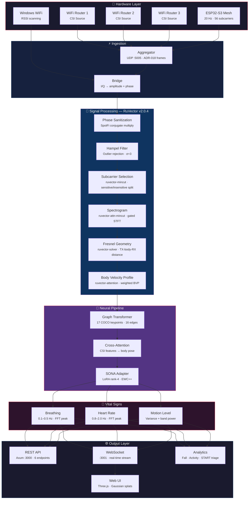
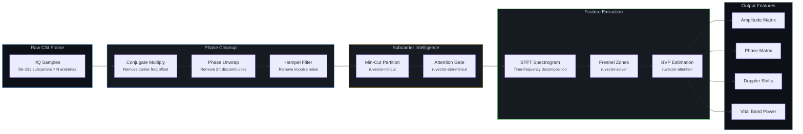
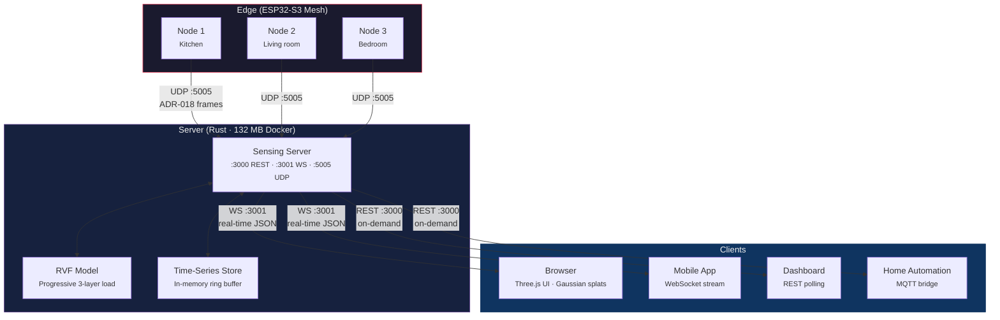

# RuView — 扩展文档

本文档收录从 [README.md](../README.md) 拆出的详细章节，让主 README 聚焦于概览、使用场景与支持信息。

---

## 最新增补

### 实时稠密点云（新增）

RuView 现在可以融合摄像头深度、WiFi CSI 与毫米波雷达，生成**实时三维点云**。所有传感器同时流入一个统一的空间模型。

| 传感器 | 数据 | 集成方式 |
|--------|------|-------------|
| **摄像头** | MiDaS 单目深度（GPU） | 640×480 → 每帧 19,200+ 个深度点 |
| **ESP32 CSI** | ADR-018 二进制帧（UDP） | 射频层析 → 8×8×4 占用网格 |
| **WiFlow 姿态** | 由 CSI 得出的 17 个 COCO 关键点 | 骨架叠加到点云上 |
| **生命体征** | 由 CSI 相位得出的呼吸率 | 每 60 秒写入 ruOS brain |
| **运动** | CSI 幅度方差 | 自适应采集速率（静止时跳过深度采集） |

**快速开始：**
```bash
cd v2
cargo build --release -p wifi-densepose-pointcloud
./target/release/ruview-pointcloud serve --bind 127.0.0.1:9880
# 打开 http://localhost:9880 查看实时三维视图
```

**命令行指令：**
```bash
ruview-pointcloud demo                            # 合成数据演示
ruview-pointcloud serve --bind 127.0.0.1:9880     # live server + Three.js viewer
ruview-pointcloud capture --output room.ply       # 导出为 PLY
ruview-pointcloud train                           # depth calibration + DPO pairs
ruview-pointcloud cameras                         # 列出可用摄像头
ruview-pointcloud csi-test --count 100            # 发送测试 CSI 帧
ruview-pointcloud fingerprint office --seconds 5  # 记录具名的 CSI 房间指纹
```

HTTP/视图服务默认只绑定**回环地址（`127.0.0.1`）** —— 把实时摄像头/CSI/生命体征暴露到 `0.0.0.0` 必须由用户显式开启。Brain 地址默认为 `http://127.0.0.1:9876`，可通过环境变量 `RUVIEW_BRAIN_URL` 或 `serve`/`train` 的 `--brain` 参数覆盖。

姿态叠加目前用的是**幅度能量启发式**（`heuristic_pose_from_amplitude`），而不是训练好的 WiFlow 推理 —— 真正的 ONNX/Candle 推理已列入后续工作。

**性能：** 流水线 22ms、API 905 请求/秒、由 20 帧构建 4 万体素的房间模型。

**Brain 集成：** 空间观测（运动、生命体征、骨架、占用情况）每 60 秒同步到 ruOS brain，供智能体推理使用。

完整细节见 [PR #405](https://github.com/ruvnet/RuView/pull/405)。

### v0.7.0 新增内容

<details>
<summary><strong>摄像头真值训练</strong></summary>

**v0.7.0 加入了摄像头监督的姿态训练**，使用 MediaPipe 配合真实 ESP32 CSI 数据：

| 能力 | 作用 | ADR |
|-----------|-------------|-----|
| **摄像头真值采集** | MediaPipe PoseLandmarker 以 30fps 捕获 17 个 COCO 关键点，与 ESP32 CSI 同步 | [ADR-079](../docs/adr/ADR-079-camera-ground-truth-training.md) |
| **ruvector 子载波筛选** | 基于方差的 top-K 把输入减半（70→35 个子载波） | ADR-079 O6 |
| **Stoer-Wagner 最小割** | 按人分离子载波簇，用于多人训练 | ADR-079 O8 |
| **可扩展 WiFlow 模型** | 4 档预设：lite (189K) → small (474K) → medium (800K) → full (770 万参数) | ADR-079 |

```bash
# 采集真值（摄像头与 ESP32 同步）
python scripts/collect-ground-truth.py --duration 300 --preview
python scripts/record-csi-udp.py --duration 300

# 把 CSI 窗口与摄像头关键点对齐
node scripts/align-ground-truth.js --gt data/ground-truth/*.jsonl --csi data/recordings/*.csi.jsonl

# 训练 WiFlow 模型（先用 lite，数据变多再放大）
node scripts/train-wiflow-supervised.js --data data/paired/*.jsonl --scale lite

# 评估
node scripts/eval-wiflow.js --model models/wiflow-real/wiflow-v1.json --data data/paired/*.jsonl
```

> **精度撤回声明（2026-06-10）：** 此前此处展示的
> 「92.9% PCK@20」数值已撤回。对留存评估集（69 个样本）的复查发现，
> 那是一个恒定输出模型，在近乎静止的帧上用了绝对阈值
> （未按躯干归一化）评分 —— 在这种评测协议下，
> 简单的均值姿态预测器就能拿到 100%。同一留出集上按躯干归一化的
> PCK@20 约为 19%（来自那个退化预测器）。目前没有发布任何实测的
> 摄像头监督 PCK@20 结果（见 CHANGELOG、PR #535）。

| 指标 | 摄像头监督运行结果（协议已撤回） |
|--------|--------------------------------------------|
| 评估损失 | 0.082 |
| 骨骼约束 | 0.008 |
| 训练耗时 | 19 分钟 |
| 模型大小 | 974 KB |

预训练模型：[HuggingFace ruv/ruview/wiflow-v1](https://huggingface.co/ruv/ruview)

</details>

### 预训练模型（v0.6.0）—— 无需训练

<details>
<summary><strong>从 HuggingFace 下载即可开始感知</strong></summary>

预训练模型已发布在 HuggingFace：
> **https://huggingface.co/ruv/ruview** (primary) | [mirror](https://huggingface.co/ruvnet/wifi-densepose-pretrained)

基于一次 8 小时通宵采集的 60,630 条真实样本训练。下载即可运行 —— 不需要数据集、GPU 或训练。

| 模型 | 大小 | 作用 |
|-------|------|-------------|
| `model.safetensors` | 48 KB | 对比学习编码器 —— 为在场、活动、环境生成 128 维嵌入 |
| `model-q4.bin` | 8 KB | 4 位量化 —— 可放进 ESP32-S3 的 SRAM 做边缘推理 |
| `model-q2.bin` | 4 KB | 2 位超紧凑版，面向内存受限设备 |
| `presence-head.json` | 2.6 KB | 在场检测头（宣称 100% 准确） |
| `node-1.json` / `node-2.json` | 21 KB | 逐房间的 LoRA 适配器（换房间时替换） |

```bash
# 下载并使用（Python）
pip install huggingface_hub
huggingface-cli download ruv/ruview --local-dir models/

# 或直接接入感知流水线
node scripts/train-ruvllm.js --data data/recordings/*.csi.jsonl  # 用自己的数据重新训练
node scripts/benchmark-ruvllm.js --model models/csi-ruvllm       # 跑基准测试
```

**基准测试（Apple M4 Pro，用通宵数据重训）：**

| 实测项 | 结果 | 意义 |
|-----------------|--------|---------------|
| **CSI 嵌入质量** | **留出集时间三元组 82.3%** | 按时间取最后 20% 的无标签诚实指标（v1 的「100% 在场」来自单类别录制 —— 已撤回，[#882](https://github.com/ruvnet/RuView/issues/882)） |
| **推理速度** | 每条嵌入 **0.008 ms** | 比实时快 125,000 倍 |
| **吞吐** | **164,183 条嵌入/秒** | 一台 Mac Mini 可带 1,600+ 个 ESP32 节点 |
| **对比学习** | **提升 51.6%** | 从真实通宵数据中学到明显的模式 |
| **模型大小** | **8 KB**（4 位量化） | 可放进 ESP32 SRAM —— 无需服务器 |
| **硬件总成本** | **$140** | ESP32 ($9) + [Cognitum Seed](https://cognitum.one) ($131) |

</details>

### 17 种感知应用（v0.6.0）

<details>
<summary><strong>健康、环境、安防与多频组网感知</strong></summary>

所有应用都跑在单个 ESP32 上，Cognitum Seed 可选。不需要摄像头、云端或互联网。

**健康与养生：**

| 应用 | 脚本 | 检测内容 |
|------------|--------|----------------|
| 睡眠监测 | `node scripts/sleep-monitor.js` | 睡眠阶段（深睡/浅睡/REM/清醒）、睡眠效率、睡眠图 |
| 呼吸暂停检测 | `node scripts/apnea-detector.js` | 超过 10 秒的呼吸停顿、AHI 严重程度评分 |
| 压力监测 | `node scripts/stress-monitor.js` | 心率变异性、LF/HF 压力比值 |
| 步态分析 | `node scripts/gait-analyzer.js` | 步频、步幅不对称、震颤检测 |

**环境与安防：**

| 应用 | 脚本 | 检测内容 |
|------------|--------|----------------|
| 人数统计 | `node scripts/mincut-person-counter.js` | 正确的人数（修复 #348） |
| 房间指纹 | `node scripts/room-fingerprint.js` | 活动状态聚类、日常规律、异常 |
| 物体检测 | `node scripts/material-detector.js` | 通过子载波零点变化发现新增/移动的物体 |
| 设备指纹 | `node scripts/device-fingerprint.js` | 电子设备的活动（打印机、路由器等） |

**多频组网**（需要 `--hop-channels` 配置）：

| 应用 | 脚本 | 检测内容 |
|------------|--------|----------------|
| 射频层析 | `node scripts/rf-tomography.js` | 用射频反投影生成二维房间图像 |
| 被动雷达 | `node scripts/passive-radar.js` | 把邻近 WiFi AP 当作双基地雷达的照射源 |
| 材质分类 | `node scripts/material-classifier.js` | 由频率响应区分金属/水/木材/玻璃 |
| 穿墙检测 | `node scripts/through-wall-detector.js` | 用较低频段的穿透能力探测墙后运动 |

所有脚本都支持 `--replay data/recordings/*.csi.jsonl` 做离线分析，以及 `--json` 输出供程序处理。

</details>

### v0.5.5 新增内容

<details>
<summary><strong>进阶感知：SNN + MinCut + WiFlow + 多频组网</strong></summary>

**v0.5.5 新增四项感知能力**，构建于 [ruvector](https://github.com/ruvnet/ruvector) 生态之上：

| 能力 | 作用 | ADR |
|-----------|-------------|-----|
| **脉冲神经网络** | 用 STDP 在线学习在 30 秒内适应你的房间 —— 无需标签、无需批量，算力降低 16-160 倍 | [ADR-074](../docs/adr/ADR-074-spiking-neural-csi-sensing.md) |
| **MinCut 人数统计** | 在子载波相关图上做 Stoer-Wagner 最小割 —— **修复 #348**（原来恒为 4，现已正确） | [ADR-075](../docs/adr/ADR-075-mincut-person-separation.md) |
| **CNN 频谱图嵌入** | 把 CSI 当作 64×20 图像 → 128 维嵌入用于环境指纹（相似度 0.95+） | [ADR-076](../docs/adr/ADR-076-csi-spectrogram-embeddings.md) |
| **WiFlow SOTA 架构** | TCN + 轴向注意力 + 姿态解码器 → 17 个 COCO 关键点，180 万参数（4 位量化 881 KB） | [ADR-072](../docs/adr/ADR-072-wiflow-architecture.md) |
| **多频组网** | 跨 6 个频段跳频，邻近 WiFi 作为被动雷达照射源 | [ADR-073](../docs/adr/ADR-073-multifrequency-mesh-scan.md) |

```bash
# 实时射频房间扫描（频谱可视化）
node scripts/rf-scan.js --port 5006 --duration 30

# 正确的人数统计（修复 #348）
node scripts/mincut-person-counter.js --port 5006

# SNN 实时自适应
node scripts/snn-csi-processor.js --port 5006

# CNN 频谱图嵌入
node scripts/csi-spectrogram.js --replay data/recordings/*.csi.jsonl

# WiFlow 17 关键点姿态训练
node scripts/train-wiflow.js --data data/recordings/*.csi.jsonl

# 在 ESP32 上启用跳频
python firmware/esp32-csi-node/provision.py --port COM9 --hop-channels "1,6,11"
```

**已验证的基准：**

| 指标 | v0.5.4 | v0.5.5 |
|--------|--------|--------|
| 人数统计 | 失效（恒为 4） | **正确**（MinCut，24/24） |
| WiFi 信道 | 1 | **6**（多频跳频） |
| 零点子载波 | 19% 被阻塞 | **16%**（频率分集） |
| 姿态模型 | 1.6 万参数（仅全连接） | **180 万参数**（WiFlow） |
| 在线自适应 | 无 | **<30 秒**（SNN STDP） |
| 指纹维度 | 8 | **128**（CNN 频谱图） |
| 多节点融合 | 平均 | **GATv2 注意力** |
| 新增脚本 | 0 | **15+** |
| 新增 ADR | 3 | **8**（069-076） |

</details>

### v0.5.4 新增内容

<details>
<summary><strong>Cognitum Seed 集成 + 无摄像头姿态训练</strong></summary>

**v0.5.4 把 RuView 从实时感知工具变成了可持久化的边缘 AI 系统。** 你的 ESP32 现在能记住感知到的内容、无需摄像头即可学习，并用密码学方式证明数据来源。

| 能力 | 细节 | 硬件 |
|-----------|---------|----------|
| **持久化向量库** | 每次感知事件以可检索的 8 维向量存入 RVF 格式 | ESP32 + [Cognitum Seed](https://cognitum.one) ($140) |
| **kNN 相似检索** | 「找出与当前最接近的 10 个状态」—— 异常检测、指纹识别 | Cognitum Seed |
| **见证链** | 每次测量的 SHA-256 防篡改审计轨迹（已验证 1,747 条） | Cognitum Seed |
| **无摄像头姿态训练** | 由 10 路传感信号得出 17 个 COCO 关键点 —— PIR、RSSI 三角定位、子载波不对称、振动、BME280 | 2x ESP32 + Seed |
| **预训练模型** | 82.8 KB（4 位量化后 8 KB），留出集时间三元组准确率 82.3%（v1 的「100% 在场」是单类别结果 —— 已撤回，[#882](https://github.com/ruvnet/RuView/issues/882)） | 从 release 下载 |
| **亚毫秒推理** | 延迟 0.012 ms，M4 Pro 上 171,472 条嵌入/秒 | 任意装有 Node.js 的机器 |
| **SONA 自适应** | 无需重训，1ms 内适应新房间 | ruvllm runtime |
| **LoRA 房间适配器** | 逐节点微调，每个适配器 2,048 个参数 | 自动 |
| **114 工具 MCP 代理** | AI 助手（Claude、GPT）通过 JSON-RPC 直接查询传感器 | Cognitum Seed |
| **多频组网** | 在 1/3/5/6/9/11 信道间跳频 —— 邻近 WiFi 作为被动雷达 | 2x ESP32 ($18) |
| **射频房间扫描器** | 实时频谱可视化：零点、反射体、运动、多径 | `node scripts/rf-scan.js` |
| **安全加固** | Bearer 令牌、TLS、源 IP 过滤、NaN 拒绝、凭据轮换 | 全部组件 |

**训练流水线（ruvllm，无需 PyTorch）：**

```bash
# 采集数据（2 分钟，ESP32 需正在推流）
python scripts/collect-training-data.py --port 5006 --duration 120

# 训练 —— 对比预训练 + 任务头 + LoRA + 量化 + EWC
node scripts/train-ruvllm.js --data data/recordings/pretrain-*.csi.jsonl

# 无摄像头 17 关键点姿态（使用 PIR + RSSI + 振动 + 子载波不对称）
node scripts/train-camera-free.js --data data/recordings/pretrain-*.csi.jsonl

# 基准测试
node scripts/benchmark-ruvllm.js --model models/csi-ruvllm
```

**基准测试 —— 在真实硬件上验证（Apple M4 Pro + ESP32-S3 + Cognitum Seed）：**

| 实测项 | 结果 | 意义 |
|-----------------|--------|---------------|
| **CSI 嵌入质量** | **留出集时间三元组 82.3%** | 无标签的诚实指标（v1 的「100% 在场」是单类别结果 —— 已撤回，[#882](https://github.com/ruvnet/RuView/issues/882)） |
| **人数统计** | **24/24 正确**（MinCut） | 修复了用户反馈最多的问题 |
| **推理速度** | 每条嵌入 **0.012 ms** | 比实时快 83,000 倍 |
| **吞吐** | **171,472 条嵌入/秒** | 一台 Mac Mini 可带 1,700+ 个 ESP32 节点 |
| **训练耗时** | **84 秒** | 不到 2 分钟即可从零得到训练好的模型 |
| **对比学习** | **提升 33.9%** | 模型从 CSI 中学到有意义的模式 |
| **模型大小** | **8 KB**（4 位量化） | 可放进 ESP32 SRAM —— 无需服务器 |
| **骨架物理约束** | 100 帧中 **0 次违规** | 每个姿态在解剖学上都成立 |
| **姿态关键点** | **17 个 COCO 关键点** | 全身姿态，无需摄像头 |
| **WiFi 信道** | **6 个并发** | 感知数据量为单信道的 3 倍 |
| **在线自适应** | **<30 秒**（SNN） | 无需重训即可学会新房间 |
| **见证链** | 已验证 **2,547 条** | 用密码学证明每次测量都真实 |
| **测试套件** | **1,463 项测试通过** | 基础扎实 |
| **硬件总成本** | **$140** | ESP32 ($9) + [Cognitum Seed](https://cognitum.one) ($131) |

完整细节见 [ADR-069](../docs/adr/ADR-069-cognitum-seed-csi-pipeline.md)、[ADR-071](../docs/adr/ADR-071-ruvllm-training-pipeline.md) 与 [Cognitum Seed 教程](../docs/tutorials/cognitum-seed-pretraining.md)。

</details>

---

<a id="key-features"></a>
## 🚀 主要功能

### 感知

仅用房间里已有的 WiFi 信号，就能隔墙看见人、呼吸与心跳。

| | 功能 | 含义 |
|---|---------|---------------|
| 🔒 | **隐私优先** | 只用 WiFi 信号追踪人体姿态 —— 无摄像头、无视频、不存图像 |
| 💓 | **生命体征** | 无需任何穿戴设备即可检测呼吸率（6-30 次/分）与心率（40-120 bpm） |
| 👥 | **多人** | 同时追踪多人，各自有独立的姿态与生命体征 —— 软件上无硬性上限（物理上：56 子载波时每个 AP 约 3-5 人，多 AP 可更多） |
| 🧱 | **穿墙** | WiFi 能穿过墙体、家具与废墟 —— 在摄像头无能为力的地方仍可工作 |
| 🚑 | **灾害响应** | 透过瓦砾探测被困幸存者，并判定伤情严重程度（START 分诊） |
| 📡 | **多静态组网** | 4-6 个低成本传感节点协同，叠加 12 条以上信号路径，实现 360 度全房间覆盖、亚英寸精度且不会认错人（[ADR-029](../docs/adr/ADR-029-ruvsense-multistatic-sensing-mode.md)） |
| 🌐 | **持久场模型** | 系统学习每个房间的射频特征，再把房间本身减去，从而分离出人体运动、发现数日内的漂移、在动作开始前预测意图，并标记伪造尝试（[ADR-030](../docs/adr/ADR-030-ruvsense-persistent-field-model.md)） |

### 智能

系统自主学习并随时间变得更准 —— 无需手工调参，也不需要标注数据。

| | 功能 | 含义 |
|---|---------|---------------|
| 🧠 | **自学习** | 从原始 WiFi 数据自学 —— 不需要标注训练集，冷启动也无需摄像头（[ADR-024](../docs/adr/ADR-024-contrastive-csi-embedding-model.md)） |
| 🎯 | **AI 信号处理** | 用注意力网络、图算法与智能压缩取代手工阈值 —— 自动适应每个房间（[RuVector](https://github.com/ruvnet/ruvector)） |
| 🌍 | **随处可用** | 训练一次，任意房间部署 —— 对抗式域泛化消除环境偏差，使模型能跨房间、跨建筑、跨硬件迁移（[ADR-027](../docs/adr/ADR-027-cross-environment-domain-generalization.md)） |
| 👁️ | **跨视角融合** | AI 把各传感器在自身角度看到的内容合并 —— 补上单一视角无法解决的盲区与深度歧义（[ADR-031](../docs/adr/ADR-031-ruview-sensing-first-rf-mode.md)） |
| 🔮 | **信号线协议** | 六级流水线把原始 WiFi 信号转成结构化的身体表征 —— 从信号净化、基于图的空间推理，到最终姿态输出（[ADR-033](../docs/adr/ADR-033-crv-signal-line-sensing-integration.md)） |
| 🔒 | **QUIC 组网安全** | 所有传感器间通信端到端加密，具备篡改检测、重放防护，以及节点移动或掉线后的无缝重连（[ADR-032](../docs/adr/ADR-032-multistatic-mesh-security-hardening.md)） |
| 🎯 | **自适应分类器** | 录制带标签的 CSI 会话，用纯 Rust 训练 15 特征逻辑回归模型，学习你房间独有的信号特征 —— 用数据驱动的分类取代手工阈值（[ADR-048](../docs/adr/ADR-048-adaptive-csi-classifier.md)） |

### 性能与部署

快到可以实时使用，小到能跑在边缘设备上，简单到一条命令就能装好。

| | 功能 | 含义 |
|---|---------|---------------|
| ⚡ | **实时** | 每帧 WiFi 信号分析不到 100 微秒 —— 足以做实时监控 |
| 🦀 | **快 810 倍** | 完整 Rust 重写：54,000 帧/秒流水线、多架构 Docker 镜像、1,031+ 项测试 |
| 🐳 | **一条命令装好** | `docker pull ruvnet/wifi-densepose:latest` —— 30 秒开始实时感知，无需工具链（amd64 + arm64 / Apple Silicon） |
| 📡 | **完全本地** | 完整跑在一块 9 美元的 ESP32 上 —— 不联网、无云账号、无订阅费。在设备端即时检测在场、生命体征与跌倒 |
| 📦 | **可移植模型** | 训练好的模型打包成单个 `.rvf` 文件 —— 可跑在边缘、云端或浏览器（WASM） |
| 🔭 | **观测站可视化** | 电影感的 Three.js 仪表盘，含 5 块全息面板 —— 子载波流形、生命体征神谕、在场热力图、相位星座、收敛引擎 —— 全部由实时或演示 CSI 数据驱动（[ADR-047](../docs/adr/ADR-047-psychohistory-observatory-visualization.md)） |
| 📟 | **AMOLED 显示屏** | 带 AMOLED 屏的 ESP32-S3 开发板直接在传感器上显示实时在场、生命体征与房间状态 —— 不需要手机或电脑（[ADR-045](../docs/adr/ADR-045-amoled-display-support.md)） |

---

## 📦 安装

<details>
<summary><strong>引导式安装器</strong> —— 交互式硬件检测与配置选择</summary>

```bash
./install.sh
```

安装器依次走 7 步：系统检测、工具链检查、WiFi 硬件扫描、配置推荐、依赖安装、构建与验证。

| 配置 | 安装内容 | 体积 | 要求 |
|---------|-----------------|------|-------------|
| `verify` | 仅流水线验证 | ~5 MB | Python 3.8+ |
| `python` | 完整 Python API 服务 + 感知 | ~500 MB | Python 3.8+ |
| `rust` | Rust 流水线（约快 810 倍） | ~200 MB | Rust 1.70+ |
| `browser` | 浏览器内执行的 WASM | ~10 MB | Rust + wasm-pack |
| `iot` | ESP32 传感组网 + 汇聚端 | 视情况 | Rust + ESP-IDF |
| `docker` | 基于 Docker 的部署 | ~1 GB | Docker |
| `field` | WiFi-Mat 灾害响应套件 | ~62 MB | Rust + wasm-pack |
| `full` | 全部内容 | ~2 GB | 全部工具链 |

```bash
# 非交互模式
./install.sh --profile rust --yes

# 仅检查硬件
./install.sh --check-only
```

</details>

<details>
<summary><strong>从源码构建</strong> —— Rust（主推）或 Python</summary>

```bash
git clone https://github.com/ruvnet/RuView.git
cd RuView

# Rust（主推 —— 快 810 倍）
cd v2
cargo build --release
cargo test --workspace

# Python（旧版 v1）
pip install -r requirements.txt
pip install -e .

# 或通过 pip
pip install wifi-densepose
pip install wifi-densepose[gpu]   # GPU 加速
pip install wifi-densepose[all]   # 全部可选依赖
```

</details>

<details>
<summary><strong>Docker</strong> —— 预构建镜像，无需工具链</summary>

```bash
# Rust 感知服务器（132 MB —— 推荐）
docker pull ruvnet/wifi-densepose:latest
docker run -p 3000:3000 -p 3001:3001 -p 5005:5005/udp ruvnet/wifi-densepose:latest

# Python 感知流水线（569 MB）
docker pull ruvnet/wifi-densepose:python
docker run -p 8765:8765 -p 8080:8080 ruvnet/wifi-densepose:python

# 两者一起用 docker-compose
cd docker && docker compose up

# 导出 RVF 模型
docker run --rm -v $(pwd):/out ruvnet/wifi-densepose:latest --export-rvf /out/model.rvf
```

| 镜像 | 标签 | 平台 | 端口 |
|-------|-----|-----------|-------|
| `ruvnet/wifi-densepose` | `latest`, `rust` | linux/amd64, linux/arm64 | 3000 (REST), 3001 (WS), 5005/udp (ESP32) |
| `ruvnet/wifi-densepose` | `python` | linux/amd64 | 8765 (WS), 8080 (UI) |

</details>

<details>
<summary><strong>系统要求</strong></summary>

- **Rust**：1.70+（主运行时 —— 通过 [rustup](https://rustup.rs/) 安装）
- **Python**：3.8+（用于验证与旧版 v1 API）
- **操作系统**：Linux (Ubuntu 18.04+)、macOS (10.15+)、Windows 10+
- **内存**：最低 4GB，推荐 8GB 以上
- **存储**：模型与数据需 2GB 可用空间
- **网络**：支持 CSI 的 WiFi 网卡（可选 —— 安装器会检测现有硬件）
- **GPU**：可选（NVIDIA CUDA 或 Apple Metal）

</details>

<details>
<summary><strong>Rust Crates</strong> —— 已分别发布在 crates.io</summary>

Rust 工作区包含 15 个 crate，全部发布在 [crates.io](https://crates.io/)：

```bash
# 把单个 crate 加入 Cargo.toml
cargo add wifi-densepose-core       # 类型、trait、错误
cargo add wifi-densepose-signal     # CSI 信号处理（6 种 SOTA 算法）
cargo add wifi-densepose-nn         # 神经网络推理（ONNX、PyTorch、Candle）
cargo add wifi-densepose-vitals     # Vital sign extraction (breathing + heart rate)
cargo add wifi-densepose-mat        # 灾害响应（MAT 幸存者检测）
cargo add wifi-densepose-hardware   # ESP32、Intel 5300、Atheros 传感器
cargo add wifi-densepose-train      # 训练流水线（MM-Fi 数据集）
cargo add wifi-densepose-wifiscan   # 多 BSSID WiFi 扫描
cargo add wifi-densepose-ruvector   # RuVector v2.0.4 集成层（ADR-017）
```

| Crate | 说明 | RuVector | crates.io |
|-------|-------------|----------|-----------|
| [`wifi-densepose-core`](https://crates.io/crates/wifi-densepose-core) | 基础类型、trait 与工具 | -- | [](https://crates.io/crates/wifi-densepose-core) |
| [`wifi-densepose-signal`](https://crates.io/crates/wifi-densepose-signal) | SOTA CSI 信号处理（SpotFi、FarSense、Widar 3.0） | `mincut`, `attn-mincut`, `attention`, `solver` | [](https://crates.io/crates/wifi-densepose-signal) |
| [`wifi-densepose-nn`](https://crates.io/crates/wifi-densepose-nn) | 多后端推理（ONNX、PyTorch、Candle） | -- | [](https://crates.io/crates/wifi-densepose-nn) |
| [`wifi-densepose-train`](https://crates.io/crates/wifi-densepose-train) | 基于 MM-Fi 数据集（NeurIPS 2023）的训练流水线 | **全部 5 个** | [](https://crates.io/crates/wifi-densepose-train) |
| [`wifi-densepose-mat`](https://crates.io/crates/wifi-densepose-mat) | 大规模伤员评估工具（灾害幸存者检测） | `solver`, `temporal-tensor` | [](https://crates.io/crates/wifi-densepose-mat) |
| [`wifi-densepose-ruvector`](https://crates.io/crates/wifi-densepose-ruvector) | RuVector v2.0.4 集成层 —— 7 个 signal+MAT 集成点（ADR-017） | **全部 5 个** | [](https://crates.io/crates/wifi-densepose-ruvector) |
| [`wifi-densepose-vitals`](https://crates.io/crates/wifi-densepose-vitals) | 生命体征：呼吸（6-30 BPM）、心率（40-120 BPM） | -- | [](https://crates.io/crates/wifi-densepose-vitals) |
| [`wifi-densepose-hardware`](https://crates.io/crates/wifi-densepose-hardware) | ESP32、Intel 5300、Atheros CSI 传感器接口 | -- | [](https://crates.io/crates/wifi-densepose-hardware) |
| [`wifi-densepose-wifiscan`](https://crates.io/crates/wifi-densepose-wifiscan) | 多 BSSID WiFi 扫描（Windows、macOS、Linux） | -- | [](https://crates.io/crates/wifi-densepose-wifiscan) |
| [`wifi-densepose-wasm`](https://crates.io/crates/wifi-densepose-wasm) | 浏览器部署用的 WebAssembly 绑定 | -- | [](https://crates.io/crates/wifi-densepose-wasm) |
| [`wifi-densepose-sensing-server`](https://crates.io/crates/wifi-densepose-sensing-server) | Axum 服务：UDP 接入、WebSocket 广播 | -- | [](https://crates.io/crates/wifi-densepose-sensing-server) |
| [`wifi-densepose-cli`](https://crates.io/crates/wifi-densepose-cli) | MAT 灾害扫描的命令行工具 | -- | [](https://crates.io/crates/wifi-densepose-cli) |
| [`wifi-densepose-api`](https://crates.io/crates/wifi-densepose-api) | REST + WebSocket API 层 | -- | [](https://crates.io/crates/wifi-densepose-api) |
| [`wifi-densepose-config`](https://crates.io/crates/wifi-densepose-config) | 配置管理 | -- | [](https://crates.io/crates/wifi-densepose-config) |
| [`wifi-densepose-db`](https://crates.io/crates/wifi-densepose-db) | 数据库持久化（PostgreSQL、SQLite、Redis） | -- | [](https://crates.io/crates/wifi-densepose-db) |
| `wifi-densepose-pointcloud` | 摄像头 + WiFi CSI 融合的实时稠密点云（Three.js 视图、brain 桥接）。目前仅在工作区内。 | -- | — |
| `wifi-densepose-geo` | 地理空间上下文（Sentinel-2 瓦片、SRTM 高程、OSM、天气、夜间模式）。目前仅在工作区内。 | -- | — |

所有 crate 都与 [RuVector v2.0.4](https://github.com/ruvnet/ruvector) 集成 —— 见下文 [AI 骨架](#ai-backbone-ruvector)。

**[rUv Neural](https://github.com/ruvnet/ruv-neural)** —— 独立的 12-crate 工作区，用于脑网络拓扑分析、神经解码与医学感知。见「模型与训练」中的 [rUv Neural](#ruv-neural)。

</details>

---

## 🚀 快速上手

<details open>
<summary><strong>三条命令完成首次 API 调用</strong></summary>

### 1. 安装

```bash
# 最快路径 —— Docker
docker pull ruvnet/wifi-densepose:latest
docker run -p 3000:3000 ruvnet/wifi-densepose:latest

# 或从源码构建（Rust）
./install.sh --profile rust --yes
```

### 2. 启动系统

```python
from wifi_densepose import WiFiDensePose

system = WiFiDensePose()
system.start()
poses = system.get_latest_poses()
print(f"Detected {len(poses)} persons")
system.stop()
```

### 3. REST API

```bash
# 健康检查
curl http://localhost:3000/health

# 最新感知帧
curl http://localhost:3000/api/v1/sensing/latest

# 生命体征
curl http://localhost:3000/api/v1/vital-signs

# 姿态估计
curl http://localhost:3000/api/v1/pose/current

# 服务信息
curl http://localhost:3000/api/v1/info
```

### 4. 实时 WebSocket

```python
import asyncio, websockets, json

async def stream():
    async with websockets.connect("ws://localhost:3001/ws/sensing") as ws:
        async for msg in ws:
            data = json.loads(msg)
            print(f"Persons: {len(data.get('persons', []))}")

asyncio.run(stream())
```

</details>

---

## 📋 目录

<details open>
<summary><strong>📡 信号处理与感知</strong> —— 从原始 WiFi 帧到生命体征</summary>

信号处理栈把原始 WiFi 信道状态信息转换成可用的人体感知数据。从 20 Hz 采集的 56-192 个复子载波值出发，流水线运用研究级算法（SpotFi 相位校正、Hampel 异常值剔除、菲涅尔区建模）提取呼吸率、心率、运动强度与多人姿态 —— 全部用纯 Rust 实现，不依赖任何外部机器学习库。

| 章节 | 说明 | 文档 |
|---------|-------------|------|
| [主要功能](#key-features) | 感知、智能、性能与部署方面的能力 | — |
| [工作原理](#how-it-works) | 端到端流水线：无线电波 → CSI 采集 → 信号处理 → AI → 姿态 + 生命体征 | — |
| [ESP32-S3 硬件流水线](#esp32-s3-hardware-pipeline) | 20 Hz CSI 推流、二进制帧解析、烧录与配置 | [ADR-018](../docs/adr/ADR-018-esp32-dev-implementation.md) · [教程 #34](https://github.com/ruvnet/RuView/issues/34) |
| [生命体征检测](#vital-sign-detection) | 呼吸 6-30 BPM、心跳 40-120 BPM、FFT 峰值检测 | [ADR-021](../docs/adr/ADR-021-vital-sign-detection-rvdna-pipeline.md) |
| [WiFi 扫描领域层](#wifi-scan-domain-layer) | 八级 RSSI 流水线、多 BSSID 指纹、Windows WiFi | [ADR-022](../docs/adr/ADR-022-windows-wifi-enhanced-fidelity-ruvector.md) · [教程 #36](https://github.com/ruvnet/RuView/issues/36) |
| [WiFi-Mat 灾害响应](#wifi-mat-disaster-response) | 搜索救援、START 分诊、穿透废墟的三维定位 | [ADR-001](../docs/adr/ADR-001-wifi-mat-disaster-detection.md) · [用户指南](../docs/wifi-mat-user-guide.md) |
| [SOTA 信号处理](#sota-signal-processing) | SpotFi、Hampel、菲涅尔、STFT 频谱图、子载波筛选、BVP | [ADR-014](../docs/adr/ADR-014-sota-signal-processing.md) |

</details>

<details>
<summary><strong>🧠 模型与训练</strong> —— DensePose 流水线、RVF 容器、SONA 自适应、RuVector 集成</summary>

神经网络流水线用带交叉注意力的图 Transformer，把 CSI 特征矩阵映射为 17 个 COCO 人体关键点与 DensePose UV 坐标。模型打包成单文件 `.rvf` 容器，支持渐进加载（A 层即时、B 层预热、C 层完整）。SONA（自优化神经架构）借助 micro-LoRA + EWC++ 实现设备端持续自适应，且不会发生灾难性遗忘。信号处理由 5 个 [RuVector](https://github.com/ruvnet/ruvector) crate（v2.0.4）驱动，在 Rust 工作区中有 7 个集成点，另有 6 个内置 crate 负责推理与图智能。

| 章节 | 说明 | 文档 |
|---------|-------------|------|
| [RVF 模型容器](#rvf-model-container) | 二进制打包、Ed25519 签名、三层渐进加载、SIMD 量化 | [ADR-023](../docs/adr/ADR-023-trained-densepose-model-ruvector-pipeline.md) |
| [训练与微调](#training--fine-tuning) | 八阶段纯 Rust 流水线（7,832 行）、MM-Fi/Wi-Pose 预训练、六项复合损失、SONA LoRA | [ADR-023](../docs/adr/ADR-023-trained-densepose-model-ruvector-pipeline.md) |
| [RuVector Crates](#ruvector-crates) | 来自 [ruvector](https://github.com/ruvnet/ruvector) 的 11 个内置 Rust crate：注意力、最小割、求解器、GNN、HNSW、时序压缩、稀疏推理 | [GitHub](https://github.com/ruvnet/ruvector) · [源码](../vendor/) |
| [rUv Neural](#ruv-neural) | 12 个 crate 的脑拓扑分析生态：神经解码、量子传感器集成、认知状态分类、BCI 输出 | [README](https://github.com/ruvnet/ruv-neural#readme) |
| [AI 骨架（RuVector）](#ai-backbone-ruvector) | 5 项取代手工阈值的 AI 能力：注意力、图最小割、稀疏求解器、分层压缩 | [crates.io](https://crates.io/crates/wifi-densepose-ruvector) |
| [自学习 WiFi AI（ADR-024）](#self-learning-wifi-ai-adr-024) | 对比自监督学习、房间指纹、异常检测、55 KB 模型 | [ADR-024](../docs/adr/ADR-024-contrastive-csi-embedding-model.md) |
| [跨环境泛化（ADR-027）](../docs/adr/ADR-027-cross-environment-domain-generalization.md) | 域对抗训练、几何条件推理、硬件归一化、零样本部署 | [ADR-027](../docs/adr/ADR-027-cross-environment-domain-generalization.md) |

</details>

<details>
<summary><strong>🖥️ 使用与配置</strong> —— 命令行参数、API 接口、硬件配置</summary>

Rust 感知服务器是主接口，提供覆盖数据源选择、模型加载、训练、基准测试与 RVF 导出的完整命令行参数。REST API（Axum）与 WebSocket 服务提供实时数据访问。旧版 Python v1 命令行工具仍保留，供既有流程使用。

| 章节 | 说明 | 文档 |
|---------|-------------|------|
| [命令行用法](#cli-usage) | `--source`, `--train`, `--benchmark`, `--export-rvf`, `--model`, `--progressive` | — |
| [REST API 与 WebSocket](#rest-api--websocket) | 6 个 REST 接口（感知、生命体征、BSSID、SONA）、WebSocket 实时流 | — |
| [硬件支持](#hardware-support-1) | ESP32-S3 ($8)、Intel 5300 ($15)、Atheros AR9580 ($20)、Windows RSSI ($0) | [ADR-012](../docs/adr/ADR-012-esp32-csi-sensor-mesh.md) · [ADR-013](../docs/adr/ADR-013-feature-level-sensing-commodity-gear.md) |

</details>

<details>
<summary><strong>⚙️ 开发与测试</strong> —— 542+ 项测试、CI、部署</summary>

项目在 7 个 crate 测试套件中维护了 542+ 项纯 Rust 测试，不使用任何 mock —— 每项测试都跑在真实算法实现上。免硬件的模拟模式（`--source simulate`）可在没有物理设备时做全栈测试。Docker 镜像已发布到 Docker Hub，开箱即部署。

| 章节 | 说明 | 文档 |
|---------|-------------|------|
| [测试](#testing) | 7 个测试套件：sensing-server (229)、signal (83)、mat (139)、wifiscan (91)、RVF (16)、vitals (18) | — |
| [部署](#deployment) | Docker 镜像（Rust 132 MB / Python 569 MB）、docker-compose、环境变量 | — |
| [贡献指南](#contributing) | Fork → 分支 → 测试 → PR 流程，Rust 与 Python 开发环境 | — |

</details>

<details>
<summary><strong>📊 性能与基准</strong> —— 实测吞吐、延迟、资源占用</summary>

所有基准都在 Rust 感知服务器上用 `cargo bench` 与内置的 `--benchmark` 参数实测。Rust v2 相比 Python v1 基线端到端提速 810 倍，其中运动检测提升达 5,400 倍。生命体征检测器在单线程基准下处理 11,665 帧/秒。

| 章节 | 说明 | 关键指标 |
|---------|-------------|------------|
| [性能指标](#performance-metrics) | 生命体征、CSI 流水线、运动检测、Docker 镜像、内存 | 生命体征 11,665 fps · 流水线 54K fps |
| [Rust 与 Python 对比](#python-vs-rust) | 5 项操作的并列基准 | 完整流水线提速 **810 倍** |

</details>

<details>
<summary><strong>📄 其他信息</strong> —— 许可、变更记录、支持</summary>

WiFi DensePose 是 MIT 许可的开源项目，由 [ruvnet](https://github.com/ruvnet) 开发。项目自 2025 年 3 月起持续活跃开发，已发布 3 个大版本，带来 Rust 移植、SOTA 信号处理、灾害响应模块与端到端训练流水线。

| 章节 | 说明 | 链接 |
|---------|-------------|------|
| [变更记录](#changelog) | v3.0.0（AETHER AI + Docker）、v2.0.0（Rust 移植 + SOTA + WiFi-Mat） | [CHANGELOG.md](../CHANGELOG.md) |
| [许可](#license) | MIT 许可 | [LICENSE](../LICENSE) |
| [支持](#support) | 缺陷反馈、功能建议、社区讨论 | [Issues](https://github.com/ruvnet/RuView/issues) · [Discussions](https://github.com/ruvnet/RuView/discussions) |

</details>

---

<details>
<summary><strong>🌍 跨环境泛化（ADR-027 —— MERIDIAN 项目）</strong> —— 训练一次，任意房间部署而无需重训</summary>

| 机制 | 原理 | 意义 |
|------|-------------|----------------|
| **梯度反转层** | 对抗分类器试图猜出信号来自哪个房间，主网络则被训练去骗过它 | 迫使模型抛弃只适用于特定房间的捷径 |
| **几何编码器（FiLM）** | 把发射/接收位置做傅里叶编码，以缩放+偏移条件注入每一层 | 模型知道硬件*在哪*，就不必死记房间布局 |
| **硬件归一化器** | 把任意芯片的 CSI 重采样为规范的 56 子载波格式并标准化幅度 | Intel 5300 与 ESP32 的数据在模型看来完全一致 |
| **虚拟域增强** | 生成房间尺度、墙面反射、散射体与噪声分布随机的合成环境 | 即使只有 2-3 个房间的数据，训练也能见到上千种房间 |
| **快速自适应（TTT）** | 用少量无标签帧生成 LoRA 权重，做对比式测试时训练 | 零样本部署 —— 模型到位后自行调整 |
| **跨域评估器** | 在所有训练环境上做留一评估，逐环境给出 PCK/OKS 指标 | 证明是泛化，而不只是记忆 |

**架构**

```
CSI Frame [any chipset]
    │
    ▼
HardwareNormalizer ──→ canonical 56 subcarriers, N(0,1) amplitude
    │
    ▼
CSI Encoder (existing) ──→ latent features
    │
    ├──→ Pose Head ──→ 17-joint pose (environment-invariant)
    │
    ├──→ Gradient Reversal Layer ──→ Domain Classifier (adversarial)
    │         λ ramps 0→1 via cosine/exponential schedule
    │
    └──→ Geometry Encoder ──→ FiLM conditioning (scale + shift)
              Fourier positional encoding → DeepSets → per-layer modulation
```

**安全加固：**
- 校准缓冲区有上限（最多 10,000 帧），防止内存耗尽
- `adapt()` 返回 `Result<_, AdaptError>` —— 输入异常时不会 panic
- 原子实例计数器保证跨线程的权重初始化各不相同
- 所有增强参数都加了除零保护

完整架构细节见 [`docs/adr/ADR-027-cross-environment-domain-generalization.md`](../docs/adr/ADR-027-cross-environment-domain-generalization.md)。

</details>

<details>
<summary><strong>🔍 独立能力审计（ADR-028）</strong> —— 1,031 项测试、SHA-256 证明、可自校验的见证包</summary>

一次[三智能体并行审计](../docs/adr/ADR-028-esp32-capability-audit.md)独立核实了本仓库的每一项宣称 —— ESP32 硬件、信号处理、神经网络、训练流水线、部署与安全。结果：

```
Rust tests:     1,031 passed, 0 failed
Python proof:   VERDICT: PASS (SHA-256: 8c0680d7...)
Bundle verify:  7/7 checks PASS
```

**33 行证明矩阵：** 31 项能力核实为是，2 项在审计时未测（基准吞吐、Kubernetes 部署）。

**自行验证**（无需硬件）：
```bash
# 运行全部测试
cd v2 && cargo test --workspace --no-default-features

# 运行确定性验证
python archive/v1/data/proof/verify.py

# 生成并校验见证包
bash scripts/generate-witness-bundle.sh
cd dist/witness-bundle-ADR028-*/ && bash VERIFY.sh
```

| 文档 | 内容 |
|----------|-----------------|
| [ADR-028](../docs/adr/ADR-028-esp32-capability-audit.md) | 完整审计：ESP32 规格、信号算法、网络架构、训练阶段、部署设施 |
| [见证日志](../docs/WITNESS-LOG-028.md) | 11 个可复现的验证步骤 + 逐行附证据的 33 行证明矩阵 |
| [`generate-witness-bundle.sh`](../scripts/generate-witness-bundle.sh) | 生成自包含的 tar.gz，含测试日志、证明输出、固件哈希、crate 版本与 VERIFY.sh |

</details>

<details>
<summary><strong>📡 多静态感知（ADR-029/030/031 —— RuvSense + RuView 项目）</strong> —— 多个 ESP32 节点融合视角，实现生产级姿态、追踪与特种感知</summary>

单个 WiFi 接收端能追踪人，但存在盲区 —— 躯干后的肢体看不见、深度有歧义、距离相近的两人信号会重叠。RuvSense 的办法是把多个 ESP32 节点协调成一个**多静态组网**：每个节点既发射又接收，N 台设备形成 N×(N-1) 条测量链路。

**通俗地说，它能做到：**
- 4 个 ESP32-S3 节点（共 $48）提供 12 条收发测量链路，覆盖 360 度
- 每个节点在 1/6/11 信道间跳频，有效带宽从 20→60 MHz 提升三倍
- 相干门控自动剔除噪声帧 —— 无需手工调参，可稳定数日
- 20 Hz 双人追踪，10 分钟内零身份互换
- 房间本身成为持久模型 —— 系统能记忆、预测并给出解释

**三份 ADR，一条流水线：**

| ADR | 代号 | 新增内容 |
|-----|----------|-------------|
| [ADR-029](../docs/adr/ADR-029-ruvsense-multistatic-sensing-mode.md) | **RuvSense** | 跳频、TDM 协议、多节点融合、相干门控、17 关键点卡尔曼追踪 |
| [ADR-030](../docs/adr/ADR-030-ruvsense-persistent-field-model.md) | **RuvSense Field** | 房间电磁本征结构（SVD）、射频层析、长期漂移检测、意图预测、手势识别、对抗检测 |
| [ADR-031](../docs/adr/ADR-031-ruview-sensing-first-rf-mode.md) | **RuView** | 带几何偏置的跨视角注意力、视角多样性优化、嵌入级融合 |

**架构**

```
4x ESP32-S3 nodes ($48)     TDM: each transmits in turn, all others receive
        │                    Channel hop: ch1→ch6→ch11 per dwell (50ms)
        ▼
Per-Node Signal Processing   Phase sanitize → Hampel → BVP → subcarrier select
        │                    (ADR-014, unchanged per viewpoint)
        ▼
Multi-Band Frame Fusion      3 channels × 56 subcarriers = 168 virtual subcarriers
        │                    Cross-channel phase alignment via NeumannSolver
        ▼
Multistatic Viewpoint Fusion  N nodes → attention-weighted fusion → single embedding
        │                    Geometric bias from node placement angles
        ▼
Coherence Gate               Accept / PredictOnly / Reject / Recalibrate
        │                    Prevents model drift, stable for days
        ▼
Persistent Field Model       SVD baseline → body = observation - environment
        │                    RF tomography, drift detection, intention signals
        ▼
Pose Tracker + DensePose     17-keypoint Kalman, re-ID via AETHER embeddings
                             Multi-person min-cut separation, zero ID swaps
```

**七层特种感知能力（ADR-030）**

| 层级 | 能力 | 检测内容 |
|------|-----------|-----------------|
| 1 | 场正则模态 | 用 SVD 得到房间电磁本征结构 |
| 2 | 粗粒度射频层析 | 由链路衰减还原三维占用体积 |
| 3 | 意图先兆信号 | 在动作前 200-500ms 预测 |
| 4 | 长期生物力学 | 个人动作在数日/数周内的变化 |
| 5 | 跨房间连续性 | 无摄像头也能跨房间保持身份 |
| 6 | 隐形交互 | 多人隔墙手势控制 |
| 7 | 对抗检测 | 识别物理上不可能出现的信号 |

**验收测试**

| 指标 | 阈值 | 证明什么 |
|--------|-----------|---------------|
| 躯干关键点抖动 | < 30mm RMS | 精度足以支撑应用 |
| 身份互换 | 10 分钟内 0 次（12,000 帧） | 多人追踪可靠 |
| 更新率 | 20 Hz（50ms 周期） | 实时响应 |
| 呼吸信噪比 | 3m 处 > 10 dB | 确认对微小运动敏感 |

**新增 Rust 模块（9,000+ 行）**

| Crate | 新增模块 | 用途 |
|-------|------------|---------|
| `wifi-densepose-signal` | `ruvsense/`（10 个模块） | 多频融合、相位对齐、多静态融合、相干性、场模型、层析、长期漂移、意图检测 |
| `wifi-densepose-ruvector` | `viewpoint/`（5 个模块） | 带几何偏置的跨视角注意力、多样性指数、相干门控、融合编排 |
| `wifi-densepose-hardware` | `esp32/tdm.rs` | TDM 感知协议、同步信标、时钟漂移补偿 |

**固件扩展（C 语言，向后兼容）**

| 文件 | 新增内容 |
|------|---------|
| `csi_collector.c` | 跳频表、定时器驱动的跳频、NDP 注入桩 |
| `nvs_config.c` | 5 个新 NVS 键：hop_count、channel_list、dwell_ms、tdm_slot、tdm_node_count |

**DDD 领域模型** —— 6 个限界上下文：多静态感知、相干性、姿态追踪、场模型、跨房间身份、对抗检测。完整规格见 [`docs/ddd/ruvsense-domain-model.md`](../docs/ddd/ruvsense-domain-model.md)。

完整架构细节、GOAP 集成计划与研究参考文献见对应 ADR 文档。

</details>

<details>
<summary><b>🔮 信号线协议（CRV）</b></summary>

### 六级 CSI 信号线

通过 `ruvector-crv`，把 CRV（坐标遥视）的信号线方法映射到 WiFi CSI 处理：

| 阶段 | CRV 名称 | WiFi CSI 映射 | ruvector 组件 |
|-------|----------|-----------------|-------------------|
| I | 意元符号 | 原始 CSI 完形（人造/自然/运动/能量） | 庞加莱球双曲嵌入 |
| II | 感官 | 幅度纹理、相位模式、频率色彩 | 多头注意力向量 |
| III | 维度 | AP 组网空间拓扑、节点几何 | GNN 图拓扑 |
| IV | 情感/AOL | 相干门控 —— 分离信号与噪声 | SNN 时序编码 |
| V | 质询 | 跨阶段探查 —— 用姿态查询 CSI 历史 | 可微搜索 |
| VI | 三维模型 | 合成人物估计、MinCut 划分 | 图划分 |

**跨会话收敛**：当多个 AP 簇观察到同一个人时，CRV 收敛分析会找出它们信号嵌入中的一致部分 —— 直接对应跨房间的身份连续性。

```rust
use wifi_densepose_ruvector::crv::WifiCrvPipeline;

let mut pipeline = WifiCrvPipeline::new(WifiCrvConfig::default());
pipeline.create_session("room-a", "person-001")?;

// 把 CSI 帧送入六级流水线
let result = pipeline.process_csi_frame("room-a", &amplitudes, &phases)?;
// result.gestalt = Movement, confidence = 0.87
// result.sensory_embedding = [0.12, -0.34, ...]

// 通过收敛分析做跨房间身份匹配
let convergence = pipeline.find_cross_room_convergence("person-001", 0.75)?;
```

**架构**：
- `CsiGestaltClassifier` —— 把 CSI 幅度/相位模式映射到 6 类完形
- `CsiSensoryEncoder` —— 从子载波提取纹理/色彩/温度/亮度特征
- `MeshTopologyEncoder` —— 把 AP 组网编码为 GNN 图（第 III 阶段）
- `CoherenceAolDetector` —— 把相干门状态映射到 AOL 噪声检测（第 IV 阶段）
- `WifiCrvPipeline` —— 把 6 个阶段编排成统一的感知会话

</details>

---

## 📡 Signal Processing & Sensing

<details>
<summary><a id="esp32-s3-hardware-pipeline"></a><strong>📡 ESP32-S3 Hardware Pipeline (ADR-018)</strong> — 28 Hz CSI streaming, flash & provision</summary>

A single ESP32-S3 board (~$9) captures WiFi signal data 28 times per second and streams it over UDP. A host server can visualize and record the data, but the ESP32 can also run on its own — detecting presence, measuring breathing and heart rate, and alerting on falls without any server at all.

```
ESP32-S3 node                    UDP/5005        Host server (optional)
┌───────────────────────┐      ──────────>      ┌──────────────────────┐
│ Captures WiFi signals │      binary frames    │ Parses frames        │
│ 28 Hz, up to 192 sub- │      or 32-byte       │ Visualizes poses     │
│ carriers per frame     │      vitals packets   │ Records CSI data     │
│                        │                       │ REST API + WebSocket │
│ On-device (optional):  │                       └──────────────────────┘
│  Presence detection    │
│  Breathing + heart rate│
│  Fall detection        │
│  WASM custom modules   │
└───────────────────────┘
```

| Metric | Measured on hardware |
|--------|----------------------|
| CSI frame rate | 28.5 Hz (channel 5, BW20) |
| Subcarriers per frame | 64 / 128 / 192 (depends on WiFi mode) |
| UDP latency | < 1 ms on local network |
| Presence detection range | Reliable at 3 m through walls |
| Binary size | 990 KB (8MB flash) / 773 KB (4MB flash) |
| Boot to ready | ~3.9 seconds |

### Flash and provision

Download a pre-built binary — no build toolchain needed:

| Release | What's included | Tag |
|---------|-----------------|-----|
| [v0.7.0](https://github.com/ruvnet/RuView/releases/tag/v0.7.0) | **Latest** — Camera-supervised WiFlow model (accuracy figure retracted 2026-06-10, see above), ground-truth training pipeline, ruvector optimizations | `v0.7.0` |
| [v0.6.0](https://github.com/ruvnet/RuView/releases/tag/v0.6.0-esp32) | [Pre-trained models on HuggingFace](https://huggingface.co/ruv/ruview), 17 sensing apps, 51.6% contrastive improvement, 0.008ms inference | `v0.6.0-esp32` |
| [v0.5.5](https://github.com/ruvnet/RuView/releases/tag/v0.5.5-esp32) | SNN + MinCut (#348 fix) + CNN spectrogram + WiFlow + multi-freq mesh + graph transformer | `v0.5.5-esp32` |
| [v0.5.4](https://github.com/ruvnet/RuView/releases/tag/v0.5.4-esp32) | Cognitum Seed integration ([ADR-069](../docs/adr/ADR-069-cognitum-seed-csi-pipeline.md)), 8-dim feature vectors, RVF store, witness chain, security hardening | `v0.5.4-esp32` |
| [v0.5.0](https://github.com/ruvnet/RuView/releases/tag/v0.5.0-esp32) | mmWave sensor fusion ([ADR-063](../docs/adr/ADR-063-mmwave-sensor-fusion.md)), auto-detect MR60BHA2/LD2410, 48-byte fused vitals, all v0.4.3.1 fixes | `v0.5.0-esp32` |
| [v0.4.3.1](https://github.com/ruvnet/RuView/releases/tag/v0.4.3.1-esp32) | Fall detection fix ([#263](https://github.com/ruvnet/RuView/issues/263)), 4MB flash ([#265](https://github.com/ruvnet/RuView/issues/265)), watchdog fix ([#266](https://github.com/ruvnet/RuView/issues/266)) | `v0.4.3.1-esp32` |
| [v0.4.1](https://github.com/ruvnet/RuView/releases/tag/v0.4.1-esp32) | CSI build fix, compile guard, AMOLED display, edge intelligence ([ADR-057](../docs/adr/ADR-057-firmware-csi-build-guard.md)) | `v0.4.1-esp32` |
| [v0.3.0-alpha](https://github.com/ruvnet/RuView/releases/tag/v0.3.0-alpha-esp32) | Alpha — adds on-device edge intelligence and WASM modules ([ADR-039](../docs/adr/ADR-039-esp32-edge-intelligence.md), [ADR-040](../docs/adr/ADR-040-wasm-programmable-sensing.md)) | `v0.3.0-alpha-esp32` |
| [v0.2.0](https://github.com/ruvnet/RuView/releases/tag/v0.2.0-esp32) | Raw CSI streaming, multi-node TDM, channel hopping | `v0.2.0-esp32` |

```bash
# 1. Flash the firmware to your ESP32-S3 (8MB flash — most boards)
python -m esptool --chip esp32s3 --port COM7 --baud 460800 \
  write_flash --flash-mode dio --flash-size 8MB --flash-freq 80m \
  0x0 bootloader.bin 0x8000 partition-table.bin \
  0xf000 ota_data_initial.bin 0x20000 esp32-csi-node.bin

# 1b. For 4MB flash boards (e.g. ESP32-S3 SuperMini 4MB) — use the 4MB binaries:
python -m esptool --chip esp32s3 --port COM7 --baud 460800 \
  write_flash --flash-mode dio --flash-size 4MB --flash-freq 80m \
  0x0 bootloader.bin 0x8000 partition-table-4mb.bin \
  0xF000 ota_data_initial.bin 0x20000 esp32-csi-node-4mb.bin

# 2. Set WiFi credentials and server address (stored in flash, survives reboots)
python firmware/esp32-csi-node/provision.py --port COM7 \
  --ssid "YourWiFi" --password "secret" --target-ip 192.168.1.20

# 3. (Optional) Start the host server to visualize data
cargo run -p wifi-densepose-sensing-server -- --http-port 3000 --source auto
# Open http://localhost:3000
```

### Multi-node mesh

For better accuracy and room coverage, deploy 3-6 nodes with time-division multiplexing (TDM) so they take turns transmitting:

```bash
# Node 0 of a 3-node mesh
python firmware/esp32-csi-node/provision.py --port COM7 \
  --ssid "YourWiFi" --password "secret" --target-ip 192.168.1.20 \
  --node-id 0 --tdm-slot 0 --tdm-total 3

# Node 1
python firmware/esp32-csi-node/provision.py --port COM8 \
  --ssid "YourWiFi" --password "secret" --target-ip 192.168.1.20 \
  --node-id 1 --tdm-slot 1 --tdm-total 3
```

Nodes can also hop across WiFi channels (1, 6, 11) to increase sensing bandwidth — configured via [ADR-029](../docs/adr/ADR-029-ruvsense-multistatic-sensing-mode.md) channel hopping.

### Cognitum Seed integration (ADR-069)

Connect an ESP32 to a [Cognitum Seed](https://cognitum.one) ($131) for persistent vector storage, kNN search, cryptographic witness chain, and AI-accessible MCP proxy:

```
ESP32-S3 ($9)  ──UDP──>  Host bridge  ──HTTPS──>  Cognitum Seed ($15)
  CSI capture              seed_csi_bridge.py         RVF vector store
  8-dim features @ 1 Hz                              kNN similarity search
  Vitals + presence                                  Ed25519 witness chain
                                                     114-tool MCP proxy
```

```bash
# 1. Provision ESP32 to send features to your laptop
python firmware/esp32-csi-node/provision.py --port COM9 \
  --ssid "YourWiFi" --password "secret" --target-ip 192.168.1.20 --target-port 5006

# 2. Run the bridge (forwards to Seed via HTTPS)
export SEED_TOKEN="your-pairing-token"
python scripts/seed_csi_bridge.py \
  --seed-url https://169.254.42.1:8443 --token "$SEED_TOKEN" --validate

# 3. Check Seed stats
python scripts/seed_csi_bridge.py --token "$SEED_TOKEN" --stats
```

The 8-dim feature vector captures: presence, motion, breathing rate, heart rate, phase variance, person count, fall detection, and RSSI — all normalized to [0.0, 1.0]. See [ADR-069](../docs/adr/ADR-069-cognitum-seed-csi-pipeline.md) for the full architecture.

### On-device intelligence (v0.3.0-alpha)

The alpha firmware can analyze signals locally and send compact results instead of raw data. This means the ESP32 works standalone — no server needed for basic sensing. Disabled by default for backward compatibility.

| Tier | What it does | RAM used |
|------|-------------|----------|
| **0** | Off — streams raw CSI only (same as v0.2.0) | 0 KB |
| **1** | Cleans up signals, picks the best subcarriers, compresses data (saves 30-50% bandwidth) | ~30 KB |
| **2** | Everything in Tier 1 + detects presence, measures breathing and heart rate, detects falls | ~33 KB |
| **3** | Everything in Tier 2 + runs custom WASM modules (gesture recognition, intrusion detection, and [63 more](../docs/edge-modules/README.md)) | ~160 KB/module |

Enable without reflashing — just reprovision:

```bash
# Turn on Tier 2 (vitals) on an already-flashed node
python firmware/esp32-csi-node/provision.py --port COM7 \
  --ssid "YourWiFi" --password "secret" --target-ip 192.168.1.20 \
  --edge-tier 2

# Fine-tune detection thresholds (fall-thresh in milli-units: 15000 = 15.0 rad/s²)
python firmware/esp32-csi-node/provision.py --port COM7 \
  --edge-tier 2 --vital-int 500 --fall-thresh 15000 --subk-count 16
```

When Tier 2 is active, the node sends a 32-byte vitals packet once per second containing: presence, motion level, breathing BPM, heart rate BPM, confidence scores, fall alert flag, and occupancy count.

See [firmware/esp32-csi-node/README.md](../firmware/esp32-csi-node/README.md), [ADR-039](../docs/adr/ADR-039-esp32-edge-intelligence.md), [ADR-050](../docs/adr/ADR-050-provisioning-tool-enhancements.md), and [Tutorial #34](https://github.com/ruvnet/RuView/issues/34).

</details>

<details>
<summary><strong>🦀 Rust Implementation (v2)</strong> — 810x faster, 54K fps pipeline</summary>

### Performance Benchmarks (Validated)

| Operation | Python (v1) | Rust (v2) | Speedup |
|-----------|-------------|-----------|---------|
| CSI Preprocessing (4x64) | ~5ms | **5.19 µs** | ~1000x |
| Phase Sanitization (4x64) | ~3ms | **3.84 µs** | ~780x |
| Feature Extraction (4x64) | ~8ms | **9.03 µs** | ~890x |
| Motion Detection | ~1ms | **186 ns** | ~5400x |
| **Full Pipeline** | ~15ms | **18.47 µs** | ~810x |
| **Vital Signs** | N/A | **86 µs** | 11,665 fps |

| Resource | Python (v1) | Rust (v2) |
|----------|-------------|-----------|
| Memory | ~500 MB | ~100 MB |
| Docker Image | 569 MB | 132 MB |
| Tests | 41 | 542+ |
| WASM Support | No | Yes |

```bash
cd v2
cargo build --release
cargo test --workspace
cargo bench --package wifi-densepose-signal
```

</details>

<details>
<summary><a id="vital-sign-detection"></a><strong>💓 Vital Sign Detection (ADR-021)</strong> — Breathing and heartbeat via FFT</summary>

| Capability | Range | Method |
|------------|-------|--------|
| **Breathing Rate** | 6-30 BPM (0.1-0.5 Hz) | Bandpass filter + FFT peak detection |
| **Heart Rate** | 40-120 BPM (0.8-2.0 Hz) | Bandpass filter + FFT peak detection |
| **Sampling Rate** | 20 Hz (ESP32 CSI) | Real-time streaming |
| **Confidence** | 0.0-1.0 per sign | Spectral coherence + signal quality |

```bash
./target/release/sensing-server --source simulate --http-port 3000 --ws-port 3001 --ui-path ../../ui
curl http://localhost:3000/api/v1/vital-signs
```

See [ADR-021](../docs/adr/ADR-021-vital-sign-detection-rvdna-pipeline.md).

</details>

<details>
<summary><a id="wifi-scan-domain-layer"></a><strong>📡 WiFi Scan Domain Layer (ADR-022/025)</strong> — 8-stage RSSI pipeline for Windows, macOS, and Linux WiFi</summary>

| Stage | Purpose |
|-------|---------|
| **Predictive Gating** | Pre-filter scan results using temporal prediction |
| **Attention Weighting** | Weight BSSIDs by signal relevance |
| **Spatial Correlation** | Cross-AP spatial signal correlation |
| **Motion Estimation** | Detect movement from RSSI variance |
| **Breathing Extraction** | Extract respiratory rate from sub-Hz oscillations |
| **Quality Gating** | Reject low-confidence estimates |
| **Fingerprint Matching** | Location and posture classification via RF fingerprints |
| **Orchestration** | Fuse all stages into unified sensing output |

```bash
cargo test -p wifi-densepose-wifiscan
```

See [ADR-022](../docs/adr/ADR-022-windows-wifi-enhanced-fidelity-ruvector.md) and [Tutorial #36](https://github.com/ruvnet/RuView/issues/36).

</details>

<details>
<summary><a id="wifi-mat-disaster-response"></a><strong>🚨 WiFi-Mat: Disaster Response</strong> — Search & rescue, START triage, 3D localization</summary>

WiFi signals penetrate non-metallic debris (concrete, wood, drywall) where cameras and thermal sensors cannot reach. The WiFi-Mat module (`wifi-densepose-mat`, 139 tests) uses CSI analysis to detect survivors trapped under rubble, classify their condition using the START triage protocol, and estimate their 3D position — giving rescue teams actionable intelligence within seconds of deployment.

| Capability | How It Works | Performance Target |
|------------|-------------|-------------------|
| **Breathing Detection** | Bandpass 0.07-1.0 Hz + Fresnel zone modeling detects chest displacement of 5-10mm at 5 GHz | 4-60 BPM, <500ms latency |
| **Heartbeat Detection** | Micro-Doppler shift extraction from fine-grained CSI phase variation | Via ruvector-temporal-tensor |
| **3D Localization** | Multi-AP triangulation + CSI fingerprint matching + depth estimation through rubble layers | 3-5m penetration |
| **START Triage** | Ensemble classifier votes on breathing + movement + vital stability → P1-P4 priority | <1% false negative |
| **Zone Scanning** | 16+ concurrent scan zones with periodic re-scan and audit logging | Full disaster site |

**Triage classification (START protocol compatible):**

| Status | Color | Detection Criteria | Priority |
|--------|-------|-------------------|----------|
| Immediate | Red | Breathing detected, no movement | P1 |
| Delayed | Yellow | Movement + breathing, stable vitals | P2 |
| Minor | Green | Strong movement, responsive patterns | P3 |
| Deceased | Black | No vitals for >30 min continuous scan | P4 |

**Deployment modes:** portable (single TX/RX handheld), distributed (multiple APs around collapse site), drone-mounted (UAV scanning), vehicle-mounted (mobile command post).

```rust
use wifi_densepose_mat::{DisasterResponse, DisasterConfig, DisasterType, ScanZone, ZoneBounds};

let config = DisasterConfig::builder()
    .disaster_type(DisasterType::Earthquake)
    .sensitivity(0.85)
    .max_depth(5.0)
    .build();

let mut response = DisasterResponse::new(config);
response.initialize_event(location, "Building collapse")?;
response.add_zone(ScanZone::new("North Wing", ZoneBounds::rectangle(0.0, 0.0, 30.0, 20.0)))?;
response.start_scanning().await?;
```

**Safety guarantees:** fail-safe defaults (assume life present on ambiguous signals), redundant multi-algorithm voting, complete audit trail, offline-capable (no network required).

- [WiFi-Mat User Guide](../docs/wifi-mat-user-guide.md) | [ADR-001](../docs/adr/ADR-001-wifi-mat-disaster-detection.md) | [Domain Model](../docs/ddd/wifi-mat-domain-model.md)

</details>

<details>
<summary><a id="sota-signal-processing"></a><strong>🔬 SOTA Signal Processing (ADR-014)</strong> — 6 research-grade algorithms</summary>

The signal processing layer bridges the gap between raw commodity WiFi hardware output and research-grade sensing accuracy. Each algorithm addresses a specific limitation of naive CSI processing — from hardware-induced phase corruption to environment-dependent multipath interference. All six are implemented in `wifi-densepose-signal/src/` with deterministic tests and no mock data.

| Algorithm | What It Does | Why It Matters | Math | Source |
|-----------|-------------|----------------|------|--------|
| **Conjugate Multiplication** | Multiplies CSI antenna pairs: `H₁[k] × conj(H₂[k])` | Cancels CFO, SFO, and packet detection delay that corrupt raw phase — preserves only environment-caused phase differences | `CSI_ratio[k] = H₁[k] * conj(H₂[k])` | [SpotFi](https://dl.acm.org/doi/10.1145/2789168.2790124) (SIGCOMM 2015) |
| **Hampel Filter** | Replaces outliers using running median ± scaled MAD | Z-score uses mean/std which are corrupted by the very outliers it detects (masking effect). Hampel uses median/MAD, resisting up to 50% contamination | `σ̂ = 1.4826 × MAD` | Standard DSP; WiGest (2015) |
| **Fresnel Zone Model** | Models signal variation from chest displacement crossing Fresnel zone boundaries | Zero-crossing counting fails in multipath-rich environments. Fresnel predicts *where* breathing should appear based on TX-RX-body geometry | `ΔΦ = 2π × 2Δd / λ`, `A = \|sin(ΔΦ/2)\|` | [FarSense](https://dl.acm.org/doi/10.1145/3300061.3345431) (MobiCom 2019) |
| **CSI Spectrogram** | Sliding-window FFT (STFT) per subcarrier → 2D time-frequency matrix | Breathing = 0.2-0.4 Hz band, walking = 1-2 Hz, static = noise. 2D structure enables CNN spatial pattern recognition that 1D features miss | `S[t,f] = \|Σₙ x[n] w[n-t] e^{-j2πfn}\|²` | Standard since 2018 |
| **Subcarrier Selection** | Ranks subcarriers by motion sensitivity (variance ratio) and selects top-K | Not all subcarriers respond to motion — some sit in multipath nulls. Selecting the 10-20 most sensitive improves SNR by 6-10 dB | `sensitivity[k] = var_motion / var_static` | [WiDance](https://dl.acm.org/doi/10.1145/3117811.3117826) (MobiCom 2017) |
| **Body Velocity Profile** | Extracts velocity distribution from Doppler shifts across subcarriers | BVP is domain-independent — same velocity profile regardless of room layout, furniture, or AP placement. Basis for cross-environment recognition | `BVP[v,t] = Σₖ \|STFTₖ[v,t]\|` | [Widar 3.0](https://dl.acm.org/doi/10.1145/3328916) (MobiSys 2019) |

**Processing pipeline order:** Raw CSI → Conjugate multiplication (phase cleaning) → Hampel filter (outlier removal) → Subcarrier selection (top-K) → CSI spectrogram (time-frequency) → Fresnel model (breathing) + BVP (activity)

See [ADR-014](../docs/adr/ADR-014-sota-signal-processing.md) for full mathematical derivations.

</details>

---

## 🧠 Models & Training

<details>
<summary><a id="ai-backbone-ruvector"></a><strong>🤖 AI Backbone: RuVector</strong> — Attention, graph algorithms, and edge-AI compression powering the sensing pipeline</summary>

Raw WiFi signals are noisy, redundant, and environment-dependent. [RuVector](https://github.com/ruvnet/ruvector) is the AI intelligence layer that transforms them into clean, structured input for the DensePose neural network. It uses **attention mechanisms** to learn which signals to trust, **graph algorithms** that automatically discover which WiFi channels are sensitive to body motion, and **compressed representations** that make edge inference possible on an $8 microcontroller.

Without RuVector, WiFi DensePose would need hand-tuned thresholds, brute-force matrix math, and 4x more memory — making real-time edge inference impossible.

```
Raw WiFi CSI (56 subcarriers, noisy)
    |
    +-- ruvector-mincut ---------- Which channels carry body-motion signal? (learned graph partitioning)
    +-- ruvector-attn-mincut ----- Which time frames are signal vs noise? (attention-gated filtering)
    +-- ruvector-attention ------- How to fuse multi-antenna data? (learned weighted aggregation)
    |
    v
Clean, structured signal --> DensePose Neural Network --> 17-keypoint body pose
                         --> FFT Vital Signs -----------> breathing rate, heart rate
                         --> ruvector-solver ------------> physics-based localization
```

The [`wifi-densepose-ruvector`](https://crates.io/crates/wifi-densepose-ruvector) crate ([ADR-017](../docs/adr/ADR-017-ruvector-signal-mat-integration.md)) connects all 7 integration points:

| AI Capability | What It Replaces | RuVector Crate | Result |
|--------------|-----------------|----------------|--------|
| **Self-optimizing channel selection** | Hand-tuned thresholds that break when rooms change | `ruvector-mincut` | Graph min-cut adapts to any environment automatically |
| **Attention-based signal cleaning** | Fixed energy cutoffs that miss subtle breathing | `ruvector-attn-mincut` | Learned gating amplifies body signals, suppresses noise |
| **Learned signal fusion** | Simple averaging where one bad channel corrupts all | `ruvector-attention` | Transformer-style attention downweights corrupted channels |
| **Physics-informed localization** | Expensive nonlinear solvers | `ruvector-solver` | Sparse least-squares Fresnel geometry in real-time |
| **O(1) survivor triangulation** | O(N^3) matrix inversion | `ruvector-solver` | Neumann series linearization for instant position updates |
| **75% memory compression** | 13.4 MB breathing buffers that overflow edge devices | `ruvector-temporal-tensor` | Tiered 3-8 bit quantization fits 60s of vitals in 3.4 MB |

See [issue #67](https://github.com/ruvnet/RuView/issues/67) for a deep dive with code examples, or [`cargo add wifi-densepose-ruvector`](https://crates.io/crates/wifi-densepose-ruvector) to use it directly.

</details>

<details>
<summary><a id="rvf-model-container"></a><strong>📦 RVF Model Container</strong> — Single-file deployment with progressive loading</summary>

The [RuVector Format (RVF)](https://github.com/ruvnet/ruvector/tree/main/crates/rvf) packages an entire trained model — weights, HNSW indexes, quantization codebooks, SONA adaptation deltas, and WASM inference runtime — into a single self-contained binary file. No external dependencies are needed at deployment time.

**Container structure:**

```
┌──────────────────────────────────────────────────────┐
│ RVF Container (.rvf)                                  │
│                                                       │
│  ┌─────────────┐  64-byte header per segment          │
│  │ Manifest     │  Magic: 0x52564653 ("RVFS")         │
│  ├─────────────┤  Type + content hash + compression   │
│  │ Weights      │  Model parameters (f32/f16/u8)      │
│  ├─────────────┤                                      │
│  │ HNSW Index   │  Vector search index                │
│  ├─────────────┤                                      │
│  │ Quant        │  Quantization codebooks              │
│  ├─────────────┤                                      │
│  │ SONA Profile │  LoRA deltas + EWC++ Fisher matrix  │
│  ├─────────────┤                                      │
│  │ Witness      │  Ed25519 training proof              │
│  ├─────────────┤                                      │
│  │ Vitals Config│  Breathing/HR filter parameters     │
│  └─────────────┘                                      │
└──────────────────────────────────────────────────────┘
```

**Deployment targets:**

| Target | Quantization | Size | Load Time | Use Case |
|--------|-------------|------|-----------|----------|
| **ESP32 / IoT** | int4 | ~0.7 MB | <5ms (Layer A) | Presence + breathing only |
| **Mobile / WebView** | int8 | ~6 MB | ~200ms (Layer B) | Pose estimation on phone |
| **Browser (WASM)** | int8 | ~10 MB | ~500ms (Layer B) | In-browser demo |
| **Field (WiFi-Mat)** | fp16 | ~62 MB | ~2s (Layer C) | Full DensePose + disaster triage |
| **Server / Cloud** | f32 | ~50+ MB | ~3s (Layer C) | Training + full inference |

| Property | Detail |
|----------|--------|
| **Format** | Segment-based binary, 20+ segment types, CRC32 integrity per segment |
| **Progressive Loading** | **Layer A** (<5ms): manifest + entry points → **Layer B** (100ms-1s): hot weights + adjacency → **Layer C** (seconds): full graph |
| **Signing** | Ed25519 training proofs for verifiable provenance — chain of custody from training data to deployed model |
| **Quantization** | Per-segment temperature-tiered: f32 (full), f16 (half), u8 (int8), int4 — with SIMD-accelerated distance computation |
| **CLI** | `--export-rvf` (generate), `--load-rvf` (config), `--save-rvf` (persist), `--model` (inference), `--progressive` (3-layer load) |

```bash
# Export model package
./target/release/sensing-server --export-rvf wifi-densepose-v1.rvf

# Load and run with progressive loading
./target/release/sensing-server --model wifi-densepose-v1.rvf --progressive

# Export via Docker
docker run --rm -v $(pwd):/out ruvnet/wifi-densepose:latest --export-rvf /out/model.rvf
```

Built on the [rvf](https://github.com/ruvnet/ruvector/tree/main/crates/rvf) crate family (rvf-types, rvf-wire, rvf-manifest, rvf-index, rvf-quant, rvf-crypto, rvf-runtime). See [ADR-023](../docs/adr/ADR-023-trained-densepose-model-ruvector-pipeline.md).

</details>

<details>
<summary><a id="training--fine-tuning"></a><strong>🧬 Training & Fine-Tuning</strong> — MM-Fi/Wi-Pose pre-training, SONA adaptation</summary>

The training pipeline implements 8 phases in pure Rust (7,832 lines, zero external ML dependencies). It trains a graph transformer with cross-attention to map CSI feature matrices to 17 COCO body keypoints and DensePose UV coordinates — following the approach from the CMU "DensePose From WiFi" paper ([arXiv:2301.00250](https://arxiv.org/abs/2301.00250)). RuVector crates provide the core building blocks: [ruvector-attention](https://github.com/ruvnet/ruvector/tree/main/crates/ruvector-attention) for cross-attention layers, [ruvector-mincut](https://github.com/ruvnet/ruvector/tree/main/crates/ruvector-mincut) for multi-person matching, and [ruvector-temporal-tensor](https://github.com/ruvnet/ruvector/tree/main/crates/ruvector-temporal-tensor) for CSI buffer compression.

**Three-tier data strategy:**

| Tier | Method | Purpose | RuVector Integration |
|------|--------|---------|---------------------|
| **1. Pre-train** | MM-Fi + Wi-Pose public datasets | Cross-environment generalization (multi-subject, multi-room) | `ruvector-temporal-tensor` compresses CSI windows (114→56 subcarrier resampling) |
| **2. Fine-tune** | ESP32 CSI + camera pseudo-labels | Environment-specific multipath adaptation | `ruvector-solver` for Fresnel geometry, `ruvector-attn-mincut` for subcarrier gating |
| **3. SONA adapt** | Micro-LoRA (rank-4) + EWC++ | Continuous on-device learning without catastrophic forgetting | [SONA](https://github.com/ruvnet/ruvector/tree/main/crates/sona) architecture (Self-Optimizing Neural Architecture) |

**Training pipeline components:**

| Phase | Module | What It Does | RuVector Crate |
|-------|--------|-------------|----------------|
| 1 | `dataset.rs` (850 lines) | MM-Fi `.npy` + Wi-Pose `.mat` loaders, subcarrier resampling (114→56, 30→56), windowing | [ruvector-temporal-tensor](https://github.com/ruvnet/ruvector/tree/main/crates/ruvector-temporal-tensor) |
| 2 | `graph_transformer.rs` (855 lines) | COCO BodyGraph (17 kp, 16 edges), AntennaGraph, multi-head CrossAttention, GCN message passing | [ruvector-attention](https://github.com/ruvnet/ruvector/tree/main/crates/ruvector-attention) |
| 3 | `trainer.rs` (881 lines) | 6-term composite loss (MSE, CE, UV, temporal, bone, symmetry), SGD+momentum, cosine+warmup, PCK/OKS | [ruvector-mincut](https://github.com/ruvnet/ruvector/tree/main/crates/ruvector-mincut) (person matching) |
| 4 | `sona.rs` (639 lines) | LoRA adapters (A×B delta), EWC++ Fisher regularization, EnvironmentDetector (3-sigma drift) | [sona](https://github.com/ruvnet/ruvector/tree/main/crates/sona) |
| 5 | `sparse_inference.rs` (753 lines) | NeuronProfiler hot/cold partitioning, SparseLinear (skip cold rows), INT8/FP16 quantization | [ruvector-sparse-inference](https://github.com/ruvnet/ruvector/tree/main/crates/ruvector-sparse-inference) |
| 6 | `rvf_pipeline.rs` (1,027 lines) | Progressive 3-layer loader, HNSW index, OverlayGraph, `RvfModelBuilder` | [ruvector-core](https://github.com/ruvnet/ruvector/tree/main/crates/ruvector-core) (HNSW) |
| 7 | `rvf_container.rs` (914 lines) | Binary container format, 6+ segment types, CRC32 integrity | [rvf](https://github.com/ruvnet/ruvector/tree/main/crates/rvf) |
| 8 | `main.rs` integration | `--train`, `--model`, `--progressive` CLI flags, REST endpoints | — |

**SONA (Self-Optimizing Neural Architecture)** — the continuous adaptation system:

| Component | What It Does | Why It Matters |
|-----------|-------------|----------------|
| **Micro-LoRA (rank-4)** | Trains small A×B weight deltas instead of full weights | 100x fewer parameters to update → runs on ESP32 |
| **EWC++ (Fisher matrix)** | Penalizes changes to important weights from previous environments | Prevents catastrophic forgetting when moving between rooms |
| **EnvironmentDetector** | Monitors CSI feature drift with 3-sigma threshold | Auto-triggers adaptation when the model is moved to a new space |
| **Best-epoch snapshot** | Saves best validation loss weights, restores before export | Prevents shipping overfit final-epoch parameters |

```bash
# Pre-train on MM-Fi dataset
./target/release/sensing-server --train --dataset data/ --dataset-type mmfi --epochs 100

# Train and export to RVF in one step
./target/release/sensing-server --train --dataset data/ --epochs 100 --save-rvf model.rvf

# Via Docker (no toolchain needed)
docker run --rm -v $(pwd)/data:/data ruvnet/wifi-densepose:latest \
  --train --dataset /data --epochs 100 --export-rvf /data/model.rvf
```

See [ADR-023](../docs/adr/ADR-023-trained-densepose-model-ruvector-pipeline.md) · [SONA crate](https://github.com/ruvnet/ruvector/tree/main/crates/sona) · [arXiv:2301.00250](https://arxiv.org/abs/2301.00250)

</details>

<details>
<summary><a id="ruvector-crates"></a><strong>🔩 RuVector Crates</strong> — 11 vendored signal intelligence crates from <a href="https://github.com/ruvnet/ruvector">github.com/ruvnet/ruvector</a></summary>

**5 directly-used crates** (v2.0.4, declared in `Cargo.toml`, 7 integration points):

| Crate | What It Does | Where It's Used in WiFi-DensePose | Source |
|-------|-------------|-----------------------------------|--------|
| [`ruvector-attention`](https://github.com/ruvnet/ruvector/tree/main/crates/ruvector-attention) | Scaled dot-product attention, MoE routing, sparse attention | `model.rs` (spatial attention), `bvp.rs` (sensitivity-weighted velocity profiles) | [crate](https://crates.io/crates/ruvector-attention) |
| [`ruvector-mincut`](https://github.com/ruvnet/ruvector/tree/main/crates/ruvector-mincut) | Subpolynomial dynamic min-cut O(n^1.5 log n) | `metrics.rs` (DynamicPersonMatcher — multi-person assignment), `subcarrier_selection.rs` (sensitive/insensitive split) | [crate](https://crates.io/crates/ruvector-mincut) |
| [`ruvector-attn-mincut`](https://github.com/ruvnet/ruvector/tree/main/crates/ruvector-attn-mincut) | Attention-gated spectrogram noise suppression | `model.rs` (antenna attention gating), `spectrogram.rs` (gate noisy time-frequency bins) | [crate](https://crates.io/crates/ruvector-attn-mincut) |
| [`ruvector-solver`](https://github.com/ruvnet/ruvector/tree/main/crates/ruvector-solver) | Sparse Neumann series solver O(sqrt(n)) | `fresnel.rs` (TX-body-RX geometry), `triangulation.rs` (3D localization), `subcarrier.rs` (sparse interpolation 114→56) | [crate](https://crates.io/crates/ruvector-solver) |
| [`ruvector-temporal-tensor`](https://github.com/ruvnet/ruvector/tree/main/crates/ruvector-temporal-tensor) | Tiered temporal compression (8/7/5/3-bit) | `dataset.rs` (CSI buffer compression), `breathing.rs` + `heartbeat.rs` (compressed vital sign spectrograms) | [crate](https://crates.io/crates/ruvector-temporal-tensor) |

**6 additional vendored crates** (used by training pipeline and inference):

| Crate | What It Does | Source |
|-------|-------------|--------|
| [`ruvector-core`](https://github.com/ruvnet/ruvector/tree/main/crates/ruvector-core) | VectorDB engine, HNSW index, SIMD distance functions, quantization codebooks | [crate](https://crates.io/crates/ruvector-core) |
| [`ruvector-gnn`](https://github.com/ruvnet/ruvector/tree/main/crates/ruvector-gnn) | Graph neural network layers, graph attention, EWC-regularized training | [crate](https://crates.io/crates/ruvector-gnn) |
| [`ruvector-graph-transformer`](https://github.com/ruvnet/ruvector/tree/main/crates/ruvector-graph-transformer) | Proof-gated graph transformer with cross-attention | [crate](https://crates.io/crates/ruvector-graph-transformer) |
| [`ruvector-sparse-inference`](https://github.com/ruvnet/ruvector/tree/main/crates/ruvector-sparse-inference) | PowerInfer-style hot/cold neuron partitioning, skip cold rows at runtime | [crate](https://crates.io/crates/ruvector-sparse-inference) |
| [`ruvector-nervous-system`](https://github.com/ruvnet/ruvector/tree/main/crates/ruvector-nervous-system) | PredictiveLayer, OscillatoryRouter, Hopfield associative memory | [crate](https://crates.io/crates/ruvector-nervous-system) |
| [`ruvector-coherence`](https://github.com/ruvnet/ruvector/tree/main/crates/ruvector-coherence) | Spectral coherence monitoring, HNSW graph health, Fiedler connectivity | [crate](https://crates.io/crates/ruvector-coherence) |

The full RuVector ecosystem includes 90+ crates. See [github.com/ruvnet/ruvector](https://github.com/ruvnet/ruvector) for the complete library, and [`vendor/ruvector/`](../vendor/) for the vendored source in this project.

</details>

<details>
<summary><a id="ruv-neural"></a><strong>🧠 rUv Neural</strong> — Brain topology analysis ecosystem for neural decoding and medical sensing</summary>

[**rUv Neural**](https://github.com/ruvnet/ruv-neural#readme) is a 12-crate Rust ecosystem that extends RuView's signal processing into brain network topology analysis. It transforms neural magnetic field measurements from quantum sensors (NV diamond magnetometers, optically pumped magnetometers) into dynamic connectivity graphs, using minimum cut algorithms to detect cognitive state transitions in real time. The ecosystem includes crates for signal processing (`ruv-neural-signal`), graph construction (`ruv-neural-graph`), HNSW-indexed pattern memory (`ruv-neural-memory`), graph embeddings (`ruv-neural-embed`), cognitive state decoding (`ruv-neural-decoder`), and ESP32/WASM edge targets. Medical and research applications include early neurological disease detection via topology signatures, brain-computer interfaces, clinical neurofeedback, and non-invasive biomedical sensing -- bridging RuView's RF sensing architecture with the emerging field of quantum biomedical diagnostics.

</details>

---

<details>
<summary><strong>🏗️ System Architecture</strong> — End-to-end data flow from CSI capture to REST/WebSocket API</summary>

### End-to-End Pipeline



### Signal Processing Detail



### Deployment Topology



| Component | Crate / Module | Description |
|-----------|---------------|-------------|
| **Aggregator** | `wifi-densepose-hardware` | ESP32 UDP listener, ADR-018 frame parser, I/Q → amplitude/phase bridge |
| **Signal Processor** | `wifi-densepose-signal` | SpotFi phase sanitization, Hampel filter, STFT spectrogram, Fresnel geometry, BVP |
| **Subcarrier Selection** | `ruvector-mincut` + `ruvector-attn-mincut` | Dynamic sensitive/insensitive partitioning, attention-gated noise suppression |
| **Fresnel Solver** | `ruvector-solver` | Sparse Neumann series O(sqrt(n)) for TX-body-RX distance estimation |
| **Graph Transformer** | `wifi-densepose-train` | COCO BodyGraph (17 kp, 16 edges), cross-attention CSI→pose, GCN message passing |
| **SONA** | `sona` crate | Micro-LoRA (rank-4) adaptation, EWC++ catastrophic forgetting prevention |
| **Vital Signs** | `wifi-densepose-signal` | FFT-based breathing (0.1-0.5 Hz) and heartbeat (0.8-2.0 Hz) extraction |
| **REST API** | `wifi-densepose-sensing-server` | Axum server: `/api/v1/sensing`, `/health`, `/vital-signs`, `/bssid`, `/sona` |
| **WebSocket** | `wifi-densepose-sensing-server` | Real-time pose, sensing, and vital sign streaming on `:3001` |
| **Analytics** | `wifi-densepose-mat` | Fall detection, activity recognition, START triage (WiFi-Mat disaster module) |
| **Web UI** | `ui/` | Three.js scene, Gaussian splat visualization, signal dashboard |

</details>

---

## 🖥️ CLI Usage

<details>
<summary><strong>Rust Sensing Server</strong> — Primary CLI interface</summary>

```bash
# Start with simulated data (no hardware)
./target/release/sensing-server --source simulate --ui-path ../../ui

# Start with ESP32 CSI hardware
./target/release/sensing-server --source esp32 --udp-port 5005

# Start with Windows WiFi RSSI
./target/release/sensing-server --source wifi

# Run vital sign benchmark
./target/release/sensing-server --benchmark

# Export RVF model package
./target/release/sensing-server --export-rvf model.rvf

# Train a model
./target/release/sensing-server --train --dataset data/ --epochs 100

# Load trained model with progressive loading
./target/release/sensing-server --model wifi-densepose-v1.rvf --progressive
```

| Flag | Description |
|------|-------------|
| `--source` | Data source: `auto`, `wifi`, `esp32`, `simulate` |
| `--http-port` | HTTP port for UI and REST API (default: 8080) |
| `--ws-port` | WebSocket port (default: 8765) |
| `--udp-port` | UDP port for ESP32 CSI frames (default: 5005) |
| `--benchmark` | Run vital sign benchmark (1000 frames) and exit |
| `--export-rvf` | Export RVF container package and exit |
| `--load-rvf` | Load model config from RVF container |
| `--save-rvf` | Save model state on shutdown |
| `--model` | Load trained `.rvf` model for inference |
| `--progressive` | Enable progressive loading (Layer A instant start) |
| `--train` | Train a model and exit |
| `--dataset` | Path to dataset directory (MM-Fi or Wi-Pose) |
| `--epochs` | Training epochs (default: 100) |

</details>

<details>
<summary><a id="rest-api--websocket"></a><strong>REST API & WebSocket</strong> — Endpoints reference</summary>

#### REST API (Rust Sensing Server)

```bash
GET  /api/v1/sensing              # Latest sensing frame
GET  /api/v1/vital-signs          # Breathing, heart rate, confidence
GET  /api/v1/bssid                # Multi-BSSID registry
GET  /api/v1/model/layers         # Progressive loading status
GET  /api/v1/model/sona/profiles  # SONA profiles
POST /api/v1/model/sona/activate  # Activate SONA profile
```

WebSocket: `ws://localhost:3001/ws/sensing` (real-time sensing + vital signs)

> Default ports (Docker): HTTP 3000, WS 3001. Binary defaults: HTTP 8080, WS 8765. Override with `--http-port` / `--ws-port`.

</details>

<details>
<summary><a id="hardware-support-1"></a><strong>Hardware Support</strong> — Devices, cost, and guides</summary>

| Hardware | CSI | Cost | Guide |
|----------|-----|------|-------|
| **ESP32-S3** | Native | ~$8 | [Tutorial #34](https://github.com/ruvnet/RuView/issues/34) |
| Intel 5300 | Firmware mod | ~$15 | Linux `iwl-csi` |
| Atheros AR9580 | ath9k patch | ~$20 | Linux only |
| Any Windows WiFi | RSSI only | $0 | [Tutorial #36](https://github.com/ruvnet/RuView/issues/36) |
| Any macOS WiFi | RSSI only (CoreWLAN) | $0 | [ADR-025](../docs/adr/ADR-025-macos-corewlan-wifi-sensing.md) |
| Any Linux WiFi | RSSI only (`iw`) | $0 | Requires `iw` + `CAP_NET_ADMIN` |

</details>

<details>
<summary><strong>QEMU Firmware Testing (ADR-061) — 9-Layer Platform</strong></summary>

Test ESP32-S3 firmware without physical hardware using Espressif's QEMU fork. The platform provides 9 layers of testing capability:

| Layer | Capability | Script / Config |
|-------|-----------|-----------------|
| 1 | Mock CSI generator (10 physics-based scenarios) | `firmware/esp32-csi-node/main/mock_csi.c` |
| 2 | Single-node QEMU runner + UART validation (16 checks) | `scripts/qemu-esp32s3-test.sh`, `scripts/validate_qemu_output.py` |
| 3 | Multi-node TDM mesh simulation (TAP networking) | `scripts/qemu-mesh-test.sh`, `scripts/validate_mesh_test.py` |
| 4 | GDB remote debugging (VS Code integration) | `.vscode/launch.json` |
| 5 | Code coverage (gcov/lcov via apptrace) | `firmware/esp32-csi-node/sdkconfig.coverage` |
| 6 | Fuzz testing (libFuzzer + ASAN/UBSAN) | `firmware/esp32-csi-node/test/fuzz_*.c` |
| 7 | NVS provisioning matrix (14 configs) | `scripts/generate_nvs_matrix.py` |
| 8 | Snapshot regression (sub-second VM restore) | `scripts/qemu-snapshot-test.sh` |
| 9 | Chaos testing (fault injection + health monitoring) | `scripts/qemu-chaos-test.sh`, `scripts/inject_fault.py`, `scripts/check_health.py` |

```bash
# Quick start: build + run + validate
cd firmware/esp32-csi-node
idf.py -D SDKCONFIG_DEFAULTS="sdkconfig.defaults;sdkconfig.qemu" build

# Single-node test (builds, merges flash, runs QEMU, validates output)
bash scripts/qemu-esp32s3-test.sh

# Multi-node mesh test (3 QEMU instances with TDM)
sudo bash scripts/qemu-mesh-test.sh 3

# Fuzz testing (60 seconds per target)
cd firmware/esp32-csi-node/test && make all CC=clang && make run_serialize FUZZ_DURATION=60

# Chaos testing (fault injection resilience)
bash scripts/qemu-chaos-test.sh --faults all --duration 120
```

**10 test scenarios**: empty room, static person, walking, fall, multi-person, channel sweep, MAC filter, ring overflow, boundary RSSI, zero-length frames.

**14 NVS configs**: default, WiFi-only, full ADR-060, edge tiers 0/1/2, TDM mesh, WASM signed/unsigned, 5GHz, boundary max/min, power-save, empty-strings.

**CI**: GitHub Actions workflow runs 7 NVS matrix configs, 3 fuzz targets, and NVS binary validation on every push to `firmware/`.

See [ADR-061](../docs/adr/ADR-061-qemu-esp32s3-firmware-testing.md) for the full architecture.

</details>

<details>
<summary><strong>QEMU Swarm Configurator (ADR-062)</strong></summary>

Test multiple ESP32-S3 nodes simultaneously using a YAML-driven orchestrator. Define node roles, network topologies, and validation assertions in a config file.

```bash
# Quick smoke test (2 nodes, 15 seconds)
python3 scripts/qemu_swarm.py --preset smoke

# Standard 3-node test (coordinator + 2 sensors)
python3 scripts/qemu_swarm.py --preset standard

# See all presets
python3 scripts/qemu_swarm.py --list-presets

# Preview without running
python3 scripts/qemu_swarm.py --preset standard --dry-run
```

**Topologies**: star (sensors → coordinator), mesh (fully connected), line (relay chain), ring (circular).

**Node roles**: sensor (generates CSI), coordinator (aggregates), gateway (bridges to host).

**7 presets**: smoke, standard, ci-matrix, large-mesh, line-relay, ring-fault, heterogeneous.

**9 swarm assertions**: boot check, crash detection, TDM collision, frame production, coordinator reception, fall detection, frame rate, boot time, heap health.

See [ADR-062](../docs/adr/ADR-062-qemu-swarm-configurator.md) and the [User Guide](../docs/user-guide.md#testing-firmware-without-hardware-qemu) for step-by-step instructions.

</details>

<details>
<summary><strong>Python Legacy CLI</strong> — v1 API server commands</summary>

```bash
wifi-densepose start                    # Start API server
wifi-densepose -c config.yaml start     # Custom config
wifi-densepose -v start                 # Verbose logging
wifi-densepose status                   # Check status
wifi-densepose stop                     # Stop server
wifi-densepose config show              # Show configuration
wifi-densepose db init                  # Initialize database
wifi-densepose tasks list               # List background tasks
```

</details>

<details>
<summary><strong>Documentation Links</strong></summary>

- [User Guide](../docs/user-guide.md) — installation, first run, API, hardware setup, QEMU testing
- [WiFi-Mat User Guide](../docs/wifi-mat-user-guide.md) | [Domain Model](../docs/ddd/wifi-mat-domain-model.md)
- [ADR-061](../docs/adr/ADR-061-qemu-esp32s3-firmware-testing.md) QEMU platform | [ADR-062](../docs/adr/ADR-062-qemu-swarm-configurator.md) Swarm configurator
- [ADR-021](../docs/adr/ADR-021-vital-sign-detection-rvdna-pipeline.md) | [ADR-022](../docs/adr/ADR-022-windows-wifi-enhanced-fidelity-ruvector.md) | [ADR-023](../docs/adr/ADR-023-trained-densepose-model-ruvector-pipeline.md)

</details>

---

## 🧪 Testing

<details>
<summary><strong>542+ tests across 7 suites</strong> — zero mocks, hardware-free simulation</summary>

```bash
# Rust tests (primary — 542+ tests)
cd v2
cargo test --workspace

# Sensing server tests (229 tests)
cargo test -p wifi-densepose-sensing-server

# Vital sign benchmark
./target/release/sensing-server --benchmark

# Python tests
python -m pytest archive/v1/tests/ -v

# Pipeline verification (no hardware needed)
./verify
```

| Suite | Tests | What It Covers |
|-------|-------|----------------|
| sensing-server lib | 147 | Graph transformer, trainer, SONA, sparse inference, RVF |
| sensing-server bin | 48 | CLI integration, WebSocket, REST API |
| RVF integration | 16 | Container build, read, progressive load |
| Vital signs integration | 18 | FFT detection, breathing, heartbeat |
| wifi-densepose-signal | 83 | SOTA algorithms, Doppler, Fresnel |
| wifi-densepose-mat | 139 | Disaster response, triage, localization |
| wifi-densepose-wifiscan | 91 | 8-stage RSSI pipeline |

</details>

---

## 🚀 Deployment

<details>
<summary><strong>Docker deployment</strong> — Production setup with docker-compose</summary>

```bash
# Rust sensing server (132 MB)
docker pull ruvnet/wifi-densepose:latest
docker run -p 3000:3000 -p 3001:3001 -p 5005:5005/udp ruvnet/wifi-densepose:latest

# Python pipeline (569 MB)
docker pull ruvnet/wifi-densepose:python
docker run -p 8765:8765 -p 8080:8080 ruvnet/wifi-densepose:python

# Both via docker-compose
cd docker && docker compose up

# Export RVF model
docker run --rm -v $(pwd):/out ruvnet/wifi-densepose:latest --export-rvf /out/model.rvf
```

### Environment Variables

```bash
RUST_LOG=info                    # Logging level
WIFI_INTERFACE=wlan0             # WiFi interface for RSSI
POSE_CONFIDENCE_THRESHOLD=0.7    # Minimum confidence
POSE_MAX_PERSONS=10              # Max tracked individuals
```

</details>

---

## 📊 Performance Metrics

<details>
<summary><strong>Measured benchmarks</strong> — Rust sensing server, validated via cargo bench</summary>

### Rust Sensing Server

| Metric | Value |
|--------|-------|
| Vital sign detection | **11,665 fps** (86 µs/frame) |
| Full CSI pipeline | **54,000 fps** (18.47 µs/frame) |
| Motion detection | **186 ns** (~5,400x vs Python) |
| Docker image | 132 MB |
| Memory usage | ~100 MB |
| Test count | 542+ |

### Python vs Rust

| Operation | Python | Rust | Speedup |
|-----------|--------|------|---------|
| CSI Preprocessing | ~5 ms | 5.19 µs | 1000x |
| Phase Sanitization | ~3 ms | 3.84 µs | 780x |
| Feature Extraction | ~8 ms | 9.03 µs | 890x |
| Motion Detection | ~1 ms | 186 ns | 5400x |
| **Full Pipeline** | ~15 ms | 18.47 µs | **810x** |

</details>

---

## 🤝 Contributing

<details>
<summary><strong>Dev setup, code standards, PR process</strong></summary>

```bash
git clone https://github.com/ruvnet/RuView.git
cd RuView

# Rust development
cd v2
cargo build --release
cargo test --workspace

# Python development
python -m venv venv && source venv/bin/activate
pip install -r requirements-dev.txt && pip install -e .
pre-commit install
```

1. **Fork** the repository
2. **Create** a feature branch (`git checkout -b feature/amazing-feature`)
3. **Commit** your changes
4. **Push** and open a Pull Request

</details>

---

## 📄 Changelog

<details>
<summary><strong>Release history</strong></summary>

### v3.2.0 — 2026-03-03

Edge intelligence: 24 hot-loadable WASM modules for on-device CSI processing on ESP32-S3.

- **ADR-041 Edge Intelligence Modules** — 24 `no_std` Rust modules compiled to `wasm32-unknown-unknown`, loaded via WASM3 on ESP32; 8 categories covering signal intelligence, adaptive learning, spatial reasoning, temporal analysis, AI security, quantum-inspired, autonomous systems, and exotic algorithms
- **Vendor Integration** — Algorithms ported from `midstream` (DTW, attractors, Flash Attention, min-cut, optimal transport) and `sublinear-time-solver` (PageRank, HNSW, sparse recovery, spiking NN)
- **On-device gesture learning** — User-teachable DTW gesture recognition with 3-rehearsal protocol and 16 template slots
- **Lifelong learning (EWC++)** — Elastic Weight Consolidation prevents catastrophic forgetting when learning new tasks
- **AI security modules** — FNV-1a replay detection, injection/jamming detection, 6D behavioral anomaly profiling with Mahalanobis scoring
- **Self-healing mesh** — 8-node mesh with health tracking, degradation/recovery hysteresis, and coverage redistribution
- **Common utility library** — `vendor_common.rs` shared across all 24 modules: CircularBuffer, EMA, WelfordStats, DTW, FixedPriorityQueue, vector math
- **243 tests passing** — All modules include comprehensive inline tests; 0 failures
- **Security audit** — 15 findings addressed (1 critical, 3 high, 6 medium, 5 low)

### v3.1.0 — 2026-03-02

Multistatic sensing, persistent field model, and cross-viewpoint fusion — the biggest capability jump since v2.0.

- **Project RuvSense (ADR-029)** — Multistatic mesh: TDM protocol, channel hopping (ch1/6/11), multi-band frame fusion, coherence gating, 17-keypoint Kalman tracker with re-ID; 10 new signal modules (5,300+ lines)
- **RuvSense Persistent Field Model (ADR-030)** — 7 exotic sensing tiers: field normal modes (SVD), RF tomography, longitudinal drift detection, intention prediction, cross-room identity, gesture classification, adversarial detection
- **Project RuView (ADR-031)** — Cross-viewpoint attention with geometric bias, Geometric Diversity Index, viewpoint fusion orchestrator; 5 new ruvector modules (2,200+ lines)
- **TDM Hardware Protocol** — ESP32 sensing coordinator: sync beacons, slot scheduling, clock drift compensation (±10ppm), 20 Hz aggregate rate
- **Channel-Hopping Firmware** — ESP32 firmware extended with hop table, timer-driven channel switching, NDP injection stub; NVS config for all TDM parameters; fully backward-compatible
- **DDD Domain Model** — 6 bounded contexts, ubiquitous language, aggregate roots, domain events, full event bus specification
- **`ruvector-crv` 6-stage CRV signal-line integration (ADR-033)** — Maps Coordinate Remote Viewing methodology to WiFi CSI: gestalt classification, sensory encoding, GNN topology, SNN coherence gating, differentiable search, MinCut partitioning; cross-session convergence for multi-room identity continuity
- **ADR-032 multistatic mesh security hardening** — HMAC-SHA256 beacon auth, SipHash-2-4 frame integrity, NDP rate limiter, coherence gate timeout, bounded buffers, NVS credential zeroing, atomic firmware state
- **ADR-032a QUIC transport layer** — `midstreamer-quic` TLS 1.3 AEAD for aggregator nodes, dual-mode security (ManualCrypto/QuicTransport), QUIC stream mapping, connection migration, congestion control
- **ADR-033 CRV signal-line sensing integration** — Architecture decision record for the 6-stage CRV pipeline mapping to ruvector components
- **Temporal gesture matching** — `midstreamer-temporal-compare` DTW/LCS/edit-distance gesture classification with quantized feature comparison
- **Attractor drift analysis** — `midstreamer-attractor` Takens' theorem phase-space embedding with Lyapunov exponent regime detection (Stable/Periodic/Chaotic)
- **v0.3.0 published** — All 15 workspace crates published to [crates.io](https://crates.io/crates/wifi-densepose-core) with updated dependencies
- **28,000+ lines of new Rust code** across 26 modules with 400+ tests
- **Security hardened** — Bounded buffers, NaN guards, no panics in public APIs, input validation at all boundaries

### v3.0.0 — 2026-03-01

Major release: AETHER contrastive embedding model, AI signal processing backbone, cross-platform adapters, Docker Hub images, and comprehensive README overhaul.

- **Project AETHER (ADR-024)** — Self-supervised contrastive learning for WiFi CSI fingerprinting, similarity search, and anomaly detection; 55 KB model fits on ESP32
- **AI Backbone (`wifi-densepose-ruvector`)** — 7 RuVector integration points replacing hand-tuned thresholds with attention, graph algorithms, and smart compression; [published to crates.io](https://crates.io/crates/wifi-densepose-ruvector)
- **Cross-platform RSSI adapters** — macOS CoreWLAN and Linux `iw` Rust adapters with `#[cfg(target_os)]` gating (ADR-025)
- **Docker images published** — `ruvnet/wifi-densepose:latest` (132 MB Rust) and `:python` (569 MB)
- **Project MERIDIAN (ADR-027)** — Cross-environment domain generalization: gradient reversal, geometry-conditioned FiLM, virtual domain augmentation, contrastive test-time training; zero-shot room transfer
- **10-phase DensePose training pipeline (ADR-023/027)** — Graph transformer, 6-term composite loss, SONA adaptation, RVF packaging, hardware normalization, domain-adversarial training
- **Vital sign detection (ADR-021)** — FFT-based breathing (6-30 BPM) and heartbeat (40-120 BPM), 11,665 fps
- **WiFi scan domain layer (ADR-022/025)** — 8-stage signal intelligence pipeline for Windows, macOS, and Linux
- **700+ Rust tests** — All passing, zero mocks

### v2.0.0 — 2026-02-28

Complete Rust sensing server, SOTA signal processing, WiFi-Mat disaster response, ESP32 hardware, RuVector integration, guided installer, and security hardening.

- **Rust sensing server** — Axum REST API + WebSocket, 810x speedup over Python, 54K fps pipeline
- **RuVector integration** — 11 vendored crates for HNSW, attention, GNN, temporal compression, min-cut, solver
- **6 SOTA signal algorithms (ADR-014)** — SpotFi, Hampel, Fresnel, spectrogram, subcarrier selection, BVP
- **WiFi-Mat disaster response** — START triage, 3D localization, priority alerts — 139 tests
- **ESP32 CSI hardware** — Binary frame parsing, $54 starter kit, 20 Hz streaming
- **Guided installer** — 7-step hardware detection, 8 install profiles
- **Three.js visualization** — 3D body model, 17 joints, real-time WebSocket
- **Security hardening** — 10 vulnerabilities fixed

</details>

---

